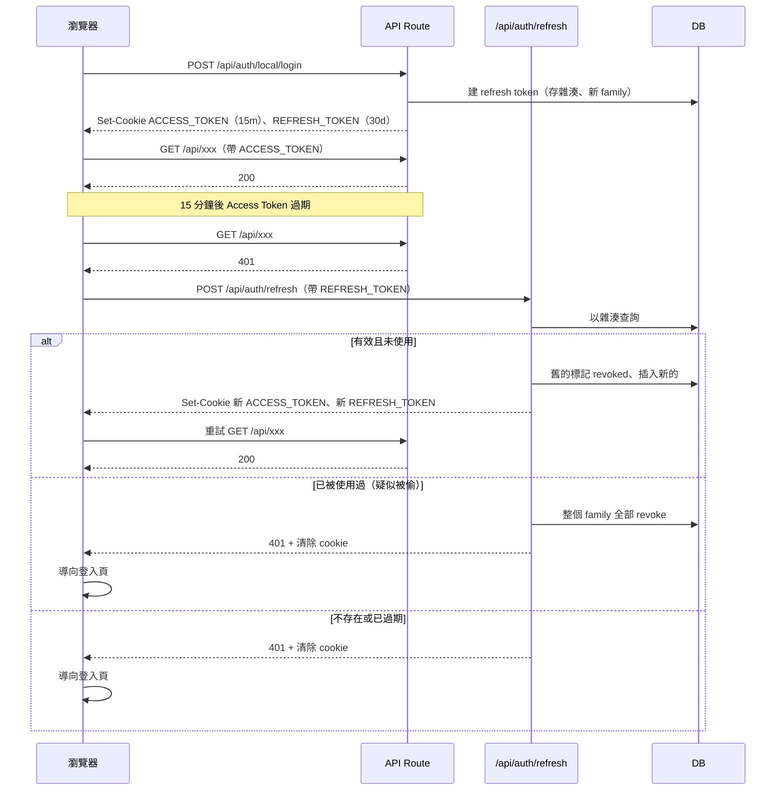

# JWT 簽章演算法（HS256 / RS256 / ES256）與 Access / Refresh Token 流程

日期：2026-10-30
專案：next-one（Next.js 15 App Router + jose + Prisma）
相關筆記：[[6-next-one-jwt-session-review]]、[[5-Refresh-Token與Token-Endpoint-雙Token機制與JWT關係]]、[[3-Session與JWT-有狀態與無狀態驗證-過期機制與Base64url]]

## 一、HS256 就是 HMAC

- HS256 = HMAC + SHA-256，不是 HMAC 以外的選項
- JWT 的 `alg` 欄位只是「簽章家族 + 雜湊」的名字

> 名詞全稱（縮寫先攤開，避免忘記）：
> - **HMAC ＝ Hash-based Message Authentication Code，雜湊訊息鑑別碼**：拿一把共享金鑰（secret）搭配雜湊函式，算出一段「防偽章」。驗章的人要有**同一把金鑰**才驗得過，所以它是對稱的。
> - **SHA ＝ Secure Hash Algorithm，安全雜湊演算法**；`SHA-256` 代表輸出 256 位元的雜湊值。
> - **RSA**：三位發明人 Rivest–Shamir–Adleman 的姓氏縮寫（非對稱）。
> - **ECDSA ＝ Elliptic Curve Digital Signature Algorithm，橢圓曲線數位簽章演算法**。
> - **EdDSA ＝ Edwards-curve Digital Signature Algorithm，愛德華曲線數位簽章演算法**。
>
> 📖 來源：[RFC 2104 — HMAC](https://datatracker.ietf.org/doc/html/rfc2104)、[RFC 7518 — JSON Web Algorithms（JWA，定義 HS256／RS256／ES256 等 `alg` 值）](https://datatracker.ietf.org/doc/html/rfc7518)

| alg | 家族 | 金鑰 | 備註 |
|---|---|---|---|
| HS256 / HS384 / HS512 | HMAC | 對稱，一把 secret | 簽與驗用同一把 |
| RS256 / RS384 / RS512 | RSA PKCS#1 v1.5 | 非對稱，私鑰簽、公鑰驗 | 金鑰 ≥ 2048 bit |
| PS256 | RSA-PSS | 非對稱 | 比 RS256 新，建議優先 |
| ES256 / ES384 / ES512 | ECDSA（P-256 / P-384 / P-521） | 非對稱 | 金鑰與簽章都很短 |
| EdDSA | Ed25519 | 非對稱 | 簽章是確定性的，沒有 nonce 風險 |

## 二、嚴謹性排序（高到低）

依「金鑰外洩面與部署風險」排：

1. ECDSA（ES256）／EdDSA
2. RSA（RS256 / PS256）
3. HMAC（HS256）

| 比較點 | ECDSA | RSA | HMAC |
|---|---|---|---|
| 驗證端能否偽造 | 不能 | 不能 | 能（驗證 = 持有 secret） |
| 金鑰洩漏範圍 | 只有簽發端 | 只有簽發端 | 所有驗證端 |
| 同等強度金鑰長度 | 256 bit ≈ RSA 3072 | 2048 / 3072 bit | 256 bit 隨機值 |
| token 大小 | 小（約 64 bytes 簽章） | 大（256 bytes 簽章） | 小（32 bytes） |
| 簽發速度 | 快 | 慢 | 最快 |
| 常見陷阱 | nonce 重複會洩漏私鑰；簽章格式是 r‖s 不是 DER | 小金鑰（< 2048）；PKCS#1 v1.5 實作瑕疵歷史 | secret 太短或寫死在 repo |

- 排序不代表演算法本身可被破解：256 bit 隨機 secret 的 HS256 在現實中無法暴力破解
- ECDSA 與 RSA 在同等強度下安全性相當，ECDSA 較省資源，RSA 相容性最廣
- 排序反映的是「金鑰管理模型」，不是數學強度

## 三、為什麼 next-one 用 HS256

- 簽發與驗證都在同一個 Next.js 應用內，只有一方持有 secret
- 沒有第三方、其他微服務需要獨立驗證 token
- 簽與驗速度最快，token 最短，cookie 體積小
- `jose` 用 `TextEncoder` 就能產 key，不用管 PEM / JWKS

### 何時換成非對稱

- 多個服務要驗證同一種 token（微服務、API gateway）
- 第三方要驗證你簽的 token（對外提供 JWKS：`/.well-known/jwks.json`）
- 想讓「驗證端被攻破」不等於「能偽造 token」
- 需要 key rotation 並讓驗證端自動抓新公鑰（`kid` + JWKS）

## 四、驗證時為何要指定 `algorithms: ['HS256']`

- 擋 `alg: none`：攻擊者把 header 改成 `none`、拿掉簽章
- 擋演算法混淆：把 `RS256` 改成 `HS256`，用公開的公鑰當 HMAC secret 簽章
- 驗證端以自己設定的演算法為準，不信 token header 自報的 `alg`

## 五、HS256 secret 要求

- RFC 7518 §3.2：金鑰長度 ≥ 雜湊輸出長度（HS256 = 256 bit / 32 bytes）
- 用 CSPRNG 產生：`openssl rand -base64 32`
- 放環境變數，不進 repo；沒設就啟動失敗
- 換 secret = 所有已簽發 token 立刻失效

---

## 六、Access Token 與 Refresh Token 流程

### 角色

| | Access Token | Refresh Token |
|---|---|---|
| 用途 | 每次 API 請求證明身分 | 只用來換新的 Access Token |
| 格式 | JWT（HS256） | 隨機不透明字串（32 bytes），不是 JWT |
| 效期 | 15 分鐘 | 7～30 天 |
| 儲存（瀏覽器） | httpOnly Cookie `ACCESS_TOKEN` | httpOnly Cookie `REFRESH_TOKEN` |
| Cookie path | `/` | `/api/auth/refresh`（只在換 token 時才送出） |
| 儲存（伺服器） | 不存（無狀態） | DB 只存 SHA-256 雜湊，不存明文 |
| 可否撤銷 | 否，等過期 | 是，改 DB 狀態 |

### 資料表

```prisma
model RefreshToken {
  id          String    @id @default(uuid()) @db.Uuid
  user_id     String    @db.Uuid
  token_hash  String    @unique
  family_id   String    @db.Uuid
  expires_at  DateTime
  revoked_at  DateTime?
  replaced_by String?   @db.Uuid
  user_agent  String?
  created_at  DateTime  @default(now())

  user User @relation(fields: [user_id], references: [user_id], onDelete: Cascade)

  @@index([user_id])
  @@index([family_id])
}
```

- `family_id`：同一次登入換出的所有 refresh token 同一家族
- `replaced_by`：旋轉後指向新 token，用來偵測舊 token 被重複使用

### 流程圖



### Refresh 端點邏輯

1. 讀 `REFRESH_TOKEN` cookie，沒有 → 401
2. `sha256(token)` 查 DB，找不到 → 401
3. `expires_at < now` → 401
4. `revoked_at` 有值 → 重複使用偵測：把同 `family_id` 全部 revoke，回 401
5. 通過：舊的寫 `revoked_at` 與 `replaced_by`，產生新的（同 `family_id`）
6. 簽新 Access Token，兩個 cookie 一起 `Set-Cookie`
7. 回 200

### 登出

- 把該 refresh token 所屬 family 全部 revoke
- 兩個 cookie 都刪除
- 效果：被偷的 Access Token 最多再活 15 分鐘（目前純 JWT 是 3 天），被偷的 Refresh Token 立刻失效

### 前端（Next.js 實作要點）

- `cookies().set` 只能在 Route Handler 與 Server Action 內使用，Server Component 渲染時不行 → refresh 必須是 Route Handler
- 在 `services/rest-client/use-fetcher.js` 的 fetch 包一層：收到 401 → 呼叫一次 refresh → 重試原請求
- 同時多個請求都 401 時，共用同一個 in-flight Promise，只打一次 refresh（否則旋轉會讓第二次請求被判重複使用）
- refresh 失敗 → 清狀態、導向登入頁
- middleware 跑在 Edge，Prisma 預設不能直接用，refresh 不要放 middleware

### Cookie 設定

| Cookie | httpOnly | secure | sameSite | path | maxAge |
|---|---|---|---|---|---|
| ACCESS_TOKEN | true | production 時 true | lax | `/` | 15 分鐘 |
| REFRESH_TOKEN | true | production 時 true | strict | `/api/auth/refresh` | 30 天 |

### 實作清單（next-one）

- [ ] `lib/jwt-session.js`：Access 預設效期改 15m；`secure` 改看 `NODE_ENV`；移除 `updateSession`
- [ ] `prisma/schema.prisma`：新增 `RefreshToken`，跑 migration
- [ ] `lib/refresh-token.js`：產生、雜湊、旋轉、revoke family
- [ ] `app/(api)/api/auth/refresh/route.js`：新增
- [ ] `auth/local/login`、`auth/google/login`、`auth/line/callback`：登入後同時發兩個 token
- [ ] `auth/local/logout`、`auth/line/logout`、`api/logout`：revoke + 刪 cookie
- [ ] `services/rest-client/use-fetcher.js`：401 攔截 + 單一 in-flight refresh
- [ ] 定期清理 `expires_at` 過期的列（cron 或登入時順手清）

## 未查證

- Google / LINE 登入路由目前各自如何設 cookie
- `use-auth.js` 與 `use-user.js` 對 401 的現有處理
