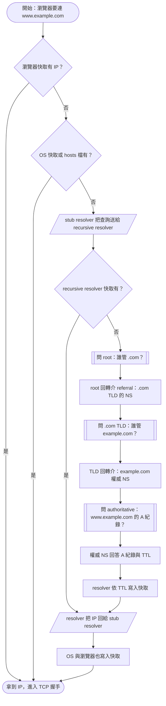
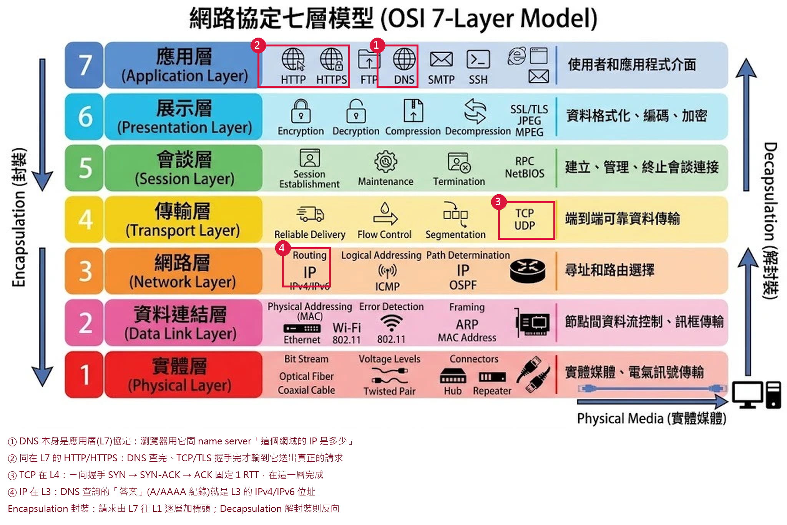
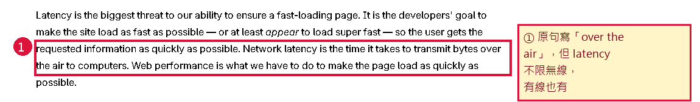
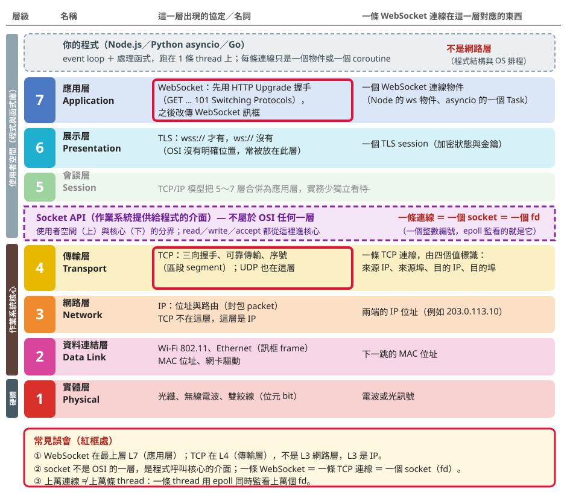

**本篇重點 a–z，共 26 個（已滿，後續請拆新筆記；第一節 (a)(b) 下另含子點 a-1～a-3、b-2、b-3）。**（(v)(w)(x)(y)(z) 為 2026-10-03 追問補入：event loop 與 epoll、一條連線對應什麼、處理程序與執行緒、I/O 名詞對照、IPC） 互動版（可一步一步點的 ISO 5807 流程圖＋延遲試算＋測驗）見 [互動版](延遲Latency-DNS遞迴查詢-TCP握手-行動網路-OSI七層串聯-互動版.html)。前一篇 [[DNS查詢-TCP與TLS握手RTT-邊緣節點與網頁效能|DNS 查詢、TCP 與 TLS 握手 RTT]] 偏「MDN 原文逐句」，這一篇偏「把名詞串成一條時間軸」。

> [!info] 一句話主軸
> 瀏覽器在送出第一個 HTTP 請求之前，必須<mark style="background: #FFF3A3A6;">依序付三筆往返延遲：DNS → TCP → TLS</mark>；行動網路沒有改變這三筆帳的次數，只是讓每一筆的「單趟距離」變長。

## 一、延遲 Latency：名詞導覽、怎麼算、正常與慢的標準、現代降低延遲的做法

> [!info] 本節是全篇的總入口
> 先把名詞講完（a），再定義延遲並算帳（b），再給「正常」與「慢」的標準（b-2），最後講怎麼降（b-3）。後面第二到第八節，都只是把本節某一格放大。表格內一律用純文字，連結寫在表格外。

### (a) 名詞導覽

(a-0) <mark style="background: #FFF3A3A6;">先定義「第幾層」：第 1 層是實體層（硬體），第 7 層是應用層（軟體）</mark>。OSI 七層的編號由下往上數：數字越小越靠近電線與電波、越偏硬體；數字越大越靠近使用者與程式、越偏軟體。送出資料時由第 7 層往第 1 層走（封裝），接收時由第 1 層往第 7 層走（解封裝）。本篇所有「L1～L7」都是這個編號。

| 層號 | 名稱 | 偏軟還是偏硬 | 離誰最近 | 這一層在解決什麼 | 本篇例子 |
|---|---|---|---|---|---|
| 7 | 應用層 Application | 軟體（程式與函式庫） | 使用者與程式 | 程式之間用什麼「語言」溝通 | DNS、HTTP、WebSocket |
| 6 | 展示層 Presentation | 軟體 | 使用者與程式 | 資料格式、編碼、加密 | TLS（常被歸在此） |
| 5 | 會談層 Session | 軟體 | 使用者與程式 | 建立與管理一次對話 | 實務少獨立看待 |
| 4 | 傳輸層 Transport | 作業系統核心（軟體） | 作業系統 | 把資料送到對方機器上的「哪個程式」，並決定可不可靠 | TCP、UDP |
| 3 | 網路層 Network | 核心與路由器（軟體為主） | 網路設備 | 跨網路送到「哪一台機器」 | IP |
| 2 | 資料連結層 Data Link | 網卡與驅動（軟硬交界） | 網卡 | 同一段網路上送給下一台設備 | Wi-Fi 802.11、Ethernet、MAC |
| 1 | 實體層 Physical | 硬體 | 電線與電波 | 位元如何變成電波或光訊號 | 光纖、無線電波、雙絞線 |

所以「TCP 在 L4」的意思是：它的上面是 L7 的 HTTP，下面是 L3 的 IP。<mark style="background: #FF5582A6;">這是 OSI 的編號</mark>；TCP/IP 四層模型的教材常把「連結、網際網路、傳輸、應用」由下往上標成 1～4（不同教材編法不一，不是標準編號），若在別處看到「第三層」，要先確認它講的是哪個模型。業界說 L3、L4、L7（例如 L4 負載平衡）一律指 OSI 編號，見 [[Round-Robin輪詢調度與負載平衡LB-L4對L7]]。

(a-1) 全篇會碰到的協定與名詞，<mark style="background: #FFF3A3A6;">依 OSI 層由第 7 層排到第 1 層，每一層都列出（沒有對應名詞的層也標明），最後才是不屬於七層的名詞</mark>。

| OSI 層 | 名詞 | 全名與中文 | 一句話定義 | 在本篇哪裡細講 |
|---|---|---|---|---|
| L7 應用層 | [DNS](https://www.rfc-editor.org/rfc/rfc1034) | Domain Name System 網域名稱系統 | 把 www.example.com 這種主機名稱翻成 IP 位址的分散式命名系統與查詢協定，預設走 UDP 的 53 埠 | 第二節 |
| L7 應用層 | [HTTP、HTTPS](https://www.rfc-editor.org/rfc/rfc9110) | HyperText Transfer Protocol（Secure） 超文字傳輸協定 | 瀏覽器向伺服器要網頁、API 資料的請求與回應格式；HTTPS 是 HTTP 加 TLS | 本節 (b) |
| L7 應用層 | [WebSocket](https://www.rfc-editor.org/rfc/rfc6455) | WebSocket 協定 | 先用 HTTP 握手，再升級成雙向、可持續互傳訊息的連線 | 第八節 (w) |
| L7 應用層 | [Name server](https://www.rfc-editor.org/rfc/rfc1034#section-2.4) | 名稱伺服器 | 回答 DNS 問題的伺服器，細分為 root、TLD、authoritative 與 recursive resolver | 第二節 |
| L7 應用層 | Web server | 網站伺服器 | 放網頁與 API 的主機，瀏覽器拿到 IP 之後才去連它 | 第二節 |
| L7 應用層 | [Stub resolver](https://www.rfc-editor.org/rfc/rfc9499.html) | 存根解析器 | 「無法自己完成整個解析、依賴 recursive resolver」的解析器（RFC 9499）；它確實負責替程式解析：查 hosts 與本機快取、把查詢送給設定好的 recursive resolver、處理逾時重送、快取答案；不做的是追查 root、TLD、authoritative | 第二節 (c) |
| L7 應用層 | [Recursive resolver](https://www.rfc-editor.org/rfc/rfc9499.html) | 遞迴解析器 | 「以遞迴模式運作、通常會快取答案」的解析器（RFC 9499）；收到查詢後若快取沒有，就代替你一站一站追到最終答案 | 第二節 (c) |
| L6 展示層 | [TLS](https://www.rfc-editor.org/rfc/rfc8446) | Transport Layer Security 傳輸層安全性協定 | 疊在 TCP 之上做加密、防竄改、驗證對方身分（OSI 沒有明確位置，常被歸在此層） | 第四、五節 |
| L5 會談層 | （本篇沒有獨立名詞） | Session 會談 | 概念上負責建立與管理一次對話；TCP/IP 模型把它併進應用層，實務少獨立看待 | 第四節 |
| L4 傳輸層 | [TCP](https://www.rfc-editor.org/rfc/rfc9293) | Transmission Control Protocol 傳輸控制協定 | 兩端先握手建立連線，之後保證資料不遺失、不重複、依序抵達的可靠位元組流 | 本節 (a-2)、第五節 |
| L4 傳輸層 | [UDP](https://www.rfc-editor.org/rfc/rfc768) | User Datagram Protocol 使用者資料報協定 | 不握手、不保證送達與順序，把一個個獨立的資料報直接丟出去，額外負擔最小 | 本節 (a-2) |
| L4 傳輸層 | [QUIC（HTTP/3 跑在它上面）](https://www.rfc-editor.org/rfc/rfc9000) | QUIC | 建在 UDP 上的傳輸協定，自己做可靠傳輸並把加密握手合併；HTTP/3 是 L7 的 HTTP 跑在 QUIC 之上 | 本節 (b-3)、第五節 |
| L3 網路層 | [IP](https://www.rfc-editor.org/rfc/rfc791) | Internet Protocol 網際網路協定 | 給每台設備一個位址，並決定封包怎麼一站一站送過去，不保證送達 | 第四節 |
| L2 資料連結層 | Wi-Fi 802.11、Ethernet、MAC 位址 | 區域網路的連結技術與硬體位址（IEEE 標準，需付費，未附連結） | 在同一段網路上，把訊框送給下一台設備（路由器、基地台） | 第四節 |
| L1 實體層 | 光纖、無線電波、Cell tower 基地台 | 實體媒介與無線電收發站 | 位元如何變成光或電波；基地台兼有 L1、L2 功能，手機的請求先到這裡 | 第三節 |
| 不屬於七層 | Socket、fd | 套接字、檔案描述符 | 作業系統提供給程式的連線介面，位於 L7／L6 與 L4 之間；fd 是它的整數編號 | 第八節 (w) |
| 不屬於七層 | CDN、PoP | Content Delivery Network、Point of Presence | 在世界各地的機房放快取與節點，讓使用者連到最近的一個 | 本節 (b-3) |

(a-2) <mark style="background: #FFF3A3A6;">TCP 與 UDP 是同一層（L4）的兩種取捨</mark>，不是「新舊」或「好壞」。

| 比較項目 | [TCP](https://www.rfc-editor.org/rfc/rfc9293) | [UDP](https://www.rfc-editor.org/rfc/rfc768) |
|---|---|---|
| 連線 | 先三向握手（約 1 RTT）才能傳資料 | 不需要握手，直接送 |
| 可靠性 | 掉了會重傳，保證送達 | 不保證，掉了就掉了，要不要補由應用層自己決定 |
| 順序 | 保證依序 | 不保證 |
| 資料形式 | 連續的位元組流，沒有訊息邊界 | 一個個獨立的資料報，有邊界 |
| 額外負擔 | 標頭較大、要維護連線狀態、有擁塞控制與慢啟動 | 標頭很小：來源埠、目的埠、長度、檢查碼各 16 位元 |
| 延遲特性 | 握手與重傳讓首包慢；掉包時後面的資料要等重傳（隊頭阻塞） | 首包最快，但掉包不會自動補 |
| 典型用途 | 網頁（HTTP/1.1、HTTP/2）、檔案傳輸、SSH、資料庫連線 | DNS 查詢、影音通話、線上遊戲、QUIC 與 HTTP/3 |
| 規範與年份 | RFC 793，1981 年 9 月（現行為 RFC 9293） | RFC 768，1980 年 8 月 |

<mark style="background: #ADCCFFA6;">DNS 偏愛 UDP 的原因</mark>：一問一答都很小，用 UDP 可以省掉握手，一個 RTT 就問完，所以「查一次 DNS 的成本約 1 RTT」才成立；若走 TCP，要先 1 RTT 握手、再 1 RTT 問答。RFC 1035 §4.2 也寫明查詢偏好資料報，因為額外負擔低、效能較好。另外以 RFC 日期看，<mark style="background: #FFF3A3A6;">UDP（1980）其實比 TCP（1981）還早一年</mark>，兩者本來就是並列的設計。

> [!question] Abby 的疑問：DNS 為什麼預設走 UDP 的 53 埠？兩者一定有關係嗎？
> <mark style="background: #FF5582A6;">沒有必然關係</mark>：UDP 是「怎麼送」（傳輸協定，L4），53 是「送給那台機器上的哪個服務」（埠號），是兩件獨立的事。「預設走 UDP」是 RFC 1035 的偏好，不是「只能走 UDP」；「53」是約定的埠號，不是 UDP 專屬。IANA 登記表把 domain 53 同時登記給 TCP 與 UDP（受讓人為 DNS 的發明者 Paul Mockapetris）。UDP 與 TCP 的埠號是各自獨立的空間，所以 UDP 53 與 TCP 53 是兩個不同的端點。

| DNS 的傳輸方式           | 協定與埠                   | 什麼時候用                                               | 規範                         |
| ------------------- | ---------------------- | --------------------------------------------------- | -------------------------- |
| 傳統查詢（預設）            | UDP 53                 | 一問一答很小，省掉握手，1 RTT 問完                                | RFC 1035（1987-11）          |
| 傳統查詢的 TCP 版         | TCP 53                 | 回應被截斷（TC 位元）、區域傳輸；RFC 7766 要求 DNS 實作必須支援 TCP        | RFC 1035、RFC 7766（2016-03） |
| 加大 UDP 訊息           | 仍是 UDP 53              | 原始 UDP 訊息上限 512 位元組；EDNS(0) 讓雙方宣告更大的大小，建議從約 4096 起試 | RFC 6891（2013-04）          |
| DNS over TLS（DoT）   | TCP 853                | 加密 stub 到 recursive resolver 的查詢                    | RFC 7858（2016-05）          |
| DNS over HTTPS（DoH） | 走 HTTPS（TCP 之上，慣用 443） | 把每個 DNS 查詢包成一次 HTTP 請求                              | RFC 8484（2018-10）          |
| DNS over QUIC（DoQ）  | UDP 853                | QUIC 之上的加密 DNS                                      | RFC 9250（2022-05）          |

埠號是約定而不是技術限制：IANA 把 853 登記給「DNS over TLS（TCP）」與「DNS over DTLS 或 QUIC（UDP）」，說明同一個服務可以因傳輸方式不同而用不同埠。

(a-3) 與延遲有關的量，常被混成一個詞，這裡拆開。

| 名詞 | 衡量什麼 | 單位 | 受什麼影響 |
|---|---|---|---|
| Latency 延遲 | 一個資料封包從來源走到目的地所花的時間 | ms | 物理距離、轉接次數、無線段 |
| RTT 往返時間 | 封包從 A 到 B 再回 A 的時間，延遲最常用的量法 | ms | 同上，約為單程的兩倍 |
| Bandwidth 頻寬 | 線路單位時間「最多」能送多少資料 | Mbps | 線路規格 |
| Throughput 吞吐量 | 單位時間「實際」送了多少資料，不會超過頻寬 | Mbps | 延遲、擁塞、TCP 慢啟動、掉包 |
| TTFB | 送出請求到收到第一個位元組的時間，已包含 DNS、TCP、TLS 與伺服器處理 | ms | 至少是各段 RTT 之和加上伺服器處理 |
| Jitter 抖動 | 延遲一次比一次不穩的程度 | ms | 無線訊號、擁塞；影音通話與遊戲特別怕 |
| Packet loss 封包遺失率 | 送出的封包掉了幾成 | % | 訊號差、壅塞；TCP 會重傳，因此延遲變大 |

<mark style="background: #ADCCFFA6;">Latency</mark> 的定義，MDN 的 Understanding latency 寫成「<mark style="background: #ADCCFFA6;">封包從來源走到目的地的時間</mark>」，並說明網路延遲常以往返時間量測。頻寬是水管多粗，latency 是水管多長，水管再粗也縮短不了長度，這就是「換更大頻寬不一定變快」的原因。

### (b) 延遲帳本：請求出門前要付哪幾筆

(b) 一個全新（沒有任何快取）的 HTTPS 請求，在拿到第一個回應位元組前要付的帳如下。<mark style="background: #FF5582A6;">每一列的「對方」不一樣</mark>，所以每一列的 RTT 長短也不一樣。

| 順序 | 步驟 | 跟誰往返 | OSI 層 | 冷啟動 RTT | 怎麼省 |
|---|---|---|---|---|---|
| 1 | DNS lookup | recursive resolver（name server 的一種） | L7 | 1 RTT 到 resolver | 快取命中為 0，由 TTL 決定 |
| 2 | TCP 三向握手 | 網站的 web server | L4 | 1 RTT | Keep-Alive、HTTP/2 複用既有連線 |
| 3 | TLS 握手 | 同一台 web server | 圖上放 L6（見 l） | TLS 1.3 為 1 RTT，TLS 1.2 為 2 RTT | 0-RTT 恢復、連線複用 |
| 4 | HTTP 請求到首位元組 | 同一台 web server | L7 | 1 RTT 加伺服器處理時間 | CDN 邊緣節點 |

web.dev 對 TTFB 的拆解與這張表一致：重新導向、Service Worker 啟動、DNS lookup、連線與 TLS 協商、以及請求到第一個位元組，這幾段加起來才是 TTFB。

<mark style="background: #FF5582A6;">這張表不能直接把 RTT 加起來當總時間</mark>，原因如下：

| 為什麼不能直接相加 | 說明 |
|---|---|
| 各段對象不同 | DNS 是手機到 resolver，TCP、TLS、HTTP 是手機到 web server，兩個 RTT 本來就不一樣長 |
| 有快取與複用 | DNS 快取命中時為 0；連線複用時 TCP 與 TLS 都為 0 |
| 不是全部串行 | 瀏覽器會同時對多個 hostname 建連線，總時間不是全部加總 |
| 資料還要傳 | 握手完後，檔案大小除以有效頻寬才是傳輸時間；而且 TCP 慢啟動使大檔要多個 RTT 才加速到全速 |
| 伺服器與渲染也要時間 | 後端查資料庫、瀏覽器解析與渲染都不在 RTT 裡 |

比較貼近實況的算式是：<mark style="background: #BBFABBA6;">總載入時間 ≈ 連線建立（各段往返數 × 該段 RTT）＋ 伺服器處理時間 ＋ 傳輸時間（資料量 ÷ 有效頻寬，含慢啟動）＋ 瀏覽器解析與渲染</mark>。詳細的 RTT 推導與慢啟動見 [[DNS查詢-TCP與TLS握手RTT-邊緣節點與網頁效能|前一篇]]，這裡不重寫。

### (b-2) 延遲怎樣算正常、怎樣算慢

「正常」沒有單一數字，要看你量的是哪一段、以及拿什麼當標準。下面分成四種標準，由官方到經驗值。

(1) 官方網頁效能指標（Google web.dev，以 75 百分位的使用者為準）：

| 指標 | 好 | 需改善 | 差 | 出處 |
|---|---|---|---|---|
| TTFB | 0.8 秒以內 | 0.8 到 1.8 秒 | 超過 1.8 秒 | web.dev TTFB，2025-11-18 更新 |
| LCP（最大內容繪製） | 2.5 秒以內 | 超過 2.5 秒需改善 | 「差」的界線本次未抓到原文 | web.dev Web Vitals，2024-10-31 更新 |
| INP（互動到下一次繪製） | 200 毫秒以內 | 超過 200 毫秒需改善 | 「差」的界線本次未抓到原文 | 同上 |

(2) 人的感受（Nielsen，1993）：

| 回應時間 | 使用者感受 |
|---|---|
| 0.1 秒以內 | 覺得系統「立即」反應，像直接操作 |
| 1 秒左右 | 思緒不被打斷，但已察覺延遲 |
| 10 秒 | 注意力的極限，超過就會去做別的事，需要進度提示 |

(3) 瀏覽器怎麼替連線分級（WICG Network Information API 的 effectiveType，依 2017 年 4 月的實測資料）。這是「分級」不是「好壞標準」，但能看出 RTT 的量級：

| 等級 | RTT 門檻 | 下行頻寬上限 |
|---|---|---|
| slow-2g | 2000 ms 以上 | 50 Kbps |
| 2g | 1400 ms 以上 | 70 Kbps |
| 3g | 270 ms 以上 | 700 Kbps |
| 4g | 低於 270 ms | 不設上限 |

(4) 物理下限與經驗值：光在光纖中約每秒 2×10⁸ 公尺，單程 10,000 公里至少 50 毫秒，所以<mark style="background: #FFF3A3A6;">RTT 的物理下限約 100 毫秒，實測 150 到 200 毫秒是常見值</mark>；同城市的 CDN 節點約 10 到 30 毫秒，行動網路約 100 到 500 毫秒。這組經驗值沿用前一篇與 script 那篇，不是官方標準。

| 你量到的 RTT | 判讀 | 該往哪個方向處理 |
|---|---|---|
| 接近物理下限 | 路徑已經是最短，慢是距離造成的 | 把內容搬近，用 CDN 與邊緣節點 |
| 遠高於物理下限 | 路由繞遠、擁塞、無線段太差 | 查路由、換線路、換網路環境 |
| RTT 正常但 TTFB 很高 | 時間花在伺服器處理 | 查後端、資料庫、伺服器端快取 |

### (b-3) 現代降低延遲的做法

降低延遲只有三個方向：<mark style="background: #BBFABBA6;">縮短距離、減少往返次數、讓等待可以重疊（提前或平行）</mark>。下表的每一項都是這三者之一的變形。

| 手法 | 省哪一筆 | 怎麼做到 | 屬於哪個方向 |
|---|---|---|---|
| CDN 與邊緣節點（PoP） | 所有往返的單趟距離 | 內容與 TLS 終結放在離使用者近的機房 | 縮短距離 |
| Anycast DNS 與公共 resolver | DNS | 同一個位址由多處實體回應，使用者連到最近的 | 縮短距離 |
| 連線複用（Keep-Alive、HTTP/2 多路複用） | 第二個請求起的 TCP 與 TLS | 同一個 hostname 只建一次連線，所有請求共用 | 減少往返 |
| TLS 1.3 與 0-RTT 恢復 | TLS | 完整握手由 2 RTT 降到 1 RTT，恢復連線時可為 0 RTT；0-RTT 資料有被重放的風險，只適合可重複執行的請求 | 減少往返 |
| HTTP/3（QUIC，跑在 UDP 上） | TCP 與 TLS 兩筆合成一筆 | RFC 9000 描述 QUIC 具低延遲連線建立與可選的 0-RTT；各 stream 不要求跨 stream 嚴格依序，一條掉包不會卡住其他 | 減少往返 |
| dns-prefetch、preconnect | DNS、TCP、TLS | 在真的需要之前，先把連線建好 | 提前 |
| 減少不同 hostname | 每個 hostname 各付的 DNS、TCP、TLS | HTTP/2 之後盡量把資源收斂到少數網域 | 減少往返 |
| 快取與壓縮 | 請求次數與傳輸時間 | Cache-Control、瀏覽器快取、brotli 與 gzip、圖片格式最佳化 | 減少往返與資料量 |
| 非同步並發 | 序列等待 | 把彼此獨立的請求同時送出，不要排隊等 | 平行 |
| 縮短伺服器處理時間 | TTFB 中的伺服器段 | 資料庫索引、伺服器端快取 | 縮短處理 |
| 5G 與 MEC | 無線段與回程 | 把處理與快取放到基地台旁 | 縮短距離 |

## 二、Recursive Lookup 遞迴查詢

> [!tip] 主軸圖（ISO 5807 符號）
> 橢圓＝開始／結束，矩形＝處理，菱形＝判斷，平行四邊形＝資料輸入輸出，雙邊矩形＝預先定義的處理（這裡指「去問另一台 name server」）。互動版可以切換「各層快取命中與否」一步一步走。



(c) 這條鏈上有五種角色，名字很像但分工完全不同。

| 角色 | 它是什麼、跑在哪 | 被問到時回答什麼 |
|---|---|---|
| [stub resolver](https://www.rfc-editor.org/rfc/rfc9499.html) | 作業系統與瀏覽器內建的解析器，在你的電腦上；RFC 9499 定義為「無法自己完成整個解析的 resolver」 | 替程式解析：先查 hosts 與本機快取，沒有就把查詢送給 recursive resolver、等回應、快取答案；它不自己追查（見下方說明） |
| [recursive resolver](https://www.rfc-editor.org/rfc/rfc9499.html) | 電信業者或公共 DNS（如 8.8.8.8、1.1.1.1）提供的解析伺服器 | 代替你一站一站追到底，並快取結果 |
| [root name server](https://www.rfc-editor.org/rfc/rfc9499.html) | 全球 13 組根伺服器位址（見下方說明），手上只有「各個 TLD 由哪些 name server 負責」的名單 | 不回答 IP，只回「.com 的 name server 有這 13 台，名字與 IP 在這」（轉介） |
| [TLD name server](https://www.rfc-editor.org/rfc/rfc9499.html) | 管 .com、.tw 等頂級網域，手上有「每個 .com 網域由哪些 name server 負責」的名單 | 不回答 IP，只回「example.com 的權威 name server 是這幾台」（轉介） |
| [authoritative name server](https://www.rfc-editor.org/rfc/rfc9499.html) | 網域擁有者設定紀錄的地方（如 Route 53、Cloudflare DNS） | 回真正的答案：A、AAAA、CNAME 等紀錄與 TTL |

> [!question] Abby 的疑問：stub resolver 不負責解析、只把問題丟出去，那它有確實解析嗎？
> <mark style="background: #FF5582A6;">有，原本「它不追查，只負責丟問題」寫得太籠統，已更正</mark>。要分清楚「解析」的兩種意思：對程式來說，解析就是「給我名字、拿回 IP」，stub resolver 就是提供這個入口並把答案交回去的那一個；它沒做的只是「追查」，也就是自己去問 root、TLD、authoritative 並處理轉介。[RFC 9499](https://www.rfc-editor.org/rfc/rfc9499.html) 的定義是「無法自己完成整個解析的 resolver」，並說它通常依賴 recursive resolver；[RFC 1034 §5.3.1](https://www.rfc-editor.org/rfc/rfc1034#section-5.3.1) 說這種做法是把解析功能搬出本機、交給支援遞迴查詢的 name server，本機只需要一份 name server 位址清單。

| stub resolver 的工作 | 做不做 | 說明 |
|---|---|---|
| 提供解析入口給程式（如 getaddrinfo） | 做 | 程式問「這個名字的 IP」，由它回答；對程式而言解析就發生在這裡 |
| 查 hosts 檔與本機快取 | 做 | 命中就直接回答，連網路都不用出 |
| 組成 DNS 查詢，送給設定好的 recursive resolver | 做 | 查詢中要求對方代為追到底；位址來自網路設定，Linux 在 resolv.conf 的 nameserver |
| 處理逾時、重送、換下一台 resolver | 做 | RFC 1034 §5.3.1 指出 stub 要自己面對「怎樣設重送間隔，才能同時應付掉包與伺服器當機」 |
| 依 TTL 快取答案 | 做 | 見下方實測，TTL 會倒數到過期 |
| 追查 root、TLD、authoritative，處理轉介 | 不做 | 這是 recursive resolver 的工作 |

stub 這個字在軟體裡是「功能被精簡、把重活委派出去的代理」的意思，所以叫存根解析器。它在不同地方的實體如下（歸納自各官方文件）：

| 位置 | 它的樣子 | 官方文件 |
|---|---|---|
| Linux 的 C 函式庫 | resolver 是 C 函式庫裡的一組函式，讀 resolv.conf 的 nameserver 去問 | [resolv.conf(5)](https://man7.org/linux/man-pages/man5/resolv.conf.5.html) |
| Windows | 作業系統的 DNS Client 服務（服務名稱 Dnscache）負責解析與本機快取 | 本機實測見下，未附 Microsoft 文件 |
| Chrome 瀏覽器 | 兩條路：自己的 built-in resolver（async resolver，用 net::DnsClient 發 DNS 查詢），或呼叫作業系統的 getaddrinfo()，符合條件時擇一 | [Chromium net/dns README](https://chromium.googlesource.com/chromium/src/+/main/net/dns/README.md) |

2026-10-03 在 Abby 這台電腦上用 PowerShell 實際觀察 Windows 這一層：

```powershell
(Get-Service Dnscache).Status                      # DNS Client 服務是否在跑
Get-DnsClientServerAddress -AddressFamily IPv4     # 設定好的 recursive resolver
Clear-DnsClientCache; Resolve-DnsName example.com  # 清空本機快取後解析一次
Get-DnsClientCache | Where-Object Entry -eq example.com   # 看 stub 的快取與 TTL
```

| 觀察 | 結果 | 代表什麼 |
|---|---|---|
| DNS Client 服務 | Running | 作業系統層的 stub resolver 常駐 |
| Wi-Fi 介面設定的 DNS 伺服器 | 3 個（位址不寫進筆記） | stub 把查詢送給這些 recursive resolver |
| 清空快取後解析 example.com | 本機快取出現 2 筆 A 紀錄，TTL 為 300 | stub 把答案存下來 |
| 3 秒後再看 | TTL 變成 297 | stub 依 TTL 倒數，到 0 就過期、下次重問 |

提醒：`Get-DnsClientCache` 會列出你造訪過的所有網域，貼到筆記或對話前要先用 `Where-Object` 過濾。

> [!question] Abby 的疑問：root 「只回 .com 該去問誰」，這樣還有必要回應嗎？
> <mark style="background: #FF5582A6;">有必要，而且這個「轉介」就是 root 的全部工作</mark>。原句寫得不清楚，完整意思是：root 回的不是「.com」三個字，而是<mark style="background: #BBFABBA6;">一份 .com name server 的名單（名字加 IP）</mark>。resolver 一開始只知道 root 的位址，不知道 .com 的 name server 在哪台；沒有這一步轉介，它就沒有下一站可以問，整條查詢走不下去。

下面是 2026-10-03 在 Abby 這台電腦對真的伺服器發出「不遞迴」查詢（`Resolve-DnsName -NoRecursion`、`nslookup -norecurse`）得到的結果，等於親手當一次 recursive resolver：

| 步驟 | 問誰 | 問題 | 對方回了什麼 |
|---|---|---|---|
| 1 | a.root-servers.net（198.41.0.4） | www.example.com 的 A 紀錄？ | 沒有給 IP，只給 13 筆 `com NS`（a～m.gtld-servers.net，TTL 172800 秒＝2 天）與它們的 IP |
| 2 | a.gtld-servers.net（192.5.6.30，.com 的 TLD） | 同一題 | 沒有給 IP，只回 example.com 由 hera.ns.cloudflare.com 與 elliott.ns.cloudflare.com 負責，並附上它們的 IP |
| 3 | hera.ns.cloudflare.com（108.162.192.162，權威） | 同一題 | 終於給答案：172.66.147.243 與 104.20.23.154 |

兩個值得注意的地方：<mark style="background: #FFF3A3A6;">第 1 步的 TTL 是 172800 秒，也就是 resolver 查過一次就能把 .com 的名單記住 2 天</mark>，所以 root 平時其實很少被問到；root 手上只有各個 TLD 的名單（數量有限，約一千多個，屬通說未逐字查證），資料量很小，所以 13 個位址就撐得起全世界。另外 example.com 近年已改由 Cloudflare 代管，答案 IP 會變動，這張表只是 2026-10-03 當下的快照。

| 比較項目 | name server | web server |
|---|---|---|
| 它回答什麼 | 「這個名字對應哪個 IP」（DNS 紀錄） | 「這個網址的內容」（HTML、JSON、圖片） |
| 瀏覽器什麼時候找它 | 最早，建立連線之前 | DNS 查完、TCP 與 TLS 握手之後 |
| 用什麼協定 | DNS，預設 UDP 53 埠 | HTTP／HTTPS，TCP 80／443 埠 |
| 實際例子 | 8.8.8.8、hera.ns.cloudflare.com、a.root-servers.net | 放你網站的那台主機（或 CDN 邊緣節點） |
| 同一台機器能兼任嗎 | 技術上可以，但是兩個獨立的服務與程式 | 同左 |

(c-2) <mark style="background: #FFF3A3A6;">「name server 全球只有 13 組」只對 root 成立</mark>。根據 root-servers.org，root 有 13 組位址（a～m），由 12 個組織營運（有一個組織營運兩組），截至 2026-10-03 全球共有 2,045 個實體站點，也就是一個位址背後有很多台機器同時回應；這種「同一位址由多處實體回應」的做法就是 <mark style="background: #ADCCFFA6;">Anycast</mark>（該站首頁與 FAQ 沒有直接寫出 anycast 這個詞，這一點屬通說，見文末存疑）。TLD 與 authoritative 的 name server 數量則多到數不清，每個網域擁有者、每家 DNS 託管商都有。所以<mark style="background: #BBFABBA6;">單說「name server」確實太籠統，要說清楚是 root、TLD、authoritative，還是 recursive resolver</mark>。

(c-3) 為什麼分這麼多層？RFC 1034 說，DNS 的名稱空間被切成一個個 <mark style="background: #ADCCFFA6;">zone（區域）</mark>，每個 zone 的管理權可以委派給別人，父層只留下指向子層 name server 的 NS 紀錄。分層有兩個好處：全世界幾億個網域不必集中放在一台、一個組織手上（規模），而且 example.com 的紀錄只有 example.com 的主人能改，不需要問 .com 的管理者或 root（權責分散）。

(d) <mark style="background: #FFF3A3A6;">「遞迴」與「迭代」是兩段不同的關係</mark>：RFC 1034 區分「resolver 要求對方代為追到底」的遞迴服務，與「對方只回『去問更近的那台』」的轉介（referral）模式。

| 段落 | 查詢型態 | 誰負責追到底 |
|---|---|---|
| stub resolver 到 recursive resolver | 遞迴查詢 | recursive resolver 負責回最終答案或錯誤 |
| recursive resolver 到 root、TLD、authoritative | 迭代查詢（每站回轉介） | recursive resolver 自己一站一站追 |

(e) <mark style="background: #BBFABBA6;">每一層都有快取，效期由 authoritative 在紀錄裡給的 TTL 決定</mark>。實務上 recursive resolver 通常早就快取了 .com 的 TLD NS，所以「冷查詢」很少真的問到 root；命中快取的那一層之後的整段追查都會省掉。

(f) <mark style="background: #FF5582A6;">name server 不是 TCP 握手裡的那個 server</mark>：name server 只回答「這個名字對應哪個 IP」，TCP 握手是瀏覽器拿到 IP 之後，另外跟網站的 web server 做的事，順序是 DNS 在前、TCP 在後。DNS 查詢預設走 UDP 的 53 埠，回應太大或需要加密時才改用 TCP、DoT、DoH。

## 三、行動網路：為什麼每次 DNS 都更痛

(g) MDN 圖中的行動請求要經過三段：手機 → <mark style="background: #FFB8EBA6;">cell tower（基地台）</mark> → <mark style="background: #FFB8EBA6;">phone company（電信公司核心機房）</mark> → Internet。<mark style="background: #ADCCFFA6;">Cell</mark> 指蜂巢式網路把服務區切成一格一格的涵蓋範圍，所以手機才叫 cell phone；cell tower 就是架設在地面或大樓頂端、負責收發手機無線電訊號的基地台。

| 段落 | 媒介 | 延遲來源 |
|---|---|---|
| 手機到基地台 | 無線電波 | 訊號品質、排程、重傳，單趟變異最大 |
| 基地台到電信核心機房 | 回程線路（backhaul） | 距離與沿路設備 |
| 核心機房到 Internet | 有線骨幹 | 距離與路由轉接 |

(h) 距離與無線段加在一起，使<mark style="background: #FF5582A6;">每一次 DNS lookup 都得先付一次手機端的完整往返</mark>。頁面引用 N 個不同 hostname 就付 N 次（快取命中的除外）。

(i) <mark style="background: #FFF3A3A6;">MDN 寫「reach an authoritative DNS server」是簡化說法</mark>：手機實際先問的是 recursive resolver，由它在機房之間的有線網路上追 root、TLD、authoritative，這些內部單趟都很短。手機端真正付費的只有「手機到 resolver」那一段，這也是為什麼把 resolver 與 CDN 放得離使用者近很有效（見 [[CloudFront-CDN概念與快取失效Invalidation]]）。

## 四、OSI 七層：這些名詞各住在哪一層



(j) 本篇出現的名詞對照到各層如下。<mark style="background: #FFF3A3A6;">DNS 協定本身在 L7，查出來的 IP 位址屬於 L3</mark>：這是「L7 的查詢拿回 L3 的位址」，不是 DNS 在 L3。

| 層 | 名稱 | 本篇出現的東西 | 資料單位（PDU） |
|---|---|---|---|
| 7 | 應用層 | DNS、HTTP、HTTPS | 訊息（data） |
| 6 | 展示層 | TLS（常被歸在此，見 l） | 訊息 |
| 5 | 會談層 | TCP/IP 模型把 5～7 層合併成應用層，實務少獨立看待 | 訊息 |
| 4 | 傳輸層 | TCP（三向握手）、UDP（DNS 預設） | 區段 segment／資料報 datagram |
| 3 | 網路層 | IP 位址、路由、ICMP | 封包 packet |
| 2 | 資料連結層 | Wi-Fi 802.11、Ethernet、蜂巢式無線介面 | 訊框 frame |
| 1 | 實體層 | 光纖、無線電波、雙絞線 | 位元 bit |

(k) 一次 DNS 查詢送出時是<mark style="background: #BBFABBA6;">由 L7 往 L1 逐層加標頭（封裝 Encapsulation）</mark>，對方收到後<mark style="background: #BBFABBA6;">由 L1 往 L7 逐層拆標頭（解封裝 Decapsulation）</mark>。

| 往下走到哪一層 | 這一層加上什麼 | 目的 |
|---|---|---|
| L7 應用層 | DNS 訊息：問 www.example.com 的 A 紀錄 | 表達「我要什麼」 |
| L4 傳輸層 | UDP 標頭：目的埠 53 | 交給對方的 DNS 服務 |
| L3 網路層 | IP 標頭：目的 IP 為 resolver | 跨網路送到對的主機 |
| L2 資料連結層 | 訊框標頭：下一跳的 MAC 位址 | 送到下一台設備 |
| L1 實體層 | 轉成電波或光訊號 | 真正離開你的裝置 |

(k-2) <mark style="background: #FFF3A3A6;">封包裡兩個 IP 都有：來源 IP（Source IP，發送端）與目的 IP（Destination IP，接收端）</mark>，兩者都寫在 L3 的 IP 標頭。路由器靠目的 IP 決定往哪轉發，接收端靠來源 IP 知道回覆要送給誰，就像信封要同時寫寄件人與收件人。（2026-11-07 追問補入，來源為 Gemini 對話，見文末）
	- <mark style="background: #FF5582A6;">⚠️ 存疑／更正</mark>：Gemini 說「TCP 與 IP 標頭都記錄來源與目的 IP」並不精確，L4 的 TCP 標頭記的是來源埠與目的埠，IP 位址只在 L3 的 IP 標頭。另外封包經過 NAT 時，路由器會改寫來源 IP，所以「來源 IP」不一定是最初發出的那台機器的位址。

(l) <mark style="background: #FF5582A6;">OSI 是概念參考模型，網際網路實際跑的是 TCP/IP 四層模型</mark>。TLS 就是不好放的例子：這張圖放在 L6，但實務上它是疊在 TCP 之上、HTTP 之下的獨立加密層，不同教材歸法不一致。負載平衡常說的 L4／L7 就是借這套編號，見 [[Round-Robin輪詢調度與負載平衡LB-L4對L7]]。

## 五、TCP 比 TLS 新穎嗎？TLS 要 2 RTT 跟新舊有關嗎

> [!question] Abby 的疑問
> 所以 TCP 比 TLS 還要新穎嗎？因為 TLS 還需要 2 RTT？

(m) <mark style="background: #FF5582A6;">答案是反過來：TCP 比較老，TLS 比較新</mark>。

| 協定 | 規範 | 發布時間 | 備註 |
|---|---|---|---|
| TCP | RFC 793 | 1981 年 9 月 | 現行規範已改為 RFC 9293，RFC 793 被標為廢止 |
| TLS 1.0 | RFC 2246 | 1999 年 1 月 | 之後由 RFC 4346 取代，現已屬歷史版本 |
| TLS 1.2 | RFC 5246 | 2008 年 8 月 | 完整握手 2 RTT |
| TLS 1.3 | RFC 8446 | 2018 年 8 月 | 完整握手 1 RTT |
| QUIC | RFC 9000 | 2021 年 5 月 | 把傳輸與加密握手合併，HTTP/3 使用它 |

(n) <mark style="background: #ADCCFFA6;">TLS 是疊在 TCP 之上的加密層</mark>，TLS 需要 TCP 先提供可靠的位元組流，所以順序必然是 TCP 握手在前、TLS 握手在後；這是「依賴關係」，不是「誰比較新」。

(o) <mark style="background: #BBFABBA6;">RTT 的多寡跟新舊沒有正相關，TLS 越新反而越省</mark>：TLS 1.2 要 2 RTT，較新的 TLS 1.3 只要 1 RTT。要同時省掉 TCP 與 TLS 兩次握手，是 QUIC 把兩者合併的原因。

> [!warning] ⚠️ 存疑／更正：MDN 的「five round trips」「eight round trips」
> MDN 在 TLS 一節寫「five more round trips」，結尾又說「eight round trips」。對照 MDN 自己的圖，TCP 畫了 3 條箭頭（SYN、SYN-ACK、ACK），TLS 畫了 5 條箭頭（ClientHello、ServerHello 與 Certificate、ClientKey、Finished、Finished），3＋5＝8 數的是<mark style="background: #FFF3A3A6;">單趟訊息（箭頭）</mark>。一個 RTT 包含去與回兩條箭頭，所以不能把箭頭數當 RTT 數；依 RFC 的算法，TCP 握手約 1 RTT，TLS 1.2 完整握手約 2 RTT，TLS 1.3 為 1 RTT。

## 六、流程圖標準：ISO 5807，不是 ISO 8607

(p) Abby 問的「ISO 8607」應更正為 <mark style="background: #FFF3A3A6;">ISO 5807:1985</mark>，標題是「Information processing — Documentation symbols and conventions for data, program and system flowcharts, program network charts and system resources charts」，2019 年複審後仍為現行版本。

| 符號 | 形狀 | 本篇流程圖用來表示 |
|---|---|---|
| 終止符 Terminator | 橢圓（圓角矩形） | 開始、結束 |
| 處理 Process | 矩形 | 一個動作，如「寫入快取」 |
| 判斷 Decision | 菱形 | 有兩條以上出口，如「快取有 IP？」 |
| 資料 Data（輸入輸出） | 平行四邊形 | 資料進出，如送出 DNS 查詢、回傳 IP |
| 預先定義的處理 Predefined process | 兩側有雙線的矩形 | 一個獨立子流程，如「去問另一台 name server」 |
| 流向線 Flow line | 帶箭頭的線 | 步驟之間的先後順序 |

## 七、Abby 的思考與校正

規則：<mark style="background: #BBFABBA6;">✅ 沒寫錯的保留原話</mark>；<mark style="background: #FFF3A3A6;">⚠️ 部分正確</mark>與 <mark style="background: #FF5582A6;">❌ 有誤</mark>的，在原話下方縮排說明更正。



1. ⚠️ 「網路延遲是指透過無線方式將位元組傳輸到電腦所需的時間」
	翻譯忠於 MDN Overview 的原句（over the air）。但 MDN 另一篇 Understanding latency 的定義比較完整：延遲是封包從來源到目的地的時間，常以往返 RTT 計；<mark style="background: #FFF3A3A6;">不限無線，有線也有延遲</mark>。

2. ⚠️ 「DNS lookup會依照不同的域名去查找DNS一次，並且解析為IP位址」
	查詢單位是 <mark style="background: #ADCCFFA6;">hostname（主機名稱）</mark>，不是 domain（網域）。www.example.com 與 cdn.example.com 同屬一個網域，卻是兩個 hostname，要各查一次。MDN 原文為 once per hostname。

3. ✅ 「這個IP位址屬於OSI 7-Layer Model的第三層網路層」
	正確。補充：DNS 協定本身在第七層，見 (j)。

4. ✅ 前半「DNS lookup也是前往網頁的第一步」
	正確，MDN 原文：The first step of navigating to a web page is finding where the assets for that page are located。

5. ⚠️ 後半「如果曾經造訪過該網頁(同一域名)就不會再做一次DNS lookup」
	不是「造訪過就不查」，而是<mark style="background: #FFF3A3A6;">快取還沒過期（TTL 內）才不查</mark>，而且快取單位是 hostname，瀏覽器、作業系統、路由器、ISP 的 resolver 各有一層。過期就要重查。

6. ❌ 「這個DNS lookup由……name server名稱伺服器來處理TCP握手連線的第一握？」
	DNS lookup 是 <mark style="background: #FF5582A6;">TCP 握手之前</mark>的獨立步驟，name server 只回答「名字對應哪個 IP」，不處理 TCP 握手。TCP 握手是拿到 IP 之後，瀏覽器與網站的 web server 之間的事，見 (f)。`fielded` 是棒球「接球」的比喻，意思是「接收並處理」。

7. ⚠️ 「As this initial request, the IP will likely be cahced for a time……」
	原文是 <mark style="background: #FFF3A3A6;">After</mark> this initial request，不是 As；另外 cahced 應為 cached。意思無誤：IP 會被快取一段時間，後續請求不必再問 name server。

8. ❌ 「看起來我們昨天討論的 TCP中的server有更具體點的名字叫做name server」
	兩者是<mark style="background: #FF5582A6;">不同的角色</mark>：TCP 連線的另一端是 web server（放網頁的主機），name server 是 DNS 的伺服器，通常不是同一台、也不是同一個服務。

9. ✅ 「cell: cellular Network裡的蜂巢式電波涵蓋區……所以行動電話在英文中叫Cell phone」
	正確。小筆誤：原文「cell tower舊勢力在地上或大樓頂端」，應為「架設在地面或大樓頂端」。

10. ✅ 「第二步才是送到central phone company指電信公司的核心網路機房/中央伺服器；第三步才是送到internet」
	正確（見 g）。<mark style="background: #ADCCFFA6;">Internet</mark> 的定義：MDN 稱為「使用 Internet protocol suite（即 TCP/IP）的全球網路之網路」，不等於 WWW（網頁只是跑在 Internet 上的服務之一）。

11. ⚠️ 「每一個DNS lookup has to go from the phone to the cell tower to reach an authoritative DNS server」
	照抄 MDN 沒有錯，但 authoritative 是簡化：手機先問的是 recursive resolver，見 (i)。

12. ✅ 「在手機、基地台、還有名稱伺服器之間的距離可以造成顯著的延遲」
	正確。這就是 (h) 的結論；原文「很具問題性的表現」指的是對「效能」（performance）的影響。

以下第 13～23 點是 Abby 讀完第八節（I/O-bound、event loop、Thread、Process）後的追問，對應 (q)～(x)。Gemini 對話 URL 未提供，故來源欄無法附上。

13. ⚠️ 「I/O bound的任務的選擇適合打外部API、存取資料庫、讀寫檔案如果以性質來說的話就是適合單執行緒的非同步I/O 或I/O多路複用(event loop/epoll)」
	打外部 API、查資料庫都是<mark style="background: #BBFABBA6;">網路 I/O</mark>，適合，正確。「讀寫檔案」要小心：<mark style="background: #FFF3A3A6;">epoll 不支援一般檔案</mark>（對一般檔案或目錄呼叫 epoll_ctl 會回 EPERM），所以 Node 的 fs 實際是丟給 libuv 的 Worker Pool 去跑。「單執行緒」指的是跑 JS 的那一條，背後仍有執行緒池，見 (v)。

14. ❌ 「event loop的e是epoll的e嗎？」
	<mark style="background: #FF5582A6;">兩者不是同一個東西，只是名稱碰巧都帶 event</mark>。epoll 的 e 就是 <mark style="background: #BBFABBA6;">event</mark>：Linux 核心裡實作它的檔案叫 `fs/eventpoll.c`，核心資料結構叫 `struct eventpoll`，檔頭註解寫 Efficient event retrieval implementation，作者是 Davide Libenzi，所以 epoll 即 event poll 的縮寫。它是 Linux 核心提供的 API；event loop 是程式裡「等事件、跑回呼、再等事件」的迴圈結構，在 Linux 上它底層呼叫 epoll，在 macOS 呼叫 kqueue，在 Windows 呼叫 IOCP。見 (v)。

15. ⚠️ 「我英文說I/O bound suits single threaded async/await Input and Output這樣合適嗎？」
	意思看得懂，但有三處可修：I/O 就是 Input/Output，不必再寫出來；async/await 是<mark style="background: #FFF3A3A6;">語法</mark>，不是機制，機制是非阻塞 I/O 加事件迴圈；主詞用複數時動詞不加 s。建議寫成：<mark style="background: #BBFABBA6;">I/O-bound workloads suit single-threaded asynchronous I/O (async/await on top of an event loop).</mark>

16. ⚠️ 「Gemini說因為CPU大部分時間都在空等網路或硬碟回應，不需要浪費額外的CPU執行緒」
	這句話<mark style="background: #FFF3A3A6;">用字不精確</mark>：空等的是「執行緒」，不是 CPU。執行緒呼叫阻塞式 read 後，作業系統讓它睡著，CPU 轉去跑別人，CPU 並沒有空等。真正被浪費的是每條執行緒佔的記憶體（stack）與排程切換成本，見 (w)。

17. ✅ 「小結:所以CPU任務跟I/O任務都會耗費執行緒？」
	對，兩種任務都得跑在執行緒上。差別在<mark style="background: #ADCCFFA6;">執行緒的狀態</mark>：CPU 任務的執行緒是「在算」，佔著一顆核心；I/O 任務的執行緒是「在睡」，不佔核心但仍佔記憶體。Node 官方文件也說，I/O 任務在執行緒沒被排程時依然會繼續推進。

18. ⚠️ 「I/O bound任務跟CPU沒啥關係……用單一執行緒搭配事件循環應該是指I/O的執行緒？」
	前半：<mark style="background: #BBFABBA6;">瓶頸不在 CPU</mark> 是對的，但處理回應仍要一點 CPU（解析 JSON、TLS 加解密）。後半 ❌：<mark style="background: #FF5582A6;">沒有「I/O 專用執行緒」與「CPU 執行緒」之分</mark>，是同一條執行緒反覆做：在 epoll_wait 睡著 → 有 fd 就緒就醒來 → 執行處理函式（這段才用 CPU）→ 回去睡。所以處理函式不能算太久，否則其他連線全被卡住，見 (v)。

19. ❌ 「Q1: 這上萬個連線每一個都需要一個THREAD嗎？他有對應到什麼概念呢？websocket的socket還是TCP？」
	<mark style="background: #FF5582A6;">不需要，一條執行緒就能顧上萬條</mark>。一條連線在各層對應的東西見 (w)。「WebSocket 的 socket」與「TCP」不是二選一，因為三者<mark style="background: #FFF3A3A6;">不在同一層</mark>：WebSocket 是 <mark style="background: #ADCCFFA6;">L7 應用層</mark>協定（先用 HTTP 握手再升級），TCP 是 <mark style="background: #ADCCFFA6;">L4 傳輸層</mark>協定，socket 則不是 OSI 的一層，是程式呼叫核心的 API。<mark style="background: #BBFABBA6;">一條 WebSocket ＝ 一條 TCP 連線 ＝ 伺服器上的一個 socket（fd）</mark>。每個名詞在哪一層的圖與速查表見 (w)。

20. ⚠️ 「Node.js、Python asyncio就能輕鬆處理上萬個連線」
	要加條件：上萬條「大多閒置」的連線可以；上萬條「同時都在忙著算」就不行，那是 CPU 問題。另外要留意 fd 數量上限（Linux 的 `ulimit -n` 常見預設值為 1024，上線前通常要調高）。

21. ⚠️ 「Cursor, claude桌面板, obsidian本質上都是用electron框架打包……chromium家族(cursor, edge, chrome, claude桌面板, obsidian)……採用了多處理程序架構」
	多處理程序架構正確，Electron 官方文件寫明它繼承自 Chromium。<mark style="background: #FFF3A3A6;">小更正：Edge、Chrome 是 Chromium 瀏覽器本體，不是 Electron</mark>；Electron ＝ Chromium ＋ Node.js，用它打包的才是桌面軟體。本機實測見 (x)：Claude 桌面版與 Obsidian 都有 `--type=renderer` 的處理程序，Obsidian 安裝資料夾有 `LICENSE.electron.txt`；Cursor 這次沒開著，未實測。

22. ✅ 「每一個處理程序都獨立於其他處理程序，他們的辦公室跟資產可以類比於獨立的記憶體空間，每一個處理程序裡面的員工就像是執行緒」
	比喻正確。補一句：同一間辦公室的員工<mark style="background: #BBFABBA6;">共用辦公室資產（同一個 process 的執行緒共用堆積記憶體 heap）</mark>，各自有自己的辦公桌（每條執行緒有自己的 stack）；不同辦公室之間要溝通得走 IPC（行程間通訊）。

23. ✅ 「I/O bound……受限於傳輸速度而非CPU，那我就認為跟網路速度也很有關係」
	正確，可以更精確：小請求（打 API）主要受<mark style="background: #ADCCFFA6;">延遲 RTT</mark> 支配，大檔案才受<mark style="background: #ADCCFFA6;">頻寬</mark>支配；另外還包含磁碟、資料庫查詢、對方伺服器處理時間。換更快的 CPU 沒用，有效手段是減少往返、快取、批次，以及<mark style="background: #BBFABBA6;">同時發出多個請求</mark>（用 async 發 100 個請求，不必排隊付 100 個 RTT）。另外，(x) 提到 Chromium 多處理程序的目的是隔離，跟「CPU-bound 靠多程序平行加速」是不同動機。

第 24～30 點是 Abby 第三輪整理（自己下定義）與「IPC 是什麼意思」的追問，對應 (y)(z)。

24. ❌ 「I/O是一種Input Output他是指要發生的事情跟任務性質，他的形容詞會是async/await」
	I/O 指的是資料傳輸這件「事」；「任務性質」要用 <mark style="background: #ADCCFFA6;">I/O-bound</mark> 來形容。<mark style="background: #FF5582A6;">async/await 不是形容詞，是程式語言的語法關鍵字</mark>。真正的形容詞有兩組：blocking／non-blocking（呼叫時會不會卡住執行緒）、synchronous／asynchronous（結果怎麼通知），見 (y)。

25. ✅ 「指的是資料在CPU/記憶體與外部設備（如網路Socket 接口、硬碟、資料庫、鍵盤）之間的"傳輸過程"」
	概念正確。兩個小補充：Socket 是作業系統提供的 API，實際的設備是網卡；資料庫不是設備而是另一支程式，通常經由網路 socket（或本機 socket）溝通，所以查資料庫算網路 I/O。

26. ✅ 「Thread線程/又叫做執行緒是執行任務的人或工人指的是作業系統指派CPU去執行程式碼的最小單位」
	正確，執行緒是作業系統排程的最小單位。

27. ❌ 「再大一點的單位是多處理架構(Multi-processing architecture)」
	再大一級的單位是 <mark style="background: #ADCCFFA6;">處理程序（Process）</mark>，一個處理程序內含一條以上的執行緒。Multi-processing 是「用多個處理程序一起工作」的做法，不是一個單位名稱。

28. ❌ 「Thread又叫做CPU Worker因為它的本質是執行程式碼的運算資源(thread = 運算資源？)」
	<mark style="background: #FF5582A6;">運算資源是 CPU 核心，thread 不是</mark>。Thread 是一條「執行流程」（有自己的程式計數器、暫存器與 stack），由作業系統排到某個核心上跑；睡眠中的執行緒不使用任何運算資源。「worker」是俗稱，指「被派去做事的執行緒」，例如 Node 的 Worker Pool。

29. ✅ 「thread的主要開銷是CPU上下文切換(Context Switch)跟記憶體(RAM Stack)」
	正確，這就是 (w) 傳統阻塞模型撐不住上萬連線的原因。補充：切換還會讓 CPU 快取失效、核心也要維護每條執行緒的管理資料。

30. ❓ 「辦公室之間要溝通得走IPC是什麼意思」
	見 (z)：處理程序之間記憶體互相看不到，要溝通必須透過作業系統提供的管道。

第 31～38 點是 Abby 第四輪追問（name server 分層、epoll 細節、處理函式），對應 (c)(c-2)(c-3) 與 (v)。

31. ⚠️ 「所以name server在全球只有13組他是一種跟伺服器位址是用Anycast佈署成很多實體？」
	<mark style="background: #FFF3A3A6;">只有 root name server 是 13 組位址</mark>（a～m，12 個組織營運，2026-10-03 共 2,045 個實體站點）。TLD 與 authoritative 的 name server 數量極多。用 Anycast 讓一個位址背後有很多實體，是 root 的作法，見 (c-2)。

32. ✅ 「所以其實講name server還是太籠統對嗎？」
	對。應說清楚是 root、TLD、authoritative 還是 recursive resolver，四者的分工見 (c) 表。

33. ❓ 「為啥一個name server分那麼多（root name server, TLD name server）」
	因為 DNS 把名稱空間切成 zone 並逐層委派：規模上不必集中在一處，權責上每個網域只有主人能改自己的紀錄，見 (c-3)。

34. ❓ 「只回.com，還有必要回應嗎」（針對筆記裡 root「只回 .com 這種 TLD 該去問誰」）
	原句寫得不清楚，已改寫。root 回的是「一份 .com name server 的名單」，沒有這份轉介就沒有下一站，所以是必要的；實測結果見 (c) 的三步查詢表。

35. ❓ 「so what's actually epoll's "e" stands for?」
	<mark style="background: #BBFABBA6;">event</mark>。核心原始碼的檔名是 `eventpoll.c`、結構是 `struct eventpoll`，見第 14 點。

36. ❓ 「epoll不支援一般檔案會回EPERM，何謂一般檔案何謂EPERM？」
	一般檔案是硬碟上的普通檔案；EPERM 是「操作不被允許」的錯誤碼，在這裡表示 fd 的類型不支援 epoll，見 (v) 的 fd 種類表。

37. ❌ 「epoll_wait = macOS的kqueue, Windows的IOCP?」
	<mark style="background: #FF5582A6;">不是等號</mark>。epoll_wait 只是 epoll 這組 API 裡的「等待」函式；kqueue 與 IOCP 是別的作業系統上<mark style="background: #ADCCFFA6;">扮演相同角色的各自 API</mark>，其中 IOCP 還是「完成通知」而非「就緒通知」，見 (v) 的對照表。

38. ✅ 「I/O 任務雖然不佔核心但佔記憶體」
	正確（我在第 17 點的說法）。佔的是執行緒的 stack 與核心管理資料；事件迴圈模型裡每條連線仍佔緩衝區與狀態物件的記憶體，只是不再有「每條連線一個 stack」。

第 39～41 點是 Abby 第五輪追問（WebSocket 與 TCP 在哪一層），對應 (w) 的圖。

39. ✅ 「websocket 是疊在 TCP 之上的應用層協定，意思是 WEBSOCKET 是應用層(這算 top level? 7th level?)」
	對，WebSocket 屬於 <mark style="background: #BBFABBA6;">第 7 層、最上面那一層的應用層</mark>（OSI 圖中編號 7 在最上）。「疊在 TCP 之上」的意思是：它的資料被交給下面的 TCP 去傳，自己不負責可靠傳輸。

40. ❌ 「websocket 相關的 TCP 概念是算網路層吧？」
	<mark style="background: #FF5582A6;">TCP 是第 4 層傳輸層，不是網路層</mark>。第 3 層網路層是 IP（位址與路由）。口訣：IP 負責「送到哪台機器」（L3），TCP 負責「送到那台機器上的哪個程式、而且不遺失不亂序」（L4，用埠號區分程式）。

41. ⚠️ 「這個回答不夠清楚，你幫我畫個小圖表示你每個名詞提到的時候的層級在哪」
	已補圖與速查表，見 (w)。特別注意兩個<mark style="background: #FFF3A3A6;">不在七層裡的名詞</mark>：socket（程式呼叫核心的 API）與 event loop／thread（程式結構與作業系統排程），所以問「socket 是第幾層」是問不出答案的。

第 42～44 點是 Abby 第六輪追問（第一節完整化、DNS 與 UDP 53、第 1 層是硬體還是應用層），對應第一節 (a-0)(a-2)。

42. ❓ 「先定義第一層是硬體層還是應用層，寫在文章內」
	<mark style="background: #BBFABBA6;">第 1 層是實體層（硬體），第 7 層是應用層（軟體）</mark>，編號由下往上數。已寫進第一節 (a-0)，並附七層對照表。

43. ❓ 「為什麼 DNS 會預設走 UDP 的 53 埠？它們是一定有關係的嗎？」
	沒有必然關係：UDP 是傳輸方式（L4），53 是埠號。預設走 UDP 是因為一問一答很小、省掉握手；DNS 也能走 TCP 53、DoT 的 TCP 853、DoH、DoQ 的 UDP 853。見 (a-2) 的傳輸方式表。

44. ❓ 「把第一節的內容同步到互動版 HTML」
	互動版新增第一節卡片：可搜尋的名詞導覽、TCP 與 UDP 情境選擇、DNS 傳輸方式表、正常與慢的判斷器、降延遲的方向篩選。

第 45～46 點是 Abby 第七輪追問（stub resolver 太籠統、要官方文件連結），對應 (c) 與第一節 (a-1)。

45. ⚠️ 「stub resolver 是作業系統跟瀏覽器內建的簡易解析器，但不負責解析只負責把問題丟給 recursive resolver？那它有確實解析嗎？」
	<mark style="background: #FF5582A6;">有，我原本寫的「不追查，只丟問題」太籠統</mark>。它負責替程式解析（查 hosts 與快取、送查詢、重送、快取答案），只是不自己追查 root、TLD、authoritative。見 (c) 的做／不做表與本機實測。

46. ✅ 「至少把權威的官方文件放在名詞上面，讓我可以回去查證」
	已在第一節 (a-1) 名詞表與 (c) 角色表的名詞上加官方連結：DNS（RFC 1034）、name server（RFC 1034 §2.4）、stub／recursive resolver（RFC 9499）、HTTP（RFC 9110）、WebSocket（RFC 6455）、TLS（RFC 8446）、TCP（RFC 9293）、UDP（RFC 768）、QUIC（RFC 9000）、IP（RFC 791）。Wi-Fi、Ethernet 屬 IEEE 付費標準，Socket、fd、CDN、Web server 這次尚未附連結。

第 47 點是 Abby 第八輪追問（Input 與 Output 的第一人稱），對應 (y-2)。

47. ⚠️ 「從網路 socket 讀取 HTTP 請求就算是 Input，但那是對於 RAM 跟 CPU 來說？HTTP 請求傳送到客戶端對客戶端來說也是一種 Input 吧？所以它算 Input 還是 Output 的對象是以 server side 為第一人稱來看？」
	前半 ✅：Input 與 Output 是站在<mark style="background: #BBFABBA6;">正在執行 I/O 的那個程式的 CPU 與記憶體</mark>來看，資料流進來是 Input、流出去是 Output。後半 ⚠️：第一人稱不固定是 server，而是「你正在分析的那個程式」。伺服器端分析就是伺服器的視角；換到瀏覽器程式，視角就換成瀏覽器。所以同一批位元組：客戶端送出是 Output、伺服器收到是 Input；回應則反過來（伺服器 Output、客戶端 Input）。「HTTP 請求傳送到客戶端」要更正：請求是由客戶端送往伺服器，傳到客戶端的是回應。見 (y-2)。

第 48 點是 Abby 第九輪追問（用自己的話描述三向握手），對應第五節與 (a-2)。

48. ⚠️ 「3步驟 TCP 第一步驟是Client 端發出想要送封包的意圖、第二步驟 伺服器端收到訊息 然後告訴瀏覽器端他想要發送封包為 y 第三步驟 是瀏覽器端確認收到封包在根伺服器端說要收到y+1」
	大方向對：三個步驟、兩個序號 y 與 y+1 都抓到了。但有四處要校正，逐步對照如下。

| 步驟 | 你的說法 | 校正後的說法 |
|---|---|---|
| 1 | Client 發出想要送封包的意圖 | ⚠️ 客戶端送出 SYN，意思是「我想建立連線，並且我這一側的位元組編號從 x 開始」。重點是「建立連線並同步編號」，這時還沒送任何資料 |
| 2 | 伺服器收到訊息，告訴瀏覽器它想發送封包為 y | ⚠️ 漏了一半：伺服器回的是 SYN-ACK，<mark style="background: #FFF3A3A6;">同一個封包做兩件事</mark>：宣告自己這一側從 y 開始（SYN），並確認收到客戶端的 x，確認號是 x+1（ACK） |
| 3 | 瀏覽器確認收到封包，在「根伺服器」端說要收到 y+1 | ❌ 「根伺服器」錯了：對方是同一台 web server，不是 root name server（那是 DNS 的角色）。ACK 的意思是「我確認收到你的 y，下一個請從 y+1 開始給我」 |

另外兩個觀念要補上：

| 觀念 | 說明 |
|---|---|
| x、y 不是「封包」的編號 | 它們是<mark style="background: #FF5582A6;">位元組（octet）編號的起始值</mark>，由兩端各自挑選（ISN，initial sequence number）。RFC 9293 §3.4 寫「every octet of data sent over a TCP connection has a sequence number」 |
| 為什麼是 x+1、y+1，不是 x、y | SYN 本身要占用一個序號（RFC 9293 把 SYN、FIN 算進序號空間），所以確認號要加 1，表示「下一個要收的編號」 |

RFC 9293 §3.5 的範例用具體數字：

| 步驟 | 方向 | 封包內容 | 意思 |
|---|---|---|---|
| 1 | A → B | SEQ=100，SYN | A 說：我這一側從 100 開始 |
| 2 | B → A | SEQ=300，ACK=101，SYN 與 ACK | B 說：我從 300 開始；我確認收到你的 100，期待下一個是 101 |
| 3 | A → B | SEQ=101，ACK=301，ACK | A 說：我確認收到你的 300，期待下一個是 301 |

兩端的連線狀態也跟著變（RFC 9293 §3.3.2 的狀態名稱）：

| 時間點 | 客戶端 | 伺服器 |
|---|---|---|
| 開始前 | （尚未連線） | LISTEN（等人連） |
| 送出 SYN | SYN-SENT | LISTEN |
| 回出 SYN-ACK | SYN-SENT | SYN-RECEIVED |
| 送出最後的 ACK | ESTABLISHED | 收到後也進入 ESTABLISHED |

互動版第五節新增「TCP 三向握手：一步一步看」，可自己改 x、y 看每一步的 seq 與 ack。更細的 SYN、ACK 旗標與 MSS 協商見 [[DNS查詢-TCP與TLS握手RTT-邊緣節點與網頁效能-原文Populating-the-page導讀|前一篇]] 的五之一之補。

第 49 點是 Abby 第十輪追問（event loop 跑在哪），對應 (v)。

49. ✅ 「event loop 是由執行緒處理的嗎」
	是，更精確地說：event loop 是一段迴圈程式，<mark style="background: #BBFABBA6;">必須跑在某一條執行緒上，而且一個 loop 同一時間只綁一條執行緒</mark>。Node.js 的主 event loop 跑在主執行緒（threadId＝0）；libuv 執行緒池的執行緒不跑 event loop，只做阻塞工作再把結果交回；Worker 則是另一條執行緒，有自己的回呼執行環境。見 (v) 的角色表與 threadId 實測。

## 八、I/O 多路複用、Thread 與 I/O-bound／CPU-bound

> [!question] Abby 的疑問
> I/O 多路複用、I/O 跟 Thread 的差異；選擇非同步還是多執行緒，要看是解決效能瓶頸還是設計併發架構；並區分 I/O-bound 與 CPU-bound。

這跟前面有關，因為<mark style="background: #FFF3A3A6;">延遲帳本裡的每一筆（DNS、TCP、TLS、HTTP）對伺服器與瀏覽器來說，大部分時間都在「等」</mark>，而「等」正是 I/O-bound 的定義。

(q) 先判斷瓶頸是哪一種，再選手段。

| 比較項目 | I/O-bound | CPU-bound |
|---|---|---|
| 瓶頸 | 等網路、磁碟、資料庫回應 | 計算本身 |
| 典型症狀 | CPU 使用率低但回應慢 | 某顆 CPU 核心接近 100% |
| 本篇的例子 | 等 DNS、TCP、TLS 的 RTT | TLS 握手的簽章與金鑰交換運算、壓縮 |
| 有效手段 | 讓等待時不佔著執行緒（非阻塞、多路複用）；減少往返次數 | 用多核心平行（多執行緒、多行程）；改善演算法 |
| 無效手段 | 單純加 CPU 核心 | 單純改成 async（還是同一顆 CPU 在算） |

(r) 伺服器同時顧很多條連線，有三種結構。每條 TCP 連線在作業系統裡是一個 <mark style="background: #ADCCFFA6;">socket（檔案描述符 fd）</mark>。

| 模型 | 怎麼運作 | 代價 | 適合 |
|---|---|---|---|
| 一連線一執行緒（阻塞 I/O） | 每條連線配一條執行緒，執行緒呼叫 read 時睡著等資料 | 執行緒記憶體與切換成本隨連線數線性增加，連線破萬就吃緊（C10K 問題） | 連線數不多、程式想寫得直觀 |
| I/O 多路複用 | 一條執行緒用 select、poll、epoll（Linux）、kqueue（BSD、macOS）一次監看大量 fd，哪個「就緒」才去處理 | 要用事件迴圈與回呼／async 寫法，單一執行緒不能被長計算卡住 | 連線多、每條多數時間在等的 I/O-bound 服務 |
| 多執行緒／多行程平行 | 把計算分給多個核心同時做 | 同步與共享狀態的複雜度 | CPU-bound 工作 |

epoll 的官方定義是「監看多個檔案描述符，看其中哪個可以進行 I/O」；預設為 level-triggered，另有只在狀態改變時通知的 edge-triggered。<mark style="background: #ADCCFFA6;">Windows 的 IOCP</mark> 屬於「完成通知」而非「就緒通知」，概念不同但目的相近。

(s) <mark style="background: #FF5582A6;">兩個「多路複用」不是同一件事</mark>。

| 名稱 | 發生在哪 | 多路的是什麼 | 一句話 |
|---|---|---|---|
| I/O 多路複用 | 作業系統的 socket API | 一條執行緒監看多個 fd | 一個人同時顧很多個電話 |
| HTTP/2 多路複用 | 應用層 HTTP | 一條 TCP 連線上跑多個 stream | 一條公路切成多個車道 |

HTTP/2 那一條見前一篇 [[DNS查詢-TCP與TLS握手RTT-邊緣節點與網頁效能|重點 (i)]]。

(t) 選非同步或多執行緒，先分兩個問題：<mark style="background: #FFF3A3A6;">我是要解掉「現有的效能瓶頸」，還是在「設計一個能同時處理很多事的架構」</mark>。前者先量測再選，後者要區分併發與平行。

| 你面對的情況 | 該問的問題 | 傾向的選擇 |
|---|---|---|
| 服務慢，要找原因 | CPU 使用率高不高？等待時間花在哪？ | 低 CPU、高等待為 I/O-bound，選非同步或減少往返；高 CPU 為 CPU-bound，選平行 |
| 設計新服務，要扛大量連線 | 每條連線大多在等嗎？ | 是，選 I/O 多路複用或非同步；否，選多核平行 |
| 兩種都有 | 能把它們拆開嗎？ | I/O 用事件迴圈，重計算丟給 worker（Node 的 worker_threads、執行緒池） |

名詞釐清：<mark style="background: #ADCCFFA6;">併發（Concurrency）</mark>是「結構上同時處理多件事」，單核心也能做到；<mark style="background: #ADCCFFA6;">平行（Parallelism）</mark>是「同一時刻真的多個核心在算」。非同步主要解決併發，多執行緒或多行程才提供平行。

(u) 回到本篇：實作上有兩個很具體的連結。

| 連結 | 說明 |
|---|---|
| Node.js 的 dns.lookup | 官方文件說它雖然從 JS 看是非同步，底層是在 libuv 執行緒池上同步呼叫 getaddrinfo；dns.resolve 系列則直接走網路、不用執行緒池。DNS 查詢竟會佔用執行緒池，見 [[Node-js底層架構-V8-libuv-Bindings與CSR澄清]] |
| Go 的 goroutine | 寫起來像阻塞式的網路程式，runtime 的 netpoller 在 Linux 底層用 epoll 監看 socket，所以能用很少的執行緒撐大量連線 |

(v) <mark style="background: #FFF3A3A6;">epoll 是作業系統的 API，event loop 是程式的結構</mark>，兩者是上下層關係：event loop 這個迴圈每一輪都去呼叫 epoll_wait，問核心「我監看的這批 fd 現在誰就緒了」，再依答案執行對應的處理函式。

| 名稱 | 所在層 | 它是什麼 | 實例 |
|---|---|---|---|
| epoll | 作業系統核心的 API（Linux 專有） | 「這堆 fd 哪些可以讀寫了」的查詢與等待機制 | `epoll_create`、`epoll_ctl`、`epoll_wait` 這一組函式 |
| event loop | 使用者空間的程式結構 | 無限迴圈：等事件 → 跑處理函式 → 再等事件 | Node.js 為 libuv、Python 為 asyncio、Go 為 runtime 的 netpoller |

<mark style="background: #FF5582A6;">epoll_wait 不等於 kqueue 或 IOCP</mark>：epoll_wait 只是 epoll 這一組 API 裡「等待」的那個函式。kqueue 與 IOCP 是<mark style="background: #ADCCFFA6;">其他作業系統上扮演同樣角色的各自 API</mark>，名字、函式、甚至運作模型都不同。libuv 的文件寫明它在各平台用的是「epoll on Linux, kqueue on OSX and other BSDs, event ports on SunOS and IOCP on Windows」。

| 作業系統 | 這一層的 API | 「建立」與「等待」的函式 | 通知模型 |
|---|---|---|---|
| Linux | epoll | `epoll_create1`／`epoll_wait` | 就緒通知：告訴你「這個 fd 現在可以讀了」，由你自己去 read |
| macOS、BSD | kqueue | `kqueue()`／`kevent()`（登記與等待同一個函式） | 就緒通知 |
| Windows | IOCP（I/O 完成埠） | `CreateIoCompletionPort`／`GetQueuedCompletionStatus` | 完成通知：先發起非同步 I/O，完成後才放一個「完成封包」進佇列通知你 |

<mark style="background: #FFF3A3A6;">這個 API 要處理的 fd 也有分「一般檔案」與「其他」</mark>。Unix 的設計是「一切皆檔案」，所以網路連線（socket）、管道、終端機、一般檔案都用同樣的整數 fd 操作；但 epoll 只能監看「有可能還沒就緒」的那幾種。

| fd 的種類 | 例子 | 能加入 epoll 嗎 | 原因 |
|---|---|---|---|
| socket | TCP 連線、UDP | 能 | 資料可能還沒到，核心會在到達時通知 |
| 管道 pipe、FIFO | 命令列的 `a｜b` | 能 | 同上 |
| 終端機、部分裝置 | 鍵盤輸入 | 能 | 同上 |
| <mark style="background: #FF5582A6;">一般檔案（regular file）</mark> | 硬碟上的 `data.txt`、`app.log` | <mark style="background: #FF5582A6;">不能，回 EPERM</mark> | 檔案內容本來就在磁碟上，沒有「還沒到」的狀態可通知，等待發生在 read 本身裡 |
| 目錄 | `/home` | 不能，回 EPERM | 同上 |

<mark style="background: #ADCCFFA6;">一般檔案（regular file）</mark>指存在磁碟檔案系統上、有固定內容與大小的普通檔案，相對於 socket、管道、裝置這些「特殊檔案」。<mark style="background: #ADCCFFA6;">EPERM</mark> 是 POSIX 的錯誤碼（errno 1），字面意思是 Operation not permitted（操作不被允許），平常常見於權限不足；但在 epoll 這裡的意思是「這個 fd 的類型不支援 epoll」，跟你的使用者權限無關。Linux 核心原始碼在 `epoll_ctl` 裡明確檢查：目標檔案必須支援 poll，否則回傳 `-EPERM`（`file_can_poll`）。這就是為什麼 Node 的 `fs` 不能靠 epoll，libuv 文件寫「the current approach is to run blocking file I/O operations in a thread pool」，檔案 I/O 走執行緒池。

| 一輪 event loop 的步驟 | 執行緒當下的狀態 | 用不用 CPU |
|---|---|---|
| 1. 呼叫 epoll_wait 等待 | 睡眠，由核心喚醒 | 不用 |
| 2. 核心回報 3 個 fd 就緒 | 被喚醒 | 一點點 |
| 3. 依序執行這 3 條連線的處理函式（解析請求、組回應） | 運算中 | 用，所以處理函式要短 |
| 4. 回到步驟 1 | 又睡眠 | 不用 |

<mark style="background: #FFF3A3A6;">event loop 不是被執行緒「處理」的東西，而是一段要有人來執行的迴圈程式，所以它必須跑在某一條執行緒上</mark>。libuv 官方設計文件說這個迴圈「meant to be tied to a single thread」（綁定在單一執行緒上），與 loop 或 handle 有關的 API 也「is not thread-safe」；同時也允許有多個 loop，前提是「each runs in a different thread」。所以一個 loop 同一時間只由它所在的那一條執行緒執行。

| 角色 | 跑在哪條執行緒 | 做什麼 |
|---|---|---|
| 主 event loop（Node.js） | 主執行緒（threadId 為 0） | 執行你的 JS 與所有回呼；官方文件說網路 I/O「is always performed in a single thread, each loop's thread」 |
| libuv 的 Worker Pool 執行緒 | 背景執行緒，不跑 event loop | 只跑阻塞工作：檔案系統操作、DNS（getaddrinfo）、以及 uv_queue_work 排進去的程式；做完把結果交回 loop 所在的那條執行緒 |
| Node 的 Worker（worker_threads） | 另一條執行緒（threadId 為 1、2…） | 官方稱它是「an independent JavaScript execution thread」；實測它的計時器回呼在自己的執行緒上跑 |

可以跑這支示範：[event-loop-跑在哪條執行緒-threadId示範.js](event-loop-跑在哪條執行緒-threadId示範.js)。它印出每個回呼是在哪條執行緒執行的（Node v24.14.0 實測，2026-11-08）：

| 事件 | 回呼在哪條執行緒執行 |
|---|---|
| 主執行緒的 setTimeout | threadId＝0 |
| fs.readFile（真正讀檔在 libuv 執行緒池做） | 回呼仍在 threadId＝0，也就是回到跑 event loop 的那一條 |
| Worker 裡的 setTimeout | threadId＝1，Worker 的回呼在它自己的執行緒執行 |

注意兩個常見誤解：Worker Pool 的執行緒<mark style="background: #FF5582A6;">不會跑 event loop</mark>，它們只是被 event loop 指派去做阻塞工作；而 Node 官方文件也提醒，Worker 適合 CPU 密集的 JS，「do not help much with I/O-intensive work」，內建的非同步 I/O 比 Worker 更有效率。

> [!question] Abby 的疑問：處理函式怎麼能變短？
> 「短」指的是<mark style="background: #FFF3A3A6;">處理函式佔用那條唯一執行緒的時間短</mark>，不是程式碼行數少。做法是把「長時間佔住執行緒」的事移走或切碎：

| 手法 | 做什麼 | 例子 |
|---|---|---|
| 用非同步版 API 取代同步版 | 等待時把執行緒讓出去，而不是睡死在原地 | Node 用 `fs.readFile` 而不是 `fs.readFileSync`；Python 用 `await` 的 async 函式庫 |
| 把重運算移給別人 | 丟給 worker 執行緒、子處理程序，或另一個服務 | Node 的 `worker_threads`、Python 的 `multiprocessing`、任務佇列 |
| 把長運算切成小片 | 每算一片就讓出，讓 event loop 先處理別人，再回來算下一片 | Node 用 `setImmediate`，Python 用 `await asyncio.sleep(0)` |
| 少做事 | 分頁、只取需要的欄位、快取結果、串流處理大檔案 | 不要一次 `JSON.parse` 一個 500 MB 的字串 |
| 避免會爆炸的運算 | 小心正規表達式的災難性回溯、巢狀大迴圈 | 對外部輸入的正規表達式設長度上限 |

可以跑這支示範：[event-loop-處理函式要短-阻塞vs切片vs-worker.js](event-loop-處理函式要短-阻塞vs切片vs-worker.js)。它用一個每 20 ms 響一次的心跳計時器代表「其他連線」，量同一個 CPU 運算在三種寫法下，其他連線最長被卡多久（Node v24.14.0 實測，2026-10-03）：

| 寫法 | 總耗時 | 其他連線最長被卡 |
|---|---|---|
| 一口氣算完（阻塞） | 810 ms | 755 ms |
| 切成 200 片，片間讓出 | 791 ms | 30 ms |
| 丟給 worker 執行緒 | 763 ms | 32 ms |

三種寫法總耗時差不多，差別在於<mark style="background: #BBFABBA6;">阻塞版讓其他連線整整等了 755 ms，其他兩種只卡 30 ms 左右</mark>。這就是「處理函式要短」的意思：運算量不變，但不要一口氣霸佔那條唯一的執行緒。數字會隨機器與當下負載浮動。

(w) 「一條連線」在各層對應的東西不同，<mark style="background: #BBFABBA6;">事件迴圈模型裡沒有「一條連線一條執行緒」</mark>，每條連線只是一個 fd 加上一份程式裡的狀態物件。



| 名詞 | 在哪一層 | 屬於 OSI 七層嗎 |
|---|---|---|
| WebSocket | L7 應用層（最上層、第七層） | 屬於 |
| HTTP Upgrade 握手 | L7 應用層 | 屬於 |
| TLS（wss://） | 常被歸在 L6 展示層，OSI 沒有明確位置 | 勉強對應 |
| TCP 與 TCP 連線 | L4 傳輸層（不是 L3） | 屬於 |
| IP 位址 | L3 網路層 | 屬於 |
| socket 與 fd | 在 L7／L6 與 L4 之間的程式介面（API） | 不屬於，是作業系統的介面 |
| epoll | 作業系統核心的等待機制 | 不屬於 |
| event loop、處理函式、thread | 你的程式結構與作業系統排程 | 不屬於 |

| 層次 | 一條連線對應什麼 | 說明 |
|---|---|---|
| 網路（L4） | 一條 TCP 連線 | 由來源 IP、來源埠、目的 IP、目的埠四個值標識 |
| 作業系統 | 一個 socket，在 Linux 是一個 fd | 核心裡的物件，epoll 監看的就是它 |
| 應用層協定 | HTTP 請求，或 WebSocket 連線 | WebSocket 用 HTTP 握手後升級，之後沿用同一條 TCP |
| Node.js | 一個 socket 物件加上回呼函式（閉包） | 沒有專屬執行緒 |
| Python asyncio | 一個 coroutine（Task）處理這條連線 | 協程是使用者空間的輕量物件，不是 OS 執行緒 |
| Go | 一個 goroutine | 同樣是 runtime 管理的輕量單位 |
| 傳統阻塞模型 | 一條 OS 執行緒 | 每條執行緒有自己的 stack，這是 (r) 第一列的成本來源 |

上萬連線的實際限制不在執行緒，而在三件事：<mark style="background: #FFF3A3A6;">fd 數量上限</mark>、每條連線的緩衝區記憶體、以及<mark style="background: #FFF3A3A6;">處理函式有沒有算太久</mark>（Node 官方說法：每個客戶端在任一時刻的工作量「小」，Node 才會快）。

(x) <mark style="background: #ADCCFFA6;">處理程序（Process）</mark>是作業系統分配資源的單位，<mark style="background: #ADCCFFA6;">執行緒（Thread）</mark>是 CPU 排程的單位；一個處理程序裡有一條到多條執行緒。

| 比較項目 | 處理程序 Process | 執行緒 Thread |
|---|---|---|
| 記憶體 | 各自獨立的虛擬位址空間 | 同一處理程序內共用 heap，各自有 stack |
| 一個出事 | 通常只影響自己 | 可能拖垮整個處理程序 |
| 溝通方式 | 要透過 IPC | 直接讀寫共享變數（要自己處理同步） |
| 辦公室比喻 | 一間獨立辦公室與它的資產 | 辦公室裡的員工 |

Electron 官方文件寫明它的多處理程序架構繼承自 Chromium，起因是單處理程序瀏覽器「一個網站當掉就拖垮整個瀏覽器」，所以把每個分頁隔離到自己的處理程序。<mark style="background: #FF5582A6;">這是為了隔離（穩定與安全），跟「CPU-bound 用多程序平行加速」是不同的動機</mark>。

| 程式 | main | renderer | gpu | utility |
|---|---|---|---|---|
| Chrome | 1 | 99 | 1 | 4 |
| Edge | 1 | 3 | 1 | 4 |
| Obsidian | 1 | 1 | 1 | 1 |
| Claude 桌面版 | 同名 claude.exe 與 Claude Code CLI 無法分辨，未列 | 3 | 1 | 8 |

上表是 2026-10-03 在 Abby 這台電腦用 PowerShell 的 `Get-CimInstance Win32_Process` 讀取各處理程序命令列中的 `--type=` 參數統計而得，數字會隨開啟的分頁與視窗變動，用來看出「一個 App 其實是一群處理程序」。

(y) 這一節的名詞很容易混，統一對照如下。

| 名詞 | 正確理解 | 常見混淆 |
|---|---|---|
| I/O | 資料在程式（CPU 與記憶體）和外部（網路、硬碟、鍵盤）之間的傳輸過程 | 不是形容詞 |
| I/O-bound | 任務性質：速度被 I/O 等待限制 | 與「CPU-bound」相對 |
| blocking／non-blocking | 呼叫時，執行緒會不會被卡住等結果 | 和 sync／async 是不同的軸 |
| synchronous／asynchronous | 結果怎麼拿：站著等，或事後被通知 | async/await 不是它的同義詞 |
| async/await | 語言的語法關鍵字，用來寫非同步程式 | 是語法，不是機制 |
| CPU 核心 | 真正的運算資源 | thread 不是運算資源 |
| Thread 執行緒 | 被作業系統排到核心上執行的一條流程，排程的最小單位 | 不是「運算資源」 |
| Process 處理程序 | 資源分配的單位，有獨立位址空間，內含一條以上執行緒 | 比 thread 大一級 |
| Multi-processing | 用多個處理程序一起工作的做法 | 不是一個「單位」 |

(y-2) <mark style="background: #FFF3A3A6;">Input 與 Output 的方向，是站在「正在執行這次 I/O 的那個程式」的角度看</mark>，也就是這個程式（處理程序）的 CPU 與記憶體：資料從外面流進它的記憶體是 Input，從它的記憶體流出去是 Output。所以不是固定以 server 為準；分析哪個程式，就以哪個程式為第一人稱。同一批位元組，在連線兩端的方向正好相反：

| 動作 | 發生在誰身上 | 對那個程式是 | 作業系統的呼叫 |
|---|---|---|---|
| 瀏覽器送出 HTTP 請求 | 客戶端（瀏覽器） | Output | write、send |
| 伺服器從 socket 讀到這個請求 | 伺服器程式 | Input | read、recv |
| 伺服器把回應寫進 socket | 伺服器程式 | Output | write、send |
| 瀏覽器收到回應 | 客戶端（瀏覽器） | Input | read、recv |
| 程式讀硬碟上的檔案 | 該程式 | Input | read |
| 程式把結果寫進檔案 | 該程式 | Output | write |
| 程式送 SQL 給資料庫 | 該程式 | Output | send |
| 程式收到查詢結果的資料列 | 該程式 | Input | recv |

可以跑這支示範：[io-input-output-方向-伺服器與客戶端視角.js](io-input-output-方向-伺服器與客戶端視角.js)。它在本機開一個伺服器與一個客戶端，兩邊各自印出自己的 Input 與 Output，同一批 35 個位元組，客戶端印 Output、伺服器印 Input；伺服器回的 40 個位元組則相反（Node v24 實測，2026-10-04）。

(z) <mark style="background: #ADCCFFA6;">IPC（Inter-Process Communication，行程間通訊）</mark>指的是：<mark style="background: #FFF3A3A6;">每個處理程序的記憶體彼此看不到，所以 A 想把資料交給 B，不能直接讀 B 的變數，必須透過作業系統提供的公共管道</mark>。對應辦公室比喻：你不能直接闖進另一間辦公室翻文件，只能用內線電話、公用信箱或郵件。同一間辦公室裡的員工（執行緒）則共用桌上的文件，所以不需要 IPC。

| IPC 方式 | 辦公室比喻 | 特性 | 常見例子 |
|---|---|---|---|
| Pipe 管道 | 傳話筒 | Linux 的管道是單向位元組流；Python 的 `Pipe()` 預設雙向 | 命令列的 `a｜b`、`multiprocessing.Pipe` |
| Socket（含本機 socket） | 電話 | 雙向，也能跨機器 | 瀏覽器連本機服務、程式連資料庫 |
| 訊息佇列 Queue | 公用信箱 | 一則一則訊息，內容會被序列化 | `multiprocessing.Queue` |
| 共享記憶體 | 兩間辦公室共租一間倉庫 | 最快、不必複製，但要自己處理同步 | 大量資料交換 |
| 檔案 | 留字條 | 簡單但慢 | 暫存檔、設定檔 |
| 信號 Signal | 按鈴 | 只能傳很少的資訊 | 終止程序的 SIGTERM |

Electron 就是 IPC 的實例：主處理程序與 renderer 處理程序之間「透過 `ipcMain` 與 `ipcRenderer` 在自訂的 channel 上傳遞訊息」，因為兩者職責不同、無法直接互相呼叫，IPC 是做許多事情唯一的辦法。為了安全，官方建議不要把 `ipcRenderer` 整個暴露給 renderer，而是在 preload 用 `contextBridge` 只開放必要的功能。

<mark style="background: #FFF3A3A6;">IPC 要把資料序列化或複製過去，比同一處理程序內的執行緒直接讀變數慢</mark>；所以「隔離」是用溝通成本換來的穩定與安全。Python 的 multiprocessing 文件也提到，傳給子處理程序的參數通常要可 pickle，放進 Queue 的物件會被序列化。

可以跑跑看這支示範：[ipc-demo-執行緒共享記憶體vs處理程序隔離與Pipe溝通.py](ipc-demo-執行緒共享記憶體vs處理程序隔離與Pipe溝通.py)。同一份 counter，執行緒改了主程式看得到，子處理程序改了主程式還是 0，要靠 Pipe 才送得回來。

```text
1) 執行緒：同一個處理程序，共用同一份 counter
  [執行緒] pid=92988 把 counter 加 1，現在在我這裡看到 n=1
  主程式回來看：n=1   <- 看得到，因為共用記憶體

2) 處理程序：各有各的記憶體，子處理程序改的是它自己的那一份（主程式的 n 先歸零為 0）
  [子處理程序] pid=3692 把 counter 加 1，現在在我這裡看到 n=1
  主程式回來看：n=0   <- 還是 0，子處理程序改的是它自己的那一份

3) 要溝通就得走 IPC：用 Pipe 讓子處理程序把話送回來
  主程式從 Pipe 收到：我是子處理程序 pid=13676，我這邊的 n=0
```

> [!note] 為什麼第 3 步子處理程序的 n 是 0
> Windows 與 macOS 上 Python 預設用 `spawn`，子處理程序是「全新啟動的直譯器」，只繼承執行 `run()` 需要的東西，所以它看到的 counter 重新從 0 開始，這正好也證明記憶體沒有共用。

## 自我測驗

### 填空（點擊顯示答案）

1. 瀏覽器查 DNS 的單位是 ||hostname（主機名稱）||，不是 domain。
2. 手機與 name server 之間，通常是手機先問 ||recursive resolver（遞迴解析器）||，不是直接問權威伺服器。
3. recursive resolver 向 root、TLD、authoritative 追查時用的是 ||迭代（轉介 referral）|| 查詢。
4. 流程圖的國際標準編號是 ||ISO 5807||。
5. DNS 協定位於 OSI 第 ||7|| 層，TCP 位於第 ||4|| 層，IP 位於第 ||3|| 層。
6. 較早誕生的是 ||TCP||（1981），TLS 1.0 是 1999 年。
7. 同一條 TCP 連線上跑多個 stream 的是 ||HTTP/2|| 的多路複用，一條執行緒監看多個 fd 的是 ||I/O|| 多路複用。
8. epoll 是作業系統的 ||API||，event loop 是程式的 ||迴圈結構||，前者被後者每一輪呼叫。
9. 一條 WebSocket ＝ 一條 ||TCP|| 連線 ＝ 伺服器上的一個 ||socket（fd）||。
10. 同一處理程序內的執行緒共用 ||heap||，各自有自己的 ||stack||。
11. IPC 的全名是 ||Inter-Process Communication（行程間通訊）||，因為不同處理程序的 ||記憶體|| 互相看不到。
12. 運算資源是 ||CPU 核心||，執行緒是被作業系統排到核心上跑的一條 ||執行流程||。
13. epoll 的 e 是 ||event||，核心裡實作它的檔案叫 ||eventpoll.c||。
14. root name server 回的不是 IP，而是 ||TLD name server 的名單（轉介 referral）||。
15. Input 與 Output 的方向，是站在 ||正在執行這次 I/O 的那個程式|| 的角度看；同一批位元組，客戶端送出是 ||Output||，伺服器收到是 ||Input||。
16. 三向握手的第二步是 ||SYN-ACK||：同一個封包宣告伺服器自己的起始序號 y，並確認收到客戶端的 x，確認號為 ||x+1||。
17. event loop 必須跑在 ||一條執行緒|| 上；libuv 官方說這個迴圈「meant to be tied to a single thread」，一個 loop 同一時間只由它所在的那一條執行緒執行。

### 是非題

1. DNS lookup 是由 name server 負責處理 TCP 三向握手的第一個封包。 → ||✗ 錯。DNS 在前，只回 IP；TCP 握手是瀏覽器與 web server 之間的事。||
2. 訪問過某網站就不會再做 DNS lookup。 → ||✗ 錯。要看快取是否仍在 TTL 內。||
3. TLS 1.3 比 TLS 1.2 新，所以握手 RTT 更少。 → ||✓ 對。1.2 為 2 RTT、1.3 為 1 RTT；但「新就一定少」並非通則，是這兩版剛好如此。||
4. MDN 說 TLS 需要 five more round trips，所以 TLS 就是 5 RTT。 → ||✗ 錯。MDN 數的是圖上的單趟箭頭，不是 RTT。||
5. 把同步程式改成 async，可以加速一個 CPU-bound 的影像壓縮工作。 → ||✗ 錯。瓶頸在計算，async 只改善等待，要靠多核心平行或更好的演算法。||
6. 用 event loop 處理一萬條連線，就需要一萬條執行緒。 → ||✗ 錯。一條執行緒用 epoll 監看一萬個 fd，每條連線只是一個 fd 加一份狀態物件。||
7. I/O-bound 任務等待時，是「CPU 在空等」。 → ||✗ 不精確。空等的是執行緒，被作業系統睡眠後 CPU 去跑別的；浪費的是執行緒的記憶體與切換成本。||
8. epoll 可以監看一般檔案，所以 Node 的 fs 直接走 epoll。 → ||✗ 錯。對一般檔案呼叫 epoll_ctl 會回 EPERM，Node 的 fs 走的是 libuv 的 Worker Pool。||
9. Edge 與 Chrome 都是用 Electron 打包的桌面軟體。 → ||✗ 錯。它們是 Chromium 瀏覽器本體；Electron ＝ Chromium ＋ Node.js，Claude 桌面版與 Obsidian 才是 Electron 軟體。||
10. Chromium 採用多處理程序，主要目的是讓 CPU-bound 工作跑得更快。 → ||✗ 錯。主要是為了隔離：一個分頁當掉不拖垮整個瀏覽器，並限制惡意程式碼的影響範圍。||
11. async/await 是 I/O 的形容詞。 → ||✗ 錯。async/await 是語法關鍵字；形容詞是 blocking／non-blocking 與 synchronous／asynchronous，任務性質則用 I/O-bound。||
12. Multi-processing 是比執行緒大一級的「單位」。 → ||✗ 錯。大一級的單位是處理程序（Process）；Multi-processing 是用多個處理程序一起工作的做法。||
13. 子處理程序修改了模組層級變數，父處理程序也會看到。 → ||✗ 錯。各自有獨立記憶體，要用 Pipe、Queue、socket 等 IPC 傳回去；同一處理程序內的執行緒才共用變數。||
14. root name server 只回 .com 的 name server 名單，所以沒有必要回應。 → ||✗ 錯。這份轉介就是 root 的全部工作；沒有它，resolver 不知道下一站去問誰。||
15. epoll_wait 就是 macOS 的 kqueue。 → ||✗ 錯。epoll_wait 是 Linux epoll 的等待函式；kqueue 與 IOCP 是其他系統上扮演相同角色的各自 API，且 IOCP 是完成通知而非就緒通知。||
16. 對一般檔案呼叫 epoll_ctl 得到 EPERM，代表使用者權限不夠。 → ||✗ 錯。在 epoll 這裡 EPERM 表示該 fd 的類型不支援 epoll（一般檔案、目錄），與使用者權限無關。||
17. 「處理函式要短」指的是程式碼行數要少。 → ||✗ 錯。指的是佔用那條唯一執行緒的時間短；做法是用非同步 API、把重運算移給 worker、把長運算切片、少做事。||
18. 同一批 HTTP 請求位元組，對客戶端是 Output，對伺服器也是 Output。 → ||✗ 錯。方向以各自的程式為第一人稱：客戶端送出是 Output，伺服器從 socket 讀到是 Input；回應則反過來。||
19. TCP 三向握手裡的序號 x、y 是封包的編號。 → ||✗ 錯。它們是位元組編號的起始值（ISN），由兩端各自挑選；SYN 占一個序號，所以確認號是 x+1、y+1。||
20. TCP 三向握手的另一端是 root name server。 → ||✗ 錯。握手的對方是網站的 web server；root name server 是 DNS 查詢鏈上的角色，DNS 在握手之前。||
21. libuv 的 Worker Pool 執行緒也會跑 event loop。 → ||✗ 錯。它們只跑阻塞工作（檔案系統、DNS 的 getaddrinfo 等），做完把結果交回 loop 所在的執行緒；fs.readFile 的回呼仍在主執行緒（threadId 0）執行。||

### 申論題

1. 使用者在手機上開一個引用 6 個不同 hostname 的頁面，全部冷快取、TLS 1.3。請列出 DNS、TCP、TLS 各要付幾個往返，並說明為什麼手機端真正貴的只有「手機到 resolver」那一段。
2. 請畫出（或口述）recursive resolver 在「快取沒有」時追查 www.example.com 的完整流程，並標出哪一段是遞迴、哪一段是迭代。
3. 一個 API 服務 CPU 使用率只有 10% 但回應很慢，另一個影像處理服務 CPU 使用率 100%。請各自判斷屬於哪種瓶頸，並建議使用 I/O 多路複用或多核平行的哪一個。
4. 請用「epoll_wait 睡眠 → 被喚醒 → 執行處理函式 → 再睡眠」說明一條執行緒為什麼能同時顧上萬條連線，並說明處理函式為什麼不能算太久。
5. 用「辦公室與員工」比喻說明處理程序、執行緒、IPC 三者的關係，並說明為什麼 IPC 比執行緒讀共享變數慢，卻仍然值得用。

## 資料來源（含查證時間）

| 主題 | 連結 | 版本／時間 |
|---|---|---|
| MDN：Populating the page: how browsers work（DNS lookup、cell tower、TCP、TLS 原文與圖） | https://developer.mozilla.org/en-US/docs/Web/Performance/Guides/How_browsers_work | 頁面最後修改 2025-12-18、查證日 2026-10-03 |
| web.dev：Optimize Time to First Byte（TTFB 門檻與組成） | https://web.dev/articles/ttfb | 頁面標示 2025-11-18 更新、查證日 2026-10-04 |
| web.dev：Web Vitals（LCP、INP 門檻與 75 百分位） | https://web.dev/articles/vitals | 頁面標示 2024-10-31 更新、查證日 2026-10-04 |
| Nielsen Norman Group：Response Times: The 3 Important Limits | https://www.nngroup.com/articles/response-times-3-important-limits/ | 文章日期 1993、查證日 2026-10-04 |
| WICG：Network Information API（effectiveType 的 RTT 與下行頻寬門檻） | https://wicg.github.io/netinfo/ | 規格內文引用 2017-04 實測資料，無發布日期、查證日 2026-10-04 |
| MDN：NetworkInformation.effectiveType | https://developer.mozilla.org/en-US/docs/Web/API/NetworkInformation/effectiveType | 頁面最後修改 2024-04-01、查證日 2026-10-04（該頁未列門檻，門檻取自 WICG 規格） |
| RFC 1035 §4.2：DNS 的傳輸（資料報偏好、512 位元組、53 埠） | https://www.rfc-editor.org/rfc/rfc1035#section-4.2 | 1987-11、查證日 2026-10-04 |
| RFC 7766：DNS Transport over TCP（TCP 必須支援） | https://www.rfc-editor.org/info/rfc7766 | 2016-03、查證日 2026-10-04 |
| RFC 7858：DNS over TLS（TCP 853） | https://www.rfc-editor.org/info/rfc7858 | 2016-05、查證日 2026-10-04 |
| RFC 8484：DNS over HTTPS | https://www.rfc-editor.org/info/rfc8484 | 2018-10、查證日 2026-10-04 |
| RFC 9250：DNS over QUIC（UDP 853） | https://www.rfc-editor.org/info/rfc9250 | 2022-05、查證日 2026-10-04 |
| RFC 6891：EDNS(0)（突破 512 位元組限制） | https://www.rfc-editor.org/info/rfc6891 | 2013-04、查證日 2026-10-04 |
| IANA：Service Name and Transport Protocol Port Number Registry（domain 53 的 TCP 與 UDP、853） | https://www.iana.org/assignments/service-names-port-numbers/service-names-port-numbers.xhtml | 登記表 2026-09-30 更新、查證日 2026-10-04 |
| RFC 9499：DNS Terminology（stub resolver、recursive resolver、recursive／iterative mode 的定義） | https://www.rfc-editor.org/rfc/rfc9499.html | 2024-03（BCP 219）、查證日 2026-10-04 |
| RFC 1034 §5.3.1：Stub resolvers | https://www.rfc-editor.org/rfc/rfc1034#section-5.3.1 | 1987-11、查證日 2026-10-04 |
| Linux man-pages：resolv.conf(5)（C 函式庫的 resolver 與 nameserver） | https://man7.org/linux/man-pages/man5/resolv.conf.5.html | 頁面標示 2026-08-22、查證日 2026-10-04 |
| Chromium：net/dns README（built-in resolver 與系統 getaddrinfo） | https://chromium.googlesource.com/chromium/src/+/main/net/dns/README.md | main 分支、查證日 2026-10-04 |
| RFC 9293 全文：§3.3.2 狀態、§3.4 序號與 ISN、§3.5 三向握手範例 | https://www.rfc-editor.org/rfc/rfc9293.html | 2022（STD 7）、查證日 2026-11-01；本次只讀到全文前約 10 萬字元，含 §3.5 |
| Gemini 對話「封包的IP記錄方式」（(k-2) 的來源，AI 回答，已標更正） | https://gemini.google.com/app/46889f497ab9c477 | 2026-11-07 擷取 |
| RFC 9293：TCP | https://www.rfc-editor.org/info/rfc9293 | 2022（STD 7，取代 RFC 793）、查證日 2026-10-04 |
| RFC 9110：HTTP Semantics | https://www.rfc-editor.org/info/rfc9110 | 2022（STD 97）、查證日 2026-10-04 |
| RFC 6455：The WebSocket Protocol | https://www.rfc-editor.org/info/rfc6455 | 2011-12、查證日 2026-10-04 |
| RFC 791：Internet Protocol（IPv4） | https://www.rfc-editor.org/info/rfc791 | 1981-09（STD 5）、查證日 2026-10-04 |
| 本機實測：Windows DNS Client 服務與本機 DNS 快取（TTL 倒數） | PowerShell Get-DnsClientCache 等 | Abby 的電腦、2026-10-03 當下快照 |
| RFC 768：User Datagram Protocol | https://www.rfc-editor.org/info/rfc768 | 1980-08-28；RFC Editor 頁面標示後續有 RFC 9868、查證日 2026-10-04 |
| RFC 9000：QUIC（低延遲連線建立、0-RTT） | https://www.rfc-editor.org/info/rfc9000 | 2021、查證日 2026-10-04 |
| RFC 9114：HTTP/3 | https://www.rfc-editor.org/info/rfc9114 | 2022、查證日 2026-10-04 |
| MDN：Understanding latency（latency 定義） | https://developer.mozilla.org/en-US/docs/Web/Performance/Guides/Understanding_latency | 頁面最後修改 2025-02-25、查證日 2026-10-03 |
| MDN Glossary：Internet | https://developer.mozilla.org/en-US/docs/Glossary/Internet | 頁面最後修改 2025-07-11、查證日 2026-10-03 |
| RFC 1034：Domain Names - Concepts and Facilities（遞迴服務與轉介、解析演算法） | https://www.rfc-editor.org/rfc/rfc1034#section-5.3 | RFC 發布 1987-11、查證日 2026-10-03 |
| RFC 793：Transmission Control Protocol | https://www.rfc-editor.org/info/rfc793 | 1981-09，已被 RFC 9293 取代、查證日 2026-10-03 |
| RFC 2246：The TLS Protocol Version 1.0 | https://www.rfc-editor.org/info/rfc2246 | 1999-01，已被 RFC 4346 取代、查證日 2026-10-03 |
| RFC 5246、RFC 8446、RFC 9002（TLS 1.2、1.3、QUIC 擁塞控制） | https://www.rfc-editor.org/rfc/rfc8446 | 沿用前一篇查證（2026-08-14、2026-09-21）；RFC 9000 的 2021-05 日期未於本次單獨查證 |
| ISO 5807:1985 流程圖符號標準 | https://www.iso.org/standard/11955.html | 搜尋結果顯示 2019 年複審確認為現行、查證日 2026-10-03 |
| Node.js：dns.lookup 與 dns.resolve 的差異 | https://nodejs.org/api/dns.html | 頁面版本 Node.js v26.10.0、查證日 2026-10-03 |
| Linux man-pages：epoll(7) | https://man7.org/linux/man-pages/man7/epoll.7.html | man-pages 6.19（2026-02-08）、查證日 2026-10-03 |
| Go 原始碼：runtime/netpoll_epoll.go | https://github.com/golang/go/blob/master/src/runtime/netpoll_epoll.go | master 分支、查證日 2026-10-03 |
| Linux man-pages：epoll_ctl(2)（EPERM：一般檔案與目錄不支援 epoll） | https://man7.org/linux/man-pages/man2/epoll_ctl.2.html | man-pages 6.19（2025-12-25）、查證日 2026-10-03 |
| Node.js：Don't Block the Event Loop（Event Loop 與 Worker Pool 分工） | https://nodejs.org/en/learn/asynchronous-work/dont-block-the-event-loop | 頁面未標版本、查證日 2026-10-03 |
| Python：asyncio（適合 IO-bound 與結構化網路程式） | https://docs.python.org/3/library/asyncio.html | Python 3.14.8 文件、查證日 2026-10-03 |
| Electron：Process Model（多處理程序繼承自 Chromium、動機為穩定與安全） | https://www.electronjs.org/docs/latest/tutorial/process-model | 頁面未標日期（latest）、查證日 2026-10-03 |
| Electron：Inter-Process Communication（ipcMain、ipcRenderer、contextBridge） | https://www.electronjs.org/docs/latest/tutorial/ipc | 文件標示 Electron 44.5.1、查證日 2026-10-03 |
| Linux man-pages：pipe(7)（管道為單向 IPC 通道） | https://man7.org/linux/man-pages/man7/pipe.7.html | man-pages 6.19（2026-07-10）、查證日 2026-10-03 |
| Python：multiprocessing（spawn、Pipe、Queue、pickle 限制） | https://docs.python.org/3/library/multiprocessing.html | Python 3 文件、查證日 2026-10-03；示範程式在 Python 3.13 實跑 |
| Root Server System（13 個 RSI、12 個 RSO、實體站點數） | https://root-servers.org/ ，https://root-servers.org/faq/ | 2026-10-03 當天顯示 2,045 個站點、查證日 2026-10-03 |
| RFC 1034 §2.4：name server、resolver、zone 與委派 | https://www.rfc-editor.org/rfc/rfc1034#section-2.4 | 1987-11、查證日 2026-10-03 |
| Linux 核心原始碼：fs/eventpoll.c（epoll 的 e＝event、file_can_poll 與 EPERM） | https://github.com/torvalds/linux/blob/master/fs/eventpoll.c | master 分支、查證日 2026-10-03 |
| libuv：Design overview（各平台用 epoll／kqueue／event ports／IOCP；檔案 I/O 走 thread pool） | https://docs.libuv.org/en/v1.x/design.html | v1.x 文件、查證日 2026-10-03 |
| libuv 設計文件再次查證：loop「meant to be tied to a single thread」、not thread-safe、網路 I/O 在各 loop 的執行緒執行 | https://docs.libuv.org/en/v1.x/design.html | v1.x 文件、查證日 2026-11-08 |
| Node.js：worker_threads（Worker 是獨立的 JavaScript 執行緒；對 I/O 密集工作幫助不大） | https://nodejs.org/api/worker_threads.html | Node.js v26.13.0 文件、查證日 2026-11-08 |
| Microsoft：I/O Completion Ports | https://learn.microsoft.com/en-us/windows/win32/fileio/i-o-completion-ports | 頁面 ms.date 2025-07-18、查證日 2026-10-03 |
| FreeBSD man：kqueue(2) | https://man.freebsd.org/cgi/man.cgi?query=kqueue&sektion=2 | FreeBSD 15.1-RELEASE 頁面（2026-01-24）、查證日 2026-10-03 |
| 本機實測：對 root、TLD、權威 name server 發不遞迴查詢 | PowerShell `Resolve-DnsName -NoRecursion`、`nslookup -norecurse` | Abby 的電腦、2026-10-03 當下快照（example.com 的託管會變動） |
| 本機實測：Chrome、Edge、Obsidian、Claude 桌面版的處理程序類型統計 | PowerShell `Get-CimInstance Win32_Process`（命令列 `--type=`） | Abby 的電腦、2026-10-03 當下快照 |
| Cloudflare Learning：What is DNS（原想核對八步驟，伺服器回 403 未取得） | https://www.cloudflare.com/learning/dns/what-is-dns/ | 未查證；五種角色與流程改以 RFC 1034 與既有知識撰寫 |

> [!warning] ⚠️ 存疑／提醒
> (1) 「DNS 預設走 UDP 53、必要時改 TCP／DoT／DoH」已於 2026-10-04 以 RFC 1035 §4.2、RFC 7766、RFC 7858、RFC 8484、RFC 9250 與 IANA 登記表查證；DoH 的「慣用 443 埠」是 HTTPS 的通例，RFC 8484 摘要未直接寫埠號。(2) 「root 為 13 組位址、以 Anycast 部署成很多實體」為通說，未逐字查證。(3) TLS 在 OSI 的歸屬（L6）依這張圖，不同教材歸法不一，不是規範。(4) 圖中紅框與說明是 2026-10-03 依 Abby 提供的 OSI 圖與 MDN 頁面截圖後製。(5) Gemini 說「CPU 大部分時間都在空等」是口語簡化，精確說法是「執行緒在等、CPU 去跑別人」，見第七節第 16 點。(6) epoll 的 e 為 event 有核心原始碼佐證（檔名 eventpoll.c、struct eventpoll）；「event poll」這個全名拼法是通行讀法，man page 本身只寫 I/O event notification facility。(6b) root-servers.org 首頁與 FAQ 沒有直接寫 anycast 這個詞，「root 以 Anycast 部署」是通說；2,045 個站點是該網站 2026-10-03 當天顯示的數字。(6c) 「TLD 約一千多個」為通說未查證。(6d) 「kqueue 與 epoll 同為就緒通知、IOCP 為完成通知」依 libuv、FreeBSD、Microsoft 文件的描述歸納，模型分類是業界通用說法。(7)「Linux ulimit -n 常見預設 1024」是常見值，各發行版與容器可能不同。(8) Cursor 本次未在執行，其 Electron 身分未實測。(11) 第一節 (a-3) 的 Throughput、Jitter、Packet loss 定義為通行定義，未逐字查證；(b-2) 的 LCP 與 INP「差」的界線本次未取得原文，故留空不填；RTT 經驗值沿用前文、非官方標準。(12) RFC 768 的 RFC Editor 頁面標示後續有 RFC 9868，本次只看到摘要，未確認其具體內容。(14) systemd-resolved 的官方頁面這次抓取回 403，沒有引用它；Windows DNS Client 服務只有本機實測、未附 Microsoft 文件。(15) 「stub 是功能被精簡、把重活委派出去的代理」是對名稱意思的說明，非引自 RFC。(16) 「查詢中要求對方代為追到底」指 DNS 標頭的 RD（Recursion Desired）位元，依 RFC 1035，本次未重讀該段。(17) Chrome built-in resolver 是否等於「瀏覽器端的 stub resolver」是歸納，Chromium 文件只寫它用 net::DnsClient 發 DNS 查詢。(13) 「0-RTT 資料有被重放風險」為 TLS 1.3 的通行說法，RFC 8446 本次未重讀原文。(18) 「Worker 有自己的 event loop」Node 的 worker_threads 頁面沒有明寫這句，是依文件的「獨立執行緒」描述與 threadId 實測（Worker 內計時器回呼在 threadId 1）歸納。(9) 「執行緒切換會讓 CPU 快取失效、核心要維護管理資料」為通行說法，未逐字查證原文。(10) IPC 六種方式的比喻與特性為整理用，Pipe 與 Electron 部分有查證，其餘為通說。
