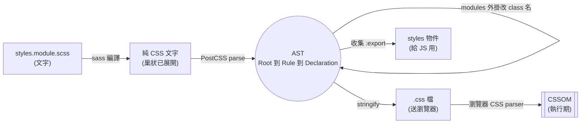
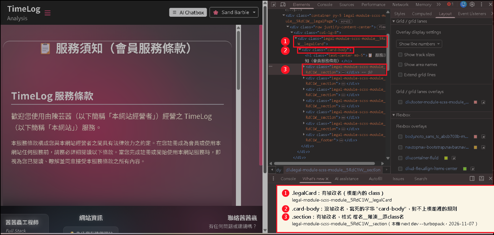

# CSS 建構期專篇

> [!info]- 這篇在整條學習線的哪裡
> **承接**：[[編譯期vs執行期三條分界線-AST與CSSOM-編譯與打包-前端與後端記憶體]] 的分界線一只說了「PostCSS 把 CSS parse 成 AST，瀏覽器才建 CSSOM」。本篇把這句話展開成完整的建構期流水線。
> **為什麼要補**：[[00-前端建構到執行全景地圖]] 第三節把 PostCSS、Autoprefixer、CSS Modules 雜湊、Sass 編譯標成待補。
> **下一站**：建構期產出的 `.css` 文字檔，會交給瀏覽器的 CSS parser 建成 CSSOM，見 [[css-兩種卡頓-render-blocking與執行期jank]] 與地圖版的 Canvas。

---

## 一、先看整條流水線（誰把什麼交給誰）

a. **Sass**（`sass` 套件，Dart 實作的預處理器）把 `.scss` 文字編譯成純 CSS 文字，產物是沒有巢狀、沒有變數的 `.css` 字串，再交給 PostCSS。
b. **PostCSS**（JS 外掛式處理器）把這串 CSS 文字 parse 成 AST（Abstract Syntax Tree，抽象語法樹），讓每個外掛走訪並修改節點，最後 stringify 成新的 CSS 文字。
c. **Autoprefixer**（PostCSS 外掛）依 Browserslist（目標瀏覽器清單）與 Can I Use 資料，替需要的屬性補上 `-webkit-`、`-moz-` 前綴。
d. **CSS Modules 外掛**（`postcss-modules-local-by-default` 與 `postcss-modules-scope`）把 class 選擇器節點改名成帶雜湊的唯一名字，並產出 `:export` 對照表交給 JS。
e. **打包器**（webpack 或 Turbopack）把改寫完的 CSS 輸出成 `.css` 檔，把對照表輸出成 JS 的 `styles` 物件，兩者各自送進瀏覽器。



f. **與 AST 的關係**：整條流水線的中間那一步（PostCSS）就是 [[編譯期vs執行期三條分界線-AST與CSSOM-編譯與打包-前端與後端記憶體]] 所說的 AST 的唯一用武之地。Sass 輸出的是文字，瀏覽器收到的也是文字，AST 只活在 b 到 d 之間的 Node.js 記憶體裡。
	- 原因：改寫程式碼需要「找得到某個選擇器」，文字搜尋做不到，樹狀結構才能精準定位到 `Rule` 節點。
	- 同理：[[script載入方式+前因後果]] 說 HTML 在 build-time 也只是文字，CSS 的建構期產物同樣只是文字，瀏覽器看到的永遠是字串。

---

## 二、Sass 編譯：把 `.scss` 變成瀏覽器看得懂的 CSS

a. **做了什麼**：展開巢狀（`.card { .title {} }` 變成 `.card .title {}`）、代入變數、做算術（`2 * 8px` 變成 `16px`）、處理 `@use`、`@import`、`@mixin`。
b. **實測**（專案的 `sass` 1.92.1，輸入 `$brand: #667eea;`、巢狀、`darken($brand, 10%)`）：
```css
.card { color: #667eea; user-select: none; backdrop-filter: blur(4px); }
.card:hover { color: rgb(57.1551724138, 88.1896551724, 227.8448275862); }
.card .title { font-size: 16px; }
```
	- `2 * 8px` 在編譯期就算完變成 `16px`，瀏覽器收到時沒有運算式。
	- `darken()` 被算成 `rgb(...)` 的小數值，這是 Sass 在建構期算好的結果，不是瀏覽器算的。
	- 同一次編譯還印出兩條 DEPRECATION WARNING：`global-builtin` 與 `color-functions`。
c. **棄用時程（要記）**：Dart Sass 1.80.0 起 `@import` 與全域內建函式（例如 `darken()`）被棄用，預計在 Dart Sass 3.0.0 移除。替代寫法是 `@use` 加 `@forward`，顏色函式改用 `color.adjust()`，可用 `sass-migrator` 自動轉。
d. **專案現況**：`styles/globals.scss` 第 2 行已用 `@use 'sass:color'`，第 5 行還有 `@import 'next-section-btn.scss'`，所以仍會觸發棄用警告，追蹤在 [issue #3](https://github.com/Abbychickenfillet-github/next-one-time-tracker/issues/3)。
e. **在 Next.js 裡**：Next 內建支援 Sass，只需安裝 `sass`，進階用 `sassOptions` 設定。Turbopack 不支援 `sassOptions.functions`。

---

## 三、PostCSS：AST 流水線的主角

a. **定位**：PostCSS 本身只做「parse、走訪、stringify」三件事，真正的功能全是外掛。它是 JS 寫的工具，跑在 Node.js 上，所以只存在於建構期。
b. **AST 長什麼樣**：`Root` 底下掛 `Rule`（有 `selector`）、`AtRule`（例如 `@media`）、`Comment`，`Rule` 底下掛 `Declaration`（有 `prop` 與 `value`）。外掛就是在這棵樹上找節點、改節點、增刪節點。
c. **為什麼不直接用 regex**：選擇器可能巢狀在 `@media` 裡、字串裡可能含 `{`、註解裡可能含 selector 文字，只有 parser 能分辨。
d. **sourcemap**：PostCSS 改寫時會保留原始位置，所以 F12 能指回你寫的 `.scss` 行號。
e. **Next.js 預設行為**（依官方 Pages 文件的搜尋摘錄，未逐頁查證日期）：
	- 沒有自訂 `postcss.config.*` 時，Next 內建 `postcss-flexbugs-fixes` 與 `postcss-preset-env`（其中 `autoprefixer` 設 `flexbox: 'no-2009'`、`stage: 3`、關閉 `custom-properties` 轉換）。
	- 一旦你自己放了 `postcss.config.*`，內建預設會整組被取代，你必須自己列出全部外掛。
f. **本專案**：沒有 `postcss.config.*`、`package.json` 沒有 `autoprefixer` 也沒有 `browserslist`，所以走的是 Next 預設那組。

---

## 四、Autoprefixer：靠目標瀏覽器清單決定要不要補

a. **誰決定要不要補前綴**：Browserslist（目標瀏覽器清單，可寫在 `package.json` 的 `browserslist` 或 `.browserslistrc`）加上 Can I Use 資料庫。目標瀏覽器不需要前綴就不補。Browserslist 的完整說明見 [[瀏覽器相容性-Polyfill補API-Babel降語法-Browserslist一次設定全家套用]]；`-webkit-` 前綴是給哪個引擎用、與 Baseline 的關係見 [[為了將固定深色背景自動調整成白色字]] 的 (i)。
b. **預設會刪舊前綴**：Autoprefixer 預設 `remove: true`，會把你手寫但目標瀏覽器已不需要的前綴刪掉。想保留某段可寫 `/* autoprefixer: off */`。
c. **實測**（沿用第二節的輸出，餵給 Next 預設的 flexbugs 加 preset-env）：
```css
.card {
  color: #667eea;
  -webkit-user-select: none;
     -moz-user-select: none;
          user-select: none;
  backdrop-filter: blur(4px);
}
```
	- `user-select` 被補上 `-webkit-` 與 `-moz-`。
	- `backdrop-filter` **沒有**被補前綴，因為預設目標瀏覽器已經不需要。**（2026-11-07 更正：這是「Sass 輸出餵給 PostCSS 預設組合」那次測試的結果。本專案 `next dev --turbopack` 實際產出有補 `-webkit-backdrop-filter`，截圖與原因見 [[為了將固定深色背景自動調整成白色字]] (i)，兩次差異的原因沒查證。）**這和 [[css-兩種卡頓-render-blocking與執行期jank]] 談的毛玻璃成本是兩回事：前綴只決定「寫不寫得出來」，不決定「畫起來貴不貴」。
d. **要自訂目標時**：在 `package.json` 加 `browserslist`，Next 的 PostCSS 預設與 Autoprefixer 會一起讀。
e. **這步值不值得做，取決於受眾**（2026-11-07 追問補入，來源為 Gemini 對話，見文末）：B2C 商業網站（電商、大眾服務）的使用者環境雜亂，跑版就是流失營收，所以要向下相容。B2B 內部系統或自己的練習專案通常可以要求使用者用最新版瀏覽器，這時花時間處理極端舊版就不划算。兩者的共通點是 Autoprefixer 與 PostCSS 都在 build-time 跑完，不增加使用者瀏覽時的 runtime 負擔。判斷「新語法能不能直接用」可看 Baseline：Newly available 代表主要瀏覽器最新版都支援，Widely available 代表達到 Newly 後又過了 30 個月，通常可放棄前綴，詳見 [[為了將固定深色背景自動調整成白色字]] 的 (i)。

---

## 五、CSS Modules 作用域雜湊：為什麼 `.card` 變成 `intro_card__wpluW`

a. **要解決的問題**：全域 CSS 的 class 名會互相衝突。CSS Modules 讓每個 `*.module.scss` 的 class 預設是區域的，由工具改名成全站唯一。
b. **分兩步做**（都是 PostCSS 外掛，所以操作對象是 AST 的 `Rule.selector`）：
	- `postcss-modules-local-by-default` 先把沒標記的 class 一律標成 `:local(...)`，`:global(...)` 的保持不動。
	- `postcss-modules-scope` 再把 `:local(...)` 裡的名字換成生成的唯一名字，同時收集成 `:export { 原名: 新名 }`。
c. **實測**（沿用同一份輸入）：
```css
.intro_card__wpluW { color: #667eea; }
.intro_card__wpluW .intro_title__O2AMg { font-size: 16px; }
.intro_aboutPage__W0Bpw .card { background: transparent; }  /* :global(.card) 原樣保留 */

:export { card: intro_card__wpluW; title: intro_title__O2AMg; aboutPage: intro_aboutPage__W0Bpw; }
```
	- `.card` 與 `.title` 被改名，`:global(.card)` 保留原名 `.card`，包住它的 `.aboutPage` 仍被改名。
	- `:export` 那一段不會出現在瀏覽器收到的 CSS 裡，打包器把它轉成 JS 的 `styles` 物件，所以 `className={styles.card}` 才拿得到新名字。
d. **名字怎麼生成**（正式建置，webpack，讀 `node_modules/next/dist/build/webpack/config/blocks/css/loaders/getCssModuleLocalIdent.js` 並手算驗證）：
	- 格式是 `[檔名]_[原 class 名]__[5 碼雜湊]`。
	- 雜湊輸入是 `filePath:<相對路徑>#className:<原名>` 的 sha1，轉 base64 取前 5 個字元。
	- 所以相同檔案加相同 class 名永遠得到同一個名字（可重現），不同檔案的同名 class 雜湊不同（不衝突）。
	- 本專案實際值：`intro_heroSection__EuyUh`、`intro_introPage__Mq8b_`、`about_aboutPage__Q5OkJ`、`about_slide__aIjaP`。
e. **開發模式不一樣**：`next dev` 用 Turbopack（內建 Lightning CSS）時觀察到的名字是 `intro-module-scss-module__Y1C7wq__heroSection`，格式和 webpack 正式建置不同。所以不能在 CSS 或測試裡寫死 class 名字。
e-1. **改名是誰做的（2026-11-07 查證）**：**不是 Autoprefixer**（它只補前綴），兩條路徑各有各的做法：

| 路徑 | 誰改名 | 證據 |
|---|---|---|
| webpack（`next build`） | Next 自帶的 css-loader 加 PostCSS 外掛 `postcss-modules-values`、`postcss-modules-local-by-default`、`postcss-modules-extract-imports`、`postcss-modules-scope`，名字由 `getCssModuleLocalIdent.js` 產生 | 本機 `node_modules/next/dist/build/webpack/loaders/css-loader/src/utils.js` 第 98 到 101 行 `require("next/dist/compiled/postcss-modules-…")`。這幾個是 PostCSS 外掛，但裝在 Next 裡面，不是你專案的獨立套件 |
| Turbopack（`next dev --turbopack`） | Lightning CSS 的 CSS Modules 功能 | [Next Turbopack 文件](https://nextjs.org/docs/app/api-reference/turbopack)：「CSS Modules … work natively (Lightning CSS)」；[Lightning CSS CSS Modules](https://lightningcss.dev/css-modules.html)：「Each class name or identifier is renamed to include a unique hash」，可用 `pattern`（`[name]`、`[hash]`、`[local]`）控制格式 |

- 看到 `legal-module-scss-module__5RdC1W__section`（Turbopack 實測，`.next/static/chunks/styles_legal_module_scss_module_0a227e3f.css` 第 77 行）：可以拆成 `legal-module-scss-module`（來源檔名）、`5RdC1W`（雜湊）、`section`（你寫的原 class 名）。**注意是 `5RdC1W`，開頭有個 5。**
- DevTools Elements 面板實際看到的樣子（`/terms` 頁，`next dev --turbopack`，2026-11-07；紅框與編號是我加的標註）：



- 圖裡的 2 號 `card-body` 沒被改名，因為頁面寫的是全域字串 `className="card-body"`，不是 `styles['card-body']`，見下面 j。無標註的原圖：`images/devtools-Elements-CSS-Modules-雜湊class名-原圖.png`。
- 這三段的對應是我從輸出與 Lightning CSS 的 `pattern` 說明推論的。Next 實際傳給 Lightning CSS 的 pattern 字串，官方文件沒寫，沒查證。
- 本專案 `node_modules` 裡的 PostCSS：頂層有 `postcss@8.4.31`，是 `next@15.5.28` 的相依（`npm ls postcss` 只有這一條）；沒有 `autoprefixer`、`lightningcss`、`css-loader`（Next 內建的 css-loader 在 `node_modules/next/dist/build/webpack/loaders/css-loader/`）。
f. **Turbopack 限制**（Next 官方 Turbopack 文件，頁面標示更新 2026-10-06）：CSS Modules 只支援函式型的 `:global(...)`，不支援單獨的 `:local`、`:global` 關鍵字。Lightning CSS 的小數精度是 5 位，webpack 是 10 位。
g. **與 Vue scoped 的差別**：Vue 的 scoped 不改 class 名，而是替元素與選擇器加 `[data-v-xxxx]` 屬性，見 [[Vue-SFC實務-styles資料夾與scoped編譯原理-lang與src屬性-CSS預處理器-JSX支援]]。兩者都是在建構期改 AST，只是改的欄位不同。
h. **和選擇器的關係**：改名只動 class 選擇器，標籤、屬性、偽類不動。選擇器各種類別見 [[01-1-選擇器-組合後代手足相鄰偽選擇器]]。
i. **在 JS 取用 `styles` 的寫法：看 class 名字是不是合法的 JS 識別字**（`styles` 是上面 `:export` 變成的普通物件，取值就是物件的屬性存取）。

| SCSS 裡的命名 | JS 寫法 | 原因 |
|---|---|---|
| camelCase：`.legalCard` | 點記法 `styles.legalCard` | camelCase 是合法的 JS 識別字 |
| kebab-case（烤肉串）：`.card-body` | 中括號 `styles['card-body']` | `-` 不能出現在識別字裡；寫 `styles.card-body` 會被解析成 `styles.card - body`（減法），拿不到 class |
| 任何命名 | 中括號 `styles['legalCard']` | 中括號收任何字串，camelCase 也能用，只是比較囉嗦 |

```jsx
<div className={styles.legalCard}>          {/* camelCase：點記法 */}
  <div className={styles['card-body']}>     {/* kebab-case：中括號 */}
```

j. **本專案踩到的坑**：`legal.module.scss` 的 `.card-body` 被雜湊成 `legal-module-scss-module__5RdC1W__card-body`（`next dev` 的 Turbopack 實測），但 `app/terms/page.js` 寫的是全域字串 `className="card-body"`（Bootstrap 的 class），兩者對不上，所以 `.legalCard .card-body { padding: 3rem }` 沒有生效。兩種修法：
	- 要用模組自己的規則：`className={styles['card-body']}`，或把 class 改成 camelCase `cardBody` 再用 `styles.cardBody`。
	- 要改 Bootstrap 的全域 `.card-body`：SCSS 寫 `:global(.card-body)`（Turbopack 只支援函式型，見 f）。
	- 這兩種修法我沒實測，只確認了雜湊後對不上的現象。
k. **`getCssModuleLocalIdent.js` 在哪、路徑每一段是什麼**（2026-11-07 在本專案實測）：

```
node_modules/next/dist/build/webpack/config/blocks/css/loaders/getCssModuleLocalIdent.js
```

| 路徑片段 | 意思 |
|---|---|
| `node_modules/next` | 這是 Next.js 套件的內部檔案，不是你的程式碼，也不是獨立套件 |
| `dist` | 編譯過的發行版。原始碼在 GitHub `vercel/next.js` 的 `packages/next/src/build/...`，副檔名是 `.ts`（用 `gh api` 確認過） |
| `build` | `next build` 這條流程用的程式 |
| `webpack` | **只給 webpack 用**，Turbopack 不會執行它 |
| `config/blocks` | 把 webpack 設定拆成一塊一塊（css、images、base...），再組合起來 |
| `css/loaders` | CSS 相關 loader 的設定：`client`、`global`（全域 CSS）、`modules`（CSS Modules）、`next-font`、`file-resolve`、`getCssModuleLocalIdent`（算 class 名） |

	- **誰呼叫它**：同資料夾 `modules.js` 第 13 行 `require("./getCssModuleLocalIdent")`，第 67 行把它交給 css-loader 的 `getLocalIdent` 選項。所以 class 名的格式是 Next 自己決定的，不是 css-loader 預設值。
	- `dist/esm/...` 還有一份 ESM 版，內容同一支，找檔案時會同時出現兩筆。

l. **不知道檔案在哪怎麼找**：

| 做法 | 指令或動作 | 備註 |
|---|---|---|
| 從專案根目錄遞迴找（cmd） | `dir /s /b C:\coding\next-one-main\getCssModuleLocalIdent.js` | 實測，會列出 dist 與 dist/esm 兩筆 |
| 同上（cmd） | `where /r C:\coding\next-one-main getCssModuleLocalIdent.js` | 實測，結果相同 |
| 同上（PowerShell） | `Get-ChildItem C:\coding\next-one-main -Recurse -Filter getCssModuleLocalIdent.js` | 沒實測 |
| 編輯器 | VS Code `Ctrl+P` 輸入檔名 | 預設會排除 `node_modules`，要在搜尋設定關掉排除 |
| 看來源 | GitHub `vercel/next.js` 用檔名搜 | 能看原始碼，但版本可能和你安裝的不同 |

	- **常見錯誤**：`dir /s /b C://xxx.js/` 會報「無效的參數 - "/"」，因為 cmd 的路徑分隔符是 `\`，結尾的 `/` 被當成參數開關。
	- **為什麼我之前直接指到 `node_modules\next`**：我當時已經知道它屬於 Next 的內部檔案。完全不知道位置時，就從專案根目錄遞迴找，慢一點但不用先猜。依賴套件裡的檔案，一定在 `node_modules` 底下。
	- 掃整個 `C:\` 太慢，先限縮到專案資料夾。

m. **這支檔案什麼時候會被執行：看跑的是哪個打包器**

| 情境 | 打包器 | 會用到 `getCssModuleLocalIdent.js` |
|---|---|---|
| 本專案 `npm run dev`（`next dev --turbopack -p 3001`） | Turbopack | 否 |
| 本專案 `next build`（package.json 沒加旗標，Next 15.5.28） | webpack | 是 |
| Vercel 部署 | 跑 `next build` | 是（沿用上一列） |
| 升級到 Next 16，不加旗標 | dev 與 build 都是 Turbopack | 否，加 `--webpack` 才會用到 |

	- Next 官方 Turbopack 文件的版本紀錄：`v15.0.0` dev 穩定、`v15.3.0` build 實驗、`v15.5.0` build beta、`v16.0.0` build 穩定且 Turbopack 成為預設打包器。
	- **結果**：本專案現在是 **dev 用 Turbopack、上線用 webpack**，兩邊 class 名格式不同（見 e），CSS 小數精度也不同（Turbopack 5 位，webpack 10 位）。

n. **既然是 Turbopack，為什麼不用 webpack、Rollup、Rolldown？Turbopack 是最好的嗎**

| 選項 | 在 Next.js 裡能不能選 | 說明 |
|---|---|---|
| Turbopack | 能，Next 16 起預設 | Rust 寫的增量打包器，內建在 Next |
| webpack | 能，`next dev --webpack`、`next build --webpack` | 舊預設，支援 `webpack()` 設定與 webpack 外掛 |
| Rollup | **查不到官方支援** | Next 官方 Turbopack 文件與 Next 16 公告只提 Turbopack 與 webpack 兩種 |
| Rolldown | **查不到官方支援** | VoidZero 做的 Rust 打包器，官網寫 Rollup 相容 API、esbuild 功能對等、「powering Vite 8+」；官網沒提 Next.js |

	- **不是「選最好的」，是 Next 只開放兩個**。Next 的路由、Server Components、API route 綁在它自己的建構流程上；要用 Rollup 或 Rolldown 得改用 Vite 這類工具，等於換掉 Next，不是換打包器。
	- **Next 官方自稱的 Turbopack 好處**（Next 16 公告，2025-10-21，數字是官方宣稱，我沒自己量）：生產建置快 2 到 5 倍，Fast Refresh 最多快 10 倍。
	- **對本專案要檢查的相容性**（Turbopack 文件「Known gaps」與「Unsupported」）：

| Turbopack 不支援或不同 | 本專案狀況 |
|---|---|
| `next.config.js` 的 `webpack()` 函式 | `next.config.js` 沒有 `webpack`（grep 確認） |
| `sassOptions.functions`（自訂 Sass 函式） | 只設了 `silenceDeprecations`，不受影響 |
| Sass 的 `~` 開頭 import（如 `~bootstrap/...`） | 沒逐檔檢查 |
| 單獨的 `:local`、`:global` | 只用到 `:global(...)` 函式型才安全；沒逐檔檢查 |
| webpack 外掛 | 沒逐項檢查依賴 |
| 小數精度 5 位 vs 10 位 | 上線若改用 Turbopack，`line-height` 這類算出來的值可能差一點 |

	- **建議的判斷順序**：先確定 dev 與 build 想不想一致。想一致就升 Next 16（兩邊都 Turbopack），或把 build 改回也用同一個。升級前先跑上表的檢查。這步我沒執行。

o. **Sass 少一個分號：為什麼會編出 `color-margin-bottom`**（2026-11-07 用本專案 sass 1.92.1 實測）：

```scss
.infoBox {
  color: red          // 少分號
  p { margin-bottom: .5rem; color: blue; }
}
```

| 寫法 | 編譯結果 |
|---|---|
| 缺分號 | `.infoBox { color: red p; color-margin-bottom: 0.5rem; color-color: blue; }` |
| 有分號 | `.infoBox { color: red; }` 與 `.infoBox p { margin-bottom: 0.5rem; color: blue; }` |

	- **原因**：Sass 有「巢狀屬性」語法，`font: { family: x; size: y; }` 會展開成 `font-family`、`font-size`。缺分號時，`color: red p { ... }` 被當成「`color` 屬性，值是 `red p`，後面接一個巢狀屬性區塊」，裡面的 `margin-bottom` 就變成 `color-margin-bottom`。
	- **所以分號重要嗎**：在 Sass 與 CSS 都重要，但後果不同。
		- Sass：不會報錯，靜默編出壞 CSS，`.infoBox p` 的規則整個不存在。
		- 純 CSS：分號是宣告之間的分隔，缺了會讓兩條宣告黏成一條，瀏覽器通常整條丟掉。這條我沒在瀏覽器實測，也沒查規格原文。
		- 例外：區塊裡**最後一條**宣告的分號可以省略。
	- 本專案實例：`legal.module.scss` 的 `.infoBox` 在 commit 前缺了 `color: var(--legal-text)` 後面的分號，已補上。

p. **`@keyframes` 對 CSS 打包的影響**（2026-11-07 在本專案實測）：

| 項目 | 結果 | 依據 |
|---|---|---|
| 名字會被雜湊嗎 | 會。CSS Modules 裡 `@keyframes backgroundFloat` 變成 `legal-module-scss-module__5RdC1W__backgroundFloat`，`animation:` 引用的名字同步改寫 | 讀 `next dev`（Turbopack）產出的 `.next/static/chunks/styles_legal_module_scss_module_*.css` |
| 沒人用的 keyframes 會被刪嗎 | **不會**。`::before` 的 `animation` 已註解掉，`@keyframes` 仍留在產出裡 | 同上 |
| 正式建置的壓縮器會刪嗎 | 不會。webpack 路徑用的 `cssnano-simple` 保留未使用的 `@keyframes` | 用 Next 內建的 `cssnano-simple` 實跑一段含未使用 keyframes 的 CSS |
| Turbopack 正式建置會刪嗎 | 沒測 | |
| 不同 module 的同名 keyframes 會衝突嗎 | 不會，各自雜湊 | 由名字含檔名雜湊推得，沒另外測兩個檔案 |

	- **打包大小**：一段 keyframes 只是幾行文字，檔案體積影響很小。真正有成本的是**執行期**：`position: fixed` 的整頁圖層加上 `infinite` 動畫，瀏覽器要一直更新這一層，和打包無關。見 [[css-兩種卡頓-render-blocking與執行期jank]]。
	- **所以要清理就得手動刪**：刪掉 `animation` 後，對應的 `@keyframes` 不會自動消失，要自己一起刪。

---

## 六、一張表收尾：建構期各步驟的輸入、輸出、對象

| 步驟 | 工具（屬性） | 輸入 | 輸出 | 是否有 AST |
|---|---|---|---|---|
| 編譯 | `sass`（Dart 預處理器） | `.scss` 文字 | 純 CSS 文字 | 有（Sass 內部自己的，不外露） |
| 改寫 | PostCSS（JS 外掛式處理器） | CSS 文字 | 新 CSS 文字 | 有（PostCSS AST） |
| 補前綴 | Autoprefixer（PostCSS 外掛） | AST | 補過前綴的 AST | 沿用 |
| 作用域 | postcss-modules-*（PostCSS 外掛） | AST | 改名的 AST 加 `:export` | 沿用 |
| 輸出 | 打包器（webpack 或 Turbopack） | 改寫後的 CSS | `.css` 檔與 JS `styles` 物件 | 無 |
| 解讀 | 瀏覽器 CSS parser（執行期） | `.css` 檔 | CSSOM | 無（那是 CSSOM 不是 AST） |

> Turbopack 的 Lightning CSS 是 Rust 寫的 parser 與 transformer，等於把「PostCSS、Autoprefixer、CSS Modules」三件事合在一個程式內完成，所以 dev 與 build 的輸出格式才會不同。

---

## 七、自我測驗

> [!question]- 填空 1
> Sass 把 `2 * 8px` 算成 `16px` 是發生在 ____ 期，瀏覽器 ____ 看到這個運算式。
> > [!success]- 答案
> > 建構（編譯）。從來沒有。

> [!question]- 填空 2
> PostCSS 的 AST 裡，`color: red` 是 ____ 節點，`.card {}` 是 ____ 節點。
> > [!success]- 答案
> > `Declaration`、`Rule`。

> [!question]- 是非題 1：Autoprefixer 一定會替 `backdrop-filter` 補 `-webkit-`。
> > [!success]- 答案
> > 錯。是否補前綴取決於 Browserslist 目標。本篇實測在 Next 預設目標下沒補。

> [!question]- 是非題 2：`:export` 那段 CSS 會被瀏覽器下載並套用。
> > [!success]- 答案
> > 錯。它被打包器轉成 JS 的 `styles` 物件，不會留在送給瀏覽器的 CSS 裡。

> [!question]- 是非題 3：`next dev` 看到的 class 名和 `next build` 的一樣。
> > [!success]- 答案
> > 錯。dev（Turbopack）與 build（webpack）命名格式不同，不能寫死。

> [!question]- 申論題：用「誰用什麼做什麼、產物是什麼、再交給誰」的句型，描述 `.scss` 到瀏覽器 CSSOM 的完整路徑，並指出 AST 活在哪一段。
> > [!success]- 參考答案
> > sass 把 `.scss` 文字編譯成純 CSS 文字 → 交給 PostCSS 把它 parse 成 AST → Autoprefixer 與 CSS Modules 外掛走訪 AST 補前綴與改 class 名 → PostCSS 把 AST stringify 成新 CSS 文字 → 打包器輸出成 `.css` 檔與 JS 的 `styles` 物件 → 瀏覽器下載 `.css` 後由自己的 CSS parser 建成 CSSOM。AST 只活在「PostCSS parse」到「stringify」之間的 Node.js 記憶體，瀏覽器從頭到尾沒見過。

---

## 八、LeetCode 與 NeetCode 對照題

a. [N-ary Tree Preorder Traversal（589）](https://leetcode.com/problems/n-ary-tree-preorder-traversal/)：PostCSS 外掛走訪 AST 就是在多叉樹上做前序走訪。
b. [Basic Calculator（224）](https://leetcode.com/problems/basic-calculator/)：Sass 算 `2 * 8px` 等於先 parse 運算式再求值。
c. [Design HashMap（706）](https://leetcode.com/problems/design-hashmap/)：CSS Modules 的 `:export` 對照表是「原名到新名」的雜湊表。
d. [Encode and Decode TinyURL（535）](https://leetcode.com/problems/encode-and-decode-tinyurl/)：把長字串壓成短識別碼並保證可重現，和 `[name]_[local]__[hash]` 的思路相近。
e. 題單入口：[NeetCode Practice](https://neetcode.io/practice)。

---

## 九、資料來源（含查證時間）

| 來源 | 內容 | 時間 |
|---|---|---|
| [Sass：@import 棄用說明](https://sass-lang.com/documentation/breaking-changes/import/) | 1.80.0 棄用、3.0.0 移除、改用 `@use` | 2026-10-25 查證 |
| [PostCSS GitHub](https://github.com/postcss/postcss) | JS 外掛式、parse 成 AST、sourcemap | 2026-10-25 查證 |
| [Autoprefixer GitHub](https://github.com/postcss/autoprefixer) | Browserslist 加 Can I Use、`remove` 預設 true、`autoprefixer: off` | 2026-10-25 查證 |
| [css-loader GitHub](https://github.com/webpack-contrib/css-loader) | `localIdentName` 預設 `[hash:base64]`、`:local`/`:global` | 2026-10-25 查證 |
| [Next.js：Turbopack](https://nextjs.org/docs/app/api-reference/turbopack) | Lightning CSS、`:global(...)` 限制、PostCSS 自動處理 | 頁面標示 2026-10-06 |
| [Next.js：Sass 指南](https://nextjs.org/docs/app/guides/sass) | `sass`、`sassOptions`、`:export` | 頁面標示 2026-09-28 |
| [Next.js：PostCSS 指南](https://nextjs.org/docs/pages/guides/post-css) | 預設外掛組合、自訂設定取代預設 | 搜尋摘錄，頁面日期未查證 |
| [MDN：Property accessors](https://developer.mozilla.org/en-US/docs/Web/JavaScript/Reference/Operators/Property_accessors) | 點記法要求合法識別字，中括號可接任何字串 | MDN 最後修改 2025-07-08；2026-11-07 查證 |
| 本機原始碼 `getCssModuleLocalIdent.js` | 雜湊公式，手算驗證 | 2026-10-25 讀取 |
| Gemini 對話「尋找檔案指令」（標題與內容不符，實為 CSS 相容性與 Baseline 問答） | https://gemini.google.com/app/151e6effcfe6c142 | 2026-11-07 擷取，AI 回答，30 個月門檻請以 web.dev/baseline 為準 |
| 本機實測腳本 | Sass 1.92.1、Next 內建 PostCSS 外掛實跑輸出 | 2026-10-25 執行 |

> [!warning] 沒做到的部分
> F12 的 Elements 面板截圖我這邊拍不到。建議你自己截：Elements 看 `<div class="intro_heroSection__EuyUh">`、Sources 看 sourcemap 指回 `.scss`，放進 `obsidian-attachment` 後補在第五節 d 之下。
