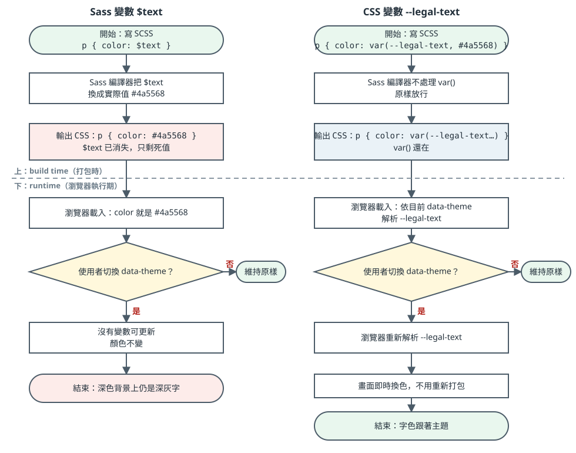

# 為了將固定深色背景自動調整成白色字

> [!info] 本篇重點 a–k，共 11 個
> 互動版（可切換主題、拖 oklch 滑桿、實測 contrast-color）：[互動版](為了將固定深色背景自動調整成白色字-互動版.html)。
> 關聯筆記：[[CSS自訂屬性-custom-properties-var與雙連字號變數]]（`--x` 與 `$x` 的差別）、[[CSS色彩空間-色相色度明度與Oklab-Oklch]]（為什麼顏色一律寫 oklch）。

---

## 一. 起因：專案現況

(a) next-one-time-tracker 的 `styles/legal.module.scss` 被三個頁面共用，頁面本身的背景由主題決定。

| 項目 | 現況 |
|---|---|
| 共用範圍 | `app/terms`、`app/return-policy`、`app/privacy-policy` 三頁都用 `legal.module.scss`，維持共用即可（每個 class 至少有一頁在用） |
| 背景 | `.legalPage`、`.legalCard` 的 `background` 已刪，卡片透出主題背景 |
| 文字色 | 全部寫死（`#1a202c`、`#4a5568` 等深色），深色主題下深字落在深底，看不到 |
| 主題機制 | `components/theme-toggle` 對 `<html>` 設 `data-theme`；`styles/globals.scss` 以 `:root[data-theme='green']` 等為每個主題定義 `--text-primary`、`--text-secondary`、`--form-bg` |
| 深色主題的字色 | green、pink、warm、sand-barbie 的 `--text-primary` 都是 `#ffffff` |

---

## 二. Sass 變數與 CSS 變數：誰在什麼時候被換掉

(b) 流程圖（上半是打包時，下半是瀏覽器執行期）：



(c) 實際編譯結果（sass 1.92.1）：

| 原始碼 | 編譯後 CSS | 結果 |
|---|---|---|
| `$text: #4a5568; .a { color: $text; }` | `.a { color: #4a5568; }` | `$text` 消失，只剩死值，改不了 |
| `.b { color: var(--legal-text, #4a5568); }` | `.b { color: var(--legal-text, #4a5568); }` | `var()` 原樣保留，瀏覽器可以重算 |

(d) 結論：不是 `data-theme` 讓 Sass 固定，而是 Sass 變數在打包時就被換成實際的值，瀏覽器切換 `data-theme` 時沒有東西可以更新。

---

## 三. 三種做法

(e) 顏色一律寫 oklch（原因見 [[CSS色彩空間-色相色度明度與Oklab-Oklch]] 的 (o)）。

| 做法 | 顏色何時決定 | 跟得上 `data-theme` | 限制 |
|---|---|---|---|
| 1. 成對 CSS 變數（建議） | 執行期 | 是 | 顏色由人手選；專案主題已有 `--text-primary`，可直接重用 |
| 2. CSS `contrast-color()` | 執行期 | 是 | 輸入要單一 `<color>`（漸層不行）；輸出只有黑或白 |
| 3. Sass 函式 `text-on($bg)` | 編譯期 | 否 | 背景色要寫死在 Sass 裡 |

做法 1：屬性名稱不變，只把寫死的值換成變數，淺色當後備值。

```scss
.legalCard {
  h1, h2 { color: var(--legal-heading, oklch(0.243 0.025 264)); }   // 原 #1a202c
  p, ul, .lead { color: var(--legal-text, oklch(0.447 0.034 261)); } // 原 #4a5568
}
// globals.scss 的深色主題補：
// --legal-heading: oklch(1 0 0);
// --legal-text: oklch(0.95 0 0);
```

做法 2：

```css
.card {
  --bg: oklch(0.3 0.05 250);
  background: var(--bg);
  color: contrast-color(var(--bg));   /* 深底得到 white */
}
```

做法 3：已用 sass 1.92.1 編譯驗證。以 oklch 的 L 判斷，比 hsl 的 lightness 貼近人眼。

```scss
@use 'sass:color';

@function text-on($bg, $light: oklch(0.98 0 0), $dark: oklch(0.243 0.025 264)) {
  @if color.channel($bg, 'lightness', $space: oklch) > 65% { @return $dark; }
  @return $light;
}
// text-on(#1a1a1a) → oklch(98% 0 0)　　text-on(#f6ca85) → oklch(21% 0.03 265)
// text-on(#502f18) → oklch(98% 0 0)　　text-on(#ede0ff) → oklch(21% 0.03 265)
```

---

## 四. `#1a202c` 是怎樣的黑色

(f) 它不是純黑，是帶一點藍的深炭灰，近黑。

| 項目 | `#000000` 純黑 | `#1a202c` | `#1a1a1a` |
|---|---|---|---|
| RGB | 0, 0, 0 | 26, 32, 44 | 26, 26, 26 |
| oklch | `oklch(0 0 0)` | `oklch(0.243 0.025 264)` | `oklch(0.218 0 90)` |
| L 明度 | 0 | 0.243 | 0.218 |
| C 彩度 | 0 | 0.025（有一點藍） | 0（純灰） |
| 印象 | 最黑 | 偏藍的深炭灰 | 中性深灰 |

(g) `#1a202c` 是 Tailwind v1 預設調色盤的 gray-900。同盤的其他灰，色相都落在 256 到 264 度（藍灰），只有 L 不同，這就是 oklch 做灰階色盤的寫法：固定 H、C，只改 L。

| Tailwind v1 | hex | oklch |
|---|---|---|
| gray-900 | `#1a202c` | `oklch(0.243 0.025 264)` |
| gray-800 | `#2d3748` | `oklch(0.335 0.033 261)` |
| gray-700 | `#4a5568` | `oklch(0.447 0.034 261)` |
| gray-300 | `#e2e8f0` | `oklch(0.929 0.013 256)` |

---

## 五. `contrast-color()` 是什麼

(h) 用途：給它一個背景色，瀏覽器自動回傳對比較高的白或黑，當文字色。不用自己維護「背景與文字」成對的顏色。

```css
button { background: var(--c); color: contrast-color(var(--c)); }
```

(i) 「Baseline 2026 newly available」的意思：2026 年 4 月起，最新版的主要瀏覽器都支援，但舊瀏覽器、舊裝置可能沒有，所以要寫 `@supports` 後備。

(j) 「中間色調」問題：它依 WCAG 的對比公式選黑或白。背景是中間亮度時，黑與白的對比都差不多，它選出來的結果可能剛好過 AA 標準（4.5:1），但小字讀起來吃力。MDN 的例子：`#2277d3`（oklch L 約 0.57，中間亮度）會得到黑字。建議只用在偏亮或偏暗的背景。

(k) <mark style="background: #FFF3A3A6;">待測試（提醒 Abby）</mark>：互動版第 f 節放了中間色調的色塊，並排比較 `contrast-color()` 與 oklch 65% 規則的結果，再決定 legal 頁要不要用 `contrast-color()`。專案的主題背景是漸層、且 lavender 與 mint 的字色不是黑白，`contrast-color()` 本來就不適合直接套在主題背景上。

---

## 資料來源（含查證時間）

| 主題 | 連結 | 版本／時間 |
|---|---|---|
| `contrast-color()`：回傳黑或白、Baseline 2026 newly available、中間色調限制 | https://developer.mozilla.org/en-US/docs/Web/CSS/color_value/contrast-color | MDN 最後修改 2026-04-22；查證 2026-11-05 |
| Sass `color.channel($color, $channel, $space)`；`$space` 自 Dart Sass 1.79.0；`color.lightness()` 已不建議使用 | https://sass-lang.com/documentation/modules/color/ | Sass 官方文件，無日期；查證 2026-11-05 |
| Tailwind v1 gray 調色盤（gray-900 = `#1A202C`） | https://v1.tailwindcss.com/docs/customizing-colors | 頁面未標版本，網址為 v1；查證 2026-11-07 |
| CSS 自訂屬性 | https://developer.mozilla.org/en-US/docs/Web/CSS/Using_CSS_custom_properties | MDN，2026-09-09 查 |
| oklch 換算、Sass 編譯結果、`.card-body` 被雜湊的編譯輸出 | 本機用 sass 1.92.1 與自寫換算腳本實測 | 2026-11-07 |
| `legal.module.scss`、`globals.scss` 主題變數 | 專案檔案 `C:\coding\next-one-main\styles` | 讀檔於 2026-11-07 |

未查證：「近黑文字比純黑柔和」是常見設計說法，沒有找來源；CSS Modules 裡 `:global([data-theme='green']) .legalCard` 的寫法在 Next 15 的實際編譯結果沒有實測。
