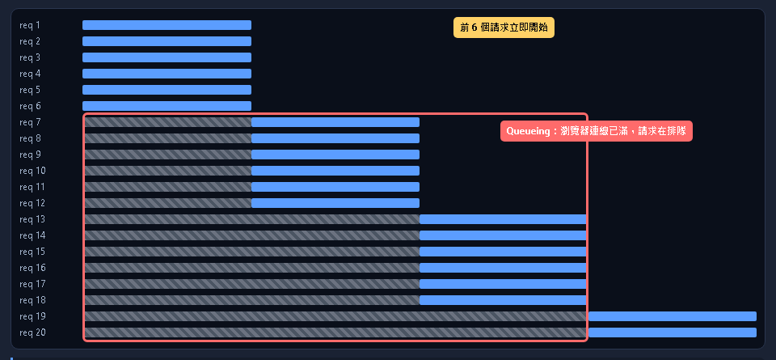

# 高併發的定義與前端工程師面試怎麼說

本篇重點 a–h，共 8 個。互動版（流程圖、填空、是非題、申論題）見 [[high-concurrency-frontend-interview-互動版.html]]。

> 使用者原問題：「高併發的定義是什麼？前端工程師面試時如何說？」

## a. 定義：高併發是同一時間有很多請求在系統內進行中

| 名詞 | 全名與意思 | 面試白話 |
|---|---|---|
| 併發 concurrency | 多個獨立任務在時間上交錯推進，結構上可同時處理 | 一個人輪流照顧多個鍋子 |
| 並行 parallelism | 多個計算在同一瞬間真的同時執行，需要多核心 | 多個人各炒一個鍋 |
| QPS | Queries Per Second，每秒查詢數 | 入口流量 |
| RPS | Requests Per Second，每秒請求數，HTTP 情境與 QPS 常通用 | 入口流量 |
| TPS | Transactions Per Second，每秒完成的交易數，一筆交易可含多個請求 | 業務完成量 |
| 吞吐量 throughput | 單位時間內成功處理的工作量 | 出口產能 |
| P95 與 P99 延遲 | Percentile，95% 或 99% 的請求不慢於此時間，用來看長尾 | 平均值會騙人 |
| 同時在線人數 | Concurrent Users，同一時間連著系統的使用者，不等於同時發請求 | 在線不等於在打 API |

高併發沒有固定門檻數字。它的意思是「同時在處理的請求數」逼近或超過系統某一層的容量（連線池、執行緒、資料庫連線、頻寬）。所以面試時要講出瓶頸在哪一層。

併發與並行的區分出自 Rob Pike 的演講，Go 官方部落格摘錄為「併發是獨立執行程序的組合，並行是（可能相關的）計算同時執行」（見來源 1）。

### Little's law：L = λ × W

1. L：系統內平均同時存在的請求數
2. λ（lambda）：平均到達率，也就是 QPS
3. W：每個請求平均停留在系統內的時間

例：QPS 1000，平均延遲 200ms，L = 1000 × 0.2 = 200 個請求同時在飛。若延遲惡化到 600ms，同時在飛數變成 600。所以「變慢」會自己放大成高併發，優化延遲等於降低併發壓力。互動版有計算機。

## b. 主軸圖：一個請求的旅程與每層優化點

主軸流程圖在互動版第 b 節（SVG，可點擊每個方框、可逐步走一次）。下表是文字版對照，順序等於流程圖由上到下。

| 步驟 | 形狀 | 內容 | 對應手段 |
|---|---|---|---|
| 起點 | 起訖 | 使用者點擊或輸入 | 無 |
| 判斷 | 菱形 | 事件是否很頻繁 | 是則 debounce 或 throttle |
| 判斷 | 菱形 | 前端快取已有資料 | 是則直接渲染，否則往下 |
| 處理 | 長方形 | 請求去重加 AbortController 取消舊請求 | SWR 去重、abort |
| 處理 | 長方形 | 併發池排隊 | worker 迴圈限制同時 N 個 |
| 判斷 | 菱形 | CDN 或 HTTP 快取命中（或 ISR 靜態頁） | 是則 304 或快取回應 |
| 處理 | 長方形 | 伺服器限流 | checkRateLimit |
| 判斷 | 菱形 | 超過額度或失敗 | 是則退避重試與降級，並回到併發池 |
| 資料儲存 | 圓柱 | 資料庫查詢 | 少碰它是所有手段的目的 |
| 處理 | 長方形 | 渲染 | 樂觀更新、虛擬化、Web Worker |
| 終點 | 起訖 | RUM 與 Web Vitals 監控 | 用數字證明有效 |

### 瀏覽器排隊的真實樣子（模擬圖）



說明：此圖由互動版第 c 節用同一規則算出，紅框是標註，**不是真的 DevTools 截圖**。要看真的，請打開 DevTools 的 Network 面板，看 Waterfall 欄位裡灰色的 Queueing 段。MDN 指出瀏覽器同網域常見上限是 6 條連線，HTTP/2 單一連線可多工所以不需要網域分片（見來源 5）。

## c. 前端面試怎麼說

### 破題（先講這句）

「前端不直接扛高併發，扛的是後端。前端能做的是讓進到後端的請求變少、變慢進來、重複變少，以及流量失敗時優雅降級。」

### 四個層次

| 層次 | 手段 | 一句話 |
|---|---|---|
| 1 少發 | debounce、throttle、合併請求、快取、CDN、Service Worker | 最快的請求是不發的請求 |
| 2 發得聰明 | 去重、AbortController 取消、併發池、SSR 與 SSG 與 ISR | 同一件事只做一次，過期的丟掉 |
| 3 失敗得漂亮 | 重試加退避、降級、骨架屏、樂觀更新 | 不要讓使用者看到白畫面 |
| 4 看得見 | RUM（Real User Monitoring，真實使用者監控）、Web Vitals | 用真實數據證明有改善 |

縮寫補充：SSR 是 Server-Side Rendering（伺服器端渲染）。SSG 是 Static Site Generation（建置時產生靜態頁）。ISR 是 Incremental Static Regeneration（過期後背景重新產生靜態頁）。

### STAR 口語稿（引用的數字都來自專案程式碼與 commit）

1. S 情境：「我做了一個 Next.js 的時間紀錄網站 timelog。儀表板一進來要載入時間紀錄、已分享清單和 AI 分析，而且免費與付費使用者有不同的 API 額度，所以我很在意重複與無效的請求。」
2. T 任務：「目標是流量變大時，不讓無效請求打到資料庫，同時讓首屏夠快。」
3. A 行動：「後端我在 `lib/rate-limit.js` 用記憶體 Map 做滑動視窗，依 userId 與類型限額，免費用戶每小時 50 次，超過回 429。前端收到 429 才用動態 import 載入 SweetAlert2，不佔首包。AI 分析區塊用 `React.lazy` 加 Suspense 延後載入。檢查額度的 API 我改讀 `current_log_count` 欄位，避免每次 COUNT 查詢。另外我把中文字體子集化。」
4. R 結果：「LCP 從 2.4 秒降到 0.81 秒（commit 23665f4，2026-09-17 的敘述）。我也自己檢查出缺口：儀表板的 fetch 還沒有 AbortController，已分享清單是等時間紀錄回來後才依序請求，這是我下一步會補的。」

面試加分點：主動講缺口與下一步，比誇大成果可信。不要說「我撐過幾萬 QPS」，除非真的壓測過。

## d. 程式碼逐行解釋

三份檔案與本篇同資料夾，皆可 `node 檔名` 直接執行。

### d1. 併發池 [demo-01-promise-pool.js](./demo-01-promise-pool.js)

核心程式（實跑輸出：8 個任務、limit 3，峰值同時在飛 = 3）：

```js
async function promisePool(tasks, limit) {
  let next = 0
  async function worker(id) {
    while (next < tasks.length) {
      const i = next++
      await tasks[i]()
    }
  }
  const workers = Array.from({ length: Math.min(limit, tasks.length) }, (_, id) => worker(id))
  await Promise.all(workers)
}
```

| 行 | 關鍵字或語法 | 解釋 | 底層關係 |
|---|---|---|---|
| 1 | `async function` | 宣告非同步函式，回傳 Promise，函式內才能用 await。`tasks` 是回傳 Promise 的函式陣列，不是 Promise 本身，這樣才能控制何時啟動 | Promise 一建立就開始執行，所以要傳函式延後啟動 |
| 2 | `let next = 0` | 所有 worker 共用的領取計數器，靠閉包共享 | 閉包保存外層變數 |
| 3 | `async function worker` | 一條「領任務、做完、再領」的迴圈 | 同時最多 limit 條 |
| 4 | `while (next < tasks.length)` | 還有任務沒領走就繼續 | 條件與 `next++` 之間沒有 await |
| 5 | `next++` | 後置遞增：先取舊值再加一 | JS 單執行緒 run-to-completion，不會被其他 worker 插隊 |
| 6 | `await tasks[i]()` | 啟動任務並等它完成。await 讓出執行權 | 讓出後 event loop 才能讓其他 worker 領任務，續行以 microtask 排程 |
| 9 | `Array.from({ length }, fn)` | 用類陣列物件加映射函式造出陣列，這裡等於呼叫 limit 次 worker | 呼叫 `worker(id)` 會同步跑到第一個 await 才返回 Promise |
| 9 | `Math.min` | 任務比上限少時不多開 worker | 無 |
| 10 | `Promise.all` | 全部 resolve 才 resolve，任一 reject 就整體 reject | 等所有 worker 結束 |

### d2. 去重與取消舊請求 [demo-02-latest-only-fetch.js](./demo-02-latest-only-fetch.js)

```js
const inflight = new Map()
function dedupedFetch(url) {
  if (inflight.has(url)) return inflight.get(url)
  const p = fakeFetch(url).finally(() => inflight.delete(url))
  inflight.set(url, p)
  return p
}

let controller = null
async function searchLatestOnly(keyword) {
  controller?.abort()
  controller = new AbortController()
  return await fakeFetch(`/search?q=${keyword}`, { signal: controller.signal })
}
```

| 行 | 關鍵字或語法 | 解釋 | 底層關係 |
|---|---|---|---|
| 1 | `new Map()` | 鍵值表，這裡用 url 當 key 存進行中的 Promise | 模組層級變數，所有呼叫者共用 |
| 3 | `inflight.has(url)` | 已有人在請求就回傳同一個 Promise，後來者共享結果 | 一個 Promise 可被多處 await，不會重複請求 |
| 4 | `.finally(fn)` | 無論成功失敗都清掉紀錄，否則失敗後該 key 永遠卡住 | finally 回呼是 microtask |
| 9 | `controller?.abort()` | `?.` 可選串接，為 null 時略過。abort() 觸發 signal 的 abort 事件 | 真 fetch 會以 AbortError reject，MDN 說明 AbortController 可中止 fetch 與串流（見來源 3） |
| 10 | `new AbortController()` | 每次請求要新的，因為 abort 是一次性的 | 無 |
| 11 | `{ signal: controller.signal }` | 把 signal 交給 fetch 的選項 | 取消只中斷客戶端，伺服器是否停止要看它是否偵測斷線（一般知識，未另外查證） |

實跑輸出：三次同時呼叫 dedupedFetch 只打網路 1 次。三個關鍵字連續搜尋，網路發出 3 次，但只有最後一個有結果。

### d3. 退避重試 [demo-03-retry-backoff.js](./demo-03-retry-backoff.js)

```js
async function withRetry(fn, { retries = 3, baseMs = 100 } = {}) {
  for (let attempt = 0; ; attempt++) {
    try {
      return await fn(attempt)
    } catch (err) {
      if (attempt >= retries || !err.retryable) throw err
      const backoff = baseMs * 2 ** attempt
      const jitter = Math.random() * backoff * 0.5
      await sleep(Math.round(backoff + jitter))
    }
  }
}
```

| 行 | 關鍵字或語法 | 解釋 | 底層關係 |
|---|---|---|---|
| 1 | `{ retries = 3, baseMs = 100 } = {}` | 解構加預設值，呼叫者不傳選項也能運作 | 無 |
| 2 | `for (...; ; ...)` | 沒有結束條件的迴圈，靠 return 或 throw 離開 | 無 |
| 4 | `return await` | 必須 await 才能讓 catch 接到非同步錯誤 | 少了 await，rejection 不會進本函式的 catch |
| 6 | `!err.retryable` | 非暫時性錯誤（例如 400）直接丟出，不浪費請求 | 只有 429 與 5xx 值得重試 |
| 7 | `2 ** attempt` | 次方運算，退避 100、200、400ms | 指數退避 |
| 8 | `Math.random()` | 隨機抖動 jitter，避免大量客戶端同刻重試造成 retry storm（重試風暴） | 無 |
| 9 | `sleep` | 包 setTimeout 的 Promise | setTimeout 回呼是 macrotask，到期才 resolve，等待期間不佔主執行緒 |

## e. 底層觀念如何對應到每個手段

| 底層觀念 | 一句話 | 對應手段 |
|---|---|---|
| event loop | JS 單執行緒，每個 job 跑到完才換下一個（run-to-completion），長任務會卡住點擊與捲動（來源 7） | 切片或丟 Web Worker |
| microtask 與 macrotask | Promise 的 then 是 microtask，在下一個 task 前清空。setTimeout 是 task（來源 6） | worker 迴圈用 await 讓出，debounce 靠 setTimeout 延後 |
| 同源連線數上限 | HTTP/1.x 同網域常見 6 條，多的請求排隊（來源 5） | 減少請求數、併發池控制在上限內 |
| HTTP/2 多工 | 單一連線可同時跑多個請求（來源 5） | 請求量仍要控制，伺服器與資料庫容量沒變 |
| HTTP 快取 | max-age 內的回應直接重用，不打來源（來源 4） | 靜態資源 hash 檔名加長快取 |
| ISR | 先回快取頁，過期後背景重新產生（來源 9） | 大量讀取的頁面不進 API 與資料庫 |
| Web Worker | 背景執行緒跑運算，不卡主執行緒（來源 8） | 大量資料排序與統計 |

## f. 你的專案實證（已實際讀過程式碼）

| 位置 | 事實 | 面試說法 |
|---|---|---|
| `lib/rate-limit.js:7` 與 `:50` | 模組層級 Map 存每個 `userId:type` 的時間戳陣列，checkRateLimit 過濾視窗內紀錄，滿額回 allowed false | 滑動視窗限流 |
| `lib/rate-limit.js:34` | 免費 api 每小時 50、db 每天 120。付費 api 120、db 520，可用環境變數覆寫 | 分級額度 |
| `lib/rate-limit.js:25` | setInterval 每小時清過期紀錄 | 避免記憶體無限成長 |
| `lib/rate-limit.js:93` | rateLimitMiddleware 是 Express 風格，專案內實際只有 checkRateLimit 被 route 呼叫 | 如實說中介層版本目前沒用 |
| `app/dashboard/page.js:823` | 收到 429 且 errorType 是 rate_limit 才動態 import SweetAlert2 | 降級提示與 code splitting |
| `app/dashboard/page.js:24` | AvatarUpload 與 AIAnalysisSection 用 React.lazy | 非首屏功能延後載入 |
| `app/dashboard/page.js:811` 與 `:857` | fetchTimeLogs 成功後才 await fetchSharedLogIds，兩個請求串行。fetch 沒有帶 signal | 缺口 |
| `app/(api)/api/timelogs/route.js` | findMany 沒有 take 或分頁，並 include steps | 缺口：資料變多要分頁 |
| `stores/useTimeLogStore.js:248` 與 `app/(api)/api/timelog/route.js:67` | 儲存流程先 GET check-limit 再 POST timelog，兩支都呼叫 checkRateLimit，一次儲存吃兩次 api 額度 | 可合併成一次請求 |
| `app/api/timelog/check-limit/route.js` | 註解寫明用 current_log_count 欄位避免 COUNT 查詢 | 用冗餘欄位換資料庫負載 |
| `services/rest-client/use-fetcher.js` | 使用 SWR，同 key 並行請求會去重（來源 10） | 請求去重來源 |
| 專案全文搜尋 | 找不到 AbortController、debounce、throttle 的使用 | 如實說還沒做 |

推論（非程式碼事實）：rate-limit 的 Map 存在單一程序記憶體，若部署成多個實例，每個實例各算各的。Next.js 文件對 ISR 檔案快取有同樣的「每個實例各自一份」警告（來源 9）。

## g. LeetCode 與 NeetCode 類似題目

| 題目 | 對應本篇 | 備註 |
|---|---|---|
| [2636 Promise Pool](https://leetcode.com/problems/promise-pool/)（Medium） | 併發池 | 鎖定題，slug 經 [doocs 鏡像](https://leetcode.doocs.org/en/lc/2636/)核對 |
| [1188 Design Bounded Blocking Queue](https://leetcode.com/problems/design-bounded-blocking-queue/)（Medium） | 有上限的生產者與消費者 | 鎖定題，[doocs 鏡像](https://leetcode.doocs.org/en/lc/1188/) |
| [2627 Debounce](https://leetcode.com/problems/debounce/)（Medium） | debounce | [doocs 鏡像](https://leetcode.doocs.org/en/lc/2627/) |
| [2676 Throttle](https://leetcode.com/problems/throttle/)（Medium） | throttle | 鎖定題 |
| [359 Logger Rate Limiter](https://leetcode.com/problems/logger-rate-limiter/)（Easy） | 限流 | 鎖定題，與 rate-limit.js 同概念 |

注意：LeetCode 官網我這邊回 403 無法直接開啟，slug 是依 doocs 鏡像頁面資訊核對，點開前請以官網為準。NeetCode 的 Promise Pool 影片我只從搜尋結果間接看到（talentd.in 的描述），沒有直接核對 NeetCode 頁面，所以不附連結。

## h. 關聯筆記（為什麼相關）

1. [[debounce為什麼一定要setTimeout-以及React的useRef]]：第 c 節「少發」這一層的 debounce 與 throttle 原理與 React 寫法。
2. [[FCP-5.24秒-Next.js效能診斷實錄-從指令到根因]]：同一個專案的首屏效能，與字體子集化的 LCP 數據互補。
3. [[App-Router與Pages-Router-RSC與Streaming-SSR-loading與error約定]]：SSR 與 Streaming 是「伺服器壓力」這一層的基礎。
4. [[瀏覽器快取-chunk-content-hash-與強制重新整理-互動版.html]]：流程圖裡「HTTP 快取命中」那個菱形的實作細節。
5. [[Axios-vs-Fetch-回應解析與錯誤處理]]：fetch 的 signal 取消與錯誤處理差異。
6. [[費米問題-Fermi-Estimation-面試估算技巧-互動版.html]]：被問「怎麼估 QPS」時的估算方法，搭配 Little's law。

Obsidian 外掛提醒：Little's law 與流程圖適合用 Excalidraw 手畫一次加深記憶。互動版 HTML 可用 HTML reader 外掛開啟。

## 資料來源（含查證時間）

查證日期皆為 2026-10-22。

| 編號 | 主題 | 連結 | 版本或時間 |
|---|---|---|---|
| 1 | 併發與並行定義 | [Go Blog：Concurrency is not parallelism](https://go.dev/blog/waza-talk) | 文章 2013-01-16 |
| 2 | Little's law | [Wikipedia](https://en.wikipedia.org/wiki/Little%27s_law) | 最後編輯 2026-08-20 |
| 3 | AbortController | [MDN](https://developer.mozilla.org/en-US/docs/Web/API/AbortController) | 2025-09-17 |
| 4 | HTTP 快取 | [MDN](https://developer.mozilla.org/en-US/docs/Web/HTTP/Guides/Caching) | 2026-08-14 |
| 5 | 連線管理與 HTTP/2 多工 | [MDN](https://developer.mozilla.org/en-US/docs/Web/HTTP/Guides/Connection_management_in_HTTP_1.x) | 2026-09-11 |
| 6 | Promise 與 microtask | [MDN](https://developer.mozilla.org/en-US/docs/Web/JavaScript/Guide/Using_promises) | 2026-09-22 |
| 7 | event loop | [MDN](https://developer.mozilla.org/en-US/docs/Web/JavaScript/Event_loop) | 2026-04-06 |
| 8 | Web Workers | [MDN](https://developer.mozilla.org/en-US/docs/Web/API/Web_Workers_API/Using_web_workers) | 2026-08-27 |
| 9 | ISR | [Next.js Docs](https://nextjs.org/docs/app/guides/incremental-static-regeneration) | lastUpdated 2026-10-15 |
| 10 | SWR 去重與預設值 | [SWR 效能](https://swr.vercel.app/docs/advanced/performance)、[SWR API](https://swr.vercel.app/docs/api) | dedupingInterval 預設 2000ms |
| 11 | Core Web Vitals 門檻 | [web.dev](https://web.dev/articles/vitals) | 2024-10-31 更新。LCP 2.5 秒、INP 200 毫秒、CLS 0.1 |
| 12 | 專案程式碼 | `C:\coding\next-one-main` 分支 perf/dashboard-fcp | 讀取於 2026-10-22 |

存疑與更正：我查證時 MDN 的 AbortController 頁面沒有說明 `AbortSignal.timeout`，所以筆記沒有引用該 API 的行為。
