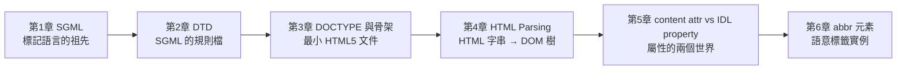

# 🗺️ html-basics 閱讀地圖

> [!tip] 怎麼用這份索引
> 這是 `html-basics/` 的閱讀順序（像一本書的目錄）。從第 1 章往下讀，每一章都建立在前一章之上。回來複習時照這個順序走就不會亂。

## 📖 閱讀順序（第 1 章 → 第 6 章）

1. **[[SGML-標準通用標記語言]]** — HTML 的祖先。先懂「標記語言的元語言」是什麼，後面 DTD 與 DOCTYPE 才接得起來。
2. **[[DTD-文件類型定義]]** — SGML 衍生出的「規則檔」。舊版 DOCTYPE 指向的就是它，讀完才懂 HTML5 為何能把 DOCTYPE 砍到剩一行。
3. **[[HTML文件結構-DOCTYPE與骨架]]** — 本資料夾主幹。最小 HTML5 文件、DOCTYPE 開關、`html` / `head` / `body` 骨架、`lang` 與 `charset` 的差別一次講清。權威來源：[WHATWG HTML Living Standard](https://html.spec.whatwg.org/)
4. **[[HTML-Parsing DOM樹建立過程-瀏覽器拿到HTTP-response-body之後]]** — 承接第 3 章：瀏覽器拿到 HTML 字串後，怎麼一步步 parse 成 DOM 樹。互動版：[[HTML-Parsing-瀏覽器拿到HTTP-response-body之後.html]]
5. **[[content-attribute-vs-IDL-property-與表單提交機制]]** — DOM 建好後，元素屬性其實有兩個世界：HTML 的 content attribute 與 JS 的 IDL property。互動版：[[content-attribute-vs-IDL-property-與表單提交機制.html]]｜範例：[[form-attribute-vs-property-demo.html]]
6. **[[abbr元素-縮寫與acronym的差異-title屬性怎麼被看見]]** — 把前面概念落到一個具體語意元素上（text-level semantics）。互動版：[[abbr元素-縮寫與acronym的差異-title屬性怎麼被看見.html]]｜範例：[[demo-abbr.html]]

## 🔗 依賴關係（為什麼是這個順序）

> 箭頭 = 「要先懂左邊才讀得順右邊」。SGML → DTD → DOCTYPE 是歷史血緣；DOCTYPE → Parsing → 屬性 → 語意元素 是「一份文件被瀏覽器讀進來」的時間順序。

## 🧩 檔案清單對照

| 章 | 可讀筆記（.md） | 互動版（.html） | 範例檔 |
|---|---|---|---|
| 1 | SGML-標準通用標記語言 | — | — |
| 2 | DTD-文件類型定義 | — | — |
| 3 | HTML文件結構-DOCTYPE與骨架 | — | — |
| 4 | HTML-Parsing DOM樹建立過程… | HTML-Parsing-瀏覽器拿到HTTP-response-body之後.html | — |
| 5 | content-attribute-vs-IDL-property… | 同名 .html | form-attribute-vs-property-demo.html |
| 6 | abbr元素-縮寫與acronym的差異… | 同名 .html | demo-abbr.html |

## 權威來源

- WHATWG HTML Living Standard（HTML 真正的規範，持續更新）：<https://html.spec.whatwg.org/>（Last Updated：2026-10-20）
- MDN Web Docs（好讀的教學與範例）：<https://developer.mozilla.org/zh-TW/docs/Web/HTML>
