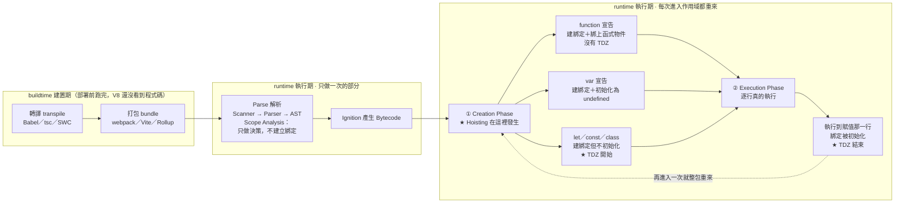

# Hoisting：函式宣告 vs 函式表達式（TDZ）、arguments 隱式綁定與 toFixed 比較陷阱

> [!info]- 📍 承接08，銜接10
> <mark style="background: #ADCCFFA6;">承接</mark>：[[08-函式呼叫核心機制-Execution-Context-與-Parameter-Binding]]提到Creation Phase會先做Hoisting——先把`var`／`function`宣告在環境記錄裡佔好位置，這篇專門講這件事跟TDZ的關係。
> <mark style="background: #BBFABBA6;">下一步</mark>：Creation Phase除了Hoisting，接著會用傳入的引數初始化參數位置，下一篇[[10-傳值vs傳址-賦值與記憶體空間]]講這一步真正發生的事。

> 此對話標題被自動命名為「閉包」，但實際內容是 Hoisting／TDZ 與折扣計算，故依實質內容歸檔。

---

## 5W1H 速查：讀本篇之前先把座標定好

> [!important]+ 最常被搞錯的一題先講：<mark style="background: #FF5582A6;">`let`／`const` **也會**被 hoist，不是「不會提升」</mark>
> 三種宣告全部都會在進入作用域時被提升，差別只在<mark style="background: #FFF3A3A6;">「提升的同時有沒有被初始化」</mark>：`function` 連名帶身體一起就緒、`var` 被初始化成 `undefined`、`let`／`const` 則<mark style="background: #FF5582A6;">只建綁定、故意不初始化</mark>——那段「已經佔好位置卻還不能碰」的空窗期就是 TDZ。所以 TDZ 恰恰是提升的**證據**，不是沒提升的證據。
> 順帶更正另一個常見的座標錯誤：本篇說的「執行前的編譯階段」指的是<mark style="background: #ADCCFFA6;">執行期的 Creation Phase</mark>，每次進入作用域都重做一次，不是 buildtime 的轉譯打包，也不是每個函式只做一次的 Parse。

| 5W1H | 問題 | 一句話答案 |
|---|---|---|
| **What** 是什麼 | Hoisting 到底是什麼？TDZ 又是什麼？ | Hoisting 是「進入一個作用域時，引擎先把裡面所有宣告在 Environment Record 裡建好綁定」；<mark style="background: #FF5582A6;">沒有任何一行程式碼被搬動</mark>。TDZ 是「綁定已建好、但還沒被初始化」的那段空窗期 |
| **When** 什麼時候 | 提升發生在哪一格？ | <mark style="background: #FF5582A6;">執行期的 Creation Phase</mark>，而且<mark style="background: #BBFABBA6;">每次進入該作用域都重做一次</mark>——函式呼叫十次就 hoist 十次。不是 buildtime，也不是只做一次的 Parse |
| **Who** 誰做的 | 是誰把綁定建起來的？ | JS 引擎（V8）。規格上依作用域種類分別叫 `GlobalDeclarationInstantiation`（全域）、`FunctionDeclarationInstantiation`（函式）、`BlockDeclarationInstantiation`（區塊） |
| **Where** 在哪裡 | 提升出來的綁定住在哪？ | 該作用域的 Environment Record 裡。沒被閉包捕獲 → **Stack Frame／CPU 暫存器**；被捕獲 → **Heap 上的 Context 物件**。函式宣告提升時一併建好的函式物件本身一定在 Heap |
| **Which** 哪一種 | 哪一種宣告享有哪種待遇？ | a. `function` 宣告：建綁定＋<mark style="background: #BBFABBA6;">直接綁上完整函式物件</mark>，所以能先呼叫；b. `var`：建綁定＋初始化為 `undefined`；c. `let`／`const`／`class`：<mark style="background: #FF5582A6;">建綁定但不初始化</mark>，進入 TDZ |
| **How** 怎麼做到 | 一次完整流程長怎樣？ | 進入作用域 → Creation Phase 掃出這個作用域的所有宣告 → 依上面三種待遇建立綁定 → Execution Phase 逐行跑 → 跑到 `const foo = …` 那一行才做初始化，<mark style="background: #BBFABBA6;">TDZ 在這一刻結束</mark> |
| **Why** 為什麼 | 為什麼函式宣告免疫、`let`／`const` 不免疫？ | 函式宣告要支援「先呼叫、後定義」與互相遞迴，所以連身體一起就緒；`let`／`const` 則是<mark style="background: #FFF3A3A6;">刻意保留 TDZ</mark>，把「用在宣告之前」從 `var` 那種安靜的 `undefined` 升級成大聲的 `ReferenceError` |

### 時間軸：這件事發生在哪一格

```text
◄──────────── buildtime 建置期 ────────────►◄──────── runtime 執行期 ────────────►
        （你的電腦／CI，部署前就跑完）              （瀏覽器或 Node 載入腳本之後）

 ①轉譯          ②打包            ③Parse          ④Bytecode      ⑤每次進入作用域
 transpile      bundle           解析             產生            都重來一次
 ┌────────┐   ┌────────┐      ┌──────────┐   ┌──────────┐   ┌──────────────────┐
 │Babel   │   │webpack │      │Scanner   │   │Ignition  │   │ Creation Phase   │
 │tsc     │──►│Vite    │─────►│Parser    │──►│把 AST 編成│──►│ ★ 這裡才是        │
 │SWC     │   │Rollup  │      │AST       │   │Bytecode  │   │   Hoisting 本人   │
 └────────┘   └────────┘      │Scope     │   └──────────┘   │ ★ function 連身體  │
                              │Analysis： │                  │ ★ var → undefined │
                              │知道有哪些 │                  │ ★ let／const 不初  │
                              │宣告、誰被 │                  │   始化 → 進 TDZ    │
                              │閉包捕獲   │                  ├──────────────────┤
                              └──────────┘                  │ Execution Phase  │
                              每個函式只做一次                │ 逐行跑，跑到賦值   │
                              只做「決策」，                  │ 那行 → TDZ 結束    │
                              不建立任何綁定                  └────────┬─────────┘
                                                                      │
                                                                      └─► 再呼叫一次
                                                                          整包重來

 ★ Hoisting 站在第 ⑤ 格，不是第 ③ 格。程式碼從頭到尾沒有被搬動過一個字元。
```

TDZ 自己也有一條更細的階段序列（就是一個綁定的一生）：

```text
  進入作用域                                    執行到宣告那一行
      │                                                │
      ▼                                                ▼
  ┌──────────┐        ┌──────────────────┐        ┌──────────┐
  │ ①宣告     │───────►│  ②尚未初始化      │───────►│ ③初始化   │──► ④之後可重新賦值
  │ declare   │        │  ★ TDZ 死區 ★    │        │initialize│    （const 不行）
  │ 佔好位置  │        │  碰它就           │        │ 綁定拿到 │
  └──────────┘        │  ReferenceError  │        │ 第一個值 │
                      └──────────────────┘        └──────────┘

  function foo(){}      沒有 ②這一格 → 從①直接跳到③，所以隨處可呼叫
  var x                 ②被自動填成 undefined → 讀得到，但讀到 undefined
  let／const x          ②真的空著 → 這段就是 TDZ
```

同一件事用 Mermaid 再畫一次：



> [!warning]- 為什麼「提升 hoisting」這個詞本身就在誤導人？四個原因
> a. <mark style="background: #FFF3A3A6;">「提升」是個比喻，不是實作</mark>：規格裡從來沒有「把宣告搬到頂端」這個步驟，只有「在 Environment Record 裡先建立綁定」。是早期教材為了好懂才畫成「程式碼往上飛」，結果比喻活得比事實還久。
> b. <mark style="background: #ADCCFFA6;">「編譯階段」四個字被兩邊共用</mark>：本篇說的「執行前的編譯階段」是<mark style="background: #BBFABBA6;">執行期的 Creation Phase</mark>（每次進入作用域都做），不是 buildtime 的轉譯 transpile，也不是 V8 只做一次的 Parse。
> c. <mark style="background: #FF5582A6;">TDZ 的錯誤訊息長得像「不存在」</mark>：`Cannot access 'x' before initialization` 常被讀成「x 還沒生出來」。其實它已經生出來了——正因為它存在，引擎才知道要丟這個錯，而不是丟「x is not defined」。這兩個錯誤訊息的分界見 [[15-ReferenceError-vs-undefined-值與錯誤的分界]]。
> d. <mark style="background: #D2B3FFA6;">「hoisting」跟「instantiation」不是二選一，是同一件事的兩個名字</mark>（2026-09-28 補充）：規格裡**根本沒有 hoisting 這個詞**，只有上面 Who 那格列的 `FunctionDeclarationInstantiation` 這個實際被執行的步驟。hoisting 是教材給「這個步驟造成的可觀察現象」取的俗稱。所以那張時間軸的第 ⑤ 格，<mark style="background: #BBFABBA6;">規範名叫 instantiation（實例化），俗稱叫 hoisting（提升），指的是同一格</mark>——問「這是 hoisting 還是 instantiation」就像問「這是台北 101 還是 Taipei 101」。要精確溝通（寫文章、答面試的深度題）講 instantiation，要跟人快速對齊講 hoisting。

### 一句話驗證法

想確認某件事在哪一格，問自己：<mark style="background: #BBFABBA6;">「這件事對同一個函式做幾次？」</mark>

1. 只做一次 → 屬於 Parse／編譯期（第 ③ ④ 格）

2. 呼叫幾次就做幾次 → 屬於執行期（第 ⑤ 格）

Hoisting 顯然是後者：同一個函式被呼叫三次，裡面的 `var` 就被重新提升並重新初始化成 `undefined` 三次，三組綁定互不相干。

### 函式宣告為什麼免疫於 TDZ？
JS 引擎在執行前有「編譯階段」。看到 <mark style="background: #ADCCFFA6;">函式宣告</mark> `function foo(){}` 時，會把<mark style="background: #FFF3A3A6;">「名稱＋整個函式內容」一起提升到範疇頂端</mark>，所以在實際第一行之前就能呼叫，沒有死區。

```javascript
processProducts();              // ✅ 可以，提早呼叫沒問題
function processProducts(){ console.log("成功執行！"); }
```

### 什麼時候才會遇到 TDZ？
把函式放進 `let` / `const`（<mark style="background: #ADCCFFA6;">函式表達式</mark>）時，編譯階段<mark style="background: #FF5582A6;">只提升變數名稱、不初始化</mark>。從提升到執行到賦值那行之間就是 <mark style="background: #FF5582A6;">TDZ（暫時性死區）</mark>，在死區內呼叫直接報錯。

```javascript
processProducts();   // ❌ ReferenceError: Cannot access ... before initialization
const processProducts = function(){ console.log("我想執行..."); };
```

> [!note] 記憶法
> `function foo(){}`（宣告）：連名帶身體一起提升，<mark style="background: #BBFABBA6;">沒有 TDZ，隨處可用</mark>。
> `const foo = function(){}`（表達式）：變數雖提升但賦值前都在 TDZ，提早呼叫直接死。

#### 提早使用的四種結果：到底丟哪一個錯（2026-09-28 實測補充）

> [!warning]+ 先更正一個很常見的記錯
> 很多人（包括我自己複習時）會記成「`const foo = function(){}` 提早呼叫會得到 <mark style="background: #FF5582A6;">`foo is not a function`</mark>」。
> <mark style="background: #BBFABBA6;">這是錯的。</mark>`foo is not a function` 是 **`TypeError`**，而且<mark style="background: #FFF3A3A6;">只有 `var` 的函式表達式、而且是「呼叫」它的時候</mark>才會出現。`const`／`let` 一律是 `ReferenceError`。

以下四種全部實測過（Node v22.22.2，2026-09-28）：

| 寫法 | 提早做的事 | 實際結果 | 為什麼 |
| --- | --- | --- | --- |
| `function foo(){}` | `foo()` | <mark style="background: #BBFABBA6;">正常執行</mark> | 綁定建立時就直接綁上函式物件，沒有 ② 那一格 |
| `var foo = function(){}` | `console.log(foo)` | `undefined`，<mark style="background: #FFF3A3A6;">不報錯</mark> | 綁定被自動初始化成 `undefined`，讀得到，只是值不是函式 |
| `var foo = function(){}` | `foo()` | <mark style="background: #FFB86CA6;">`TypeError: foo is not a function`</mark> | 讀到的是 `undefined`，`undefined()` 不能呼叫。<mark style="background: #ADCCFFA6;">錯在「值的型別」，不是「名字找不到」</mark> |
| `const`／`let foo = function(){}` | `console.log(foo)` **或** `foo()` | <mark style="background: #FF5582A6;">`ReferenceError: Cannot access 'foo' before initialization`</mark> | 綁定存在但沒初始化，<mark style="background: #FF5582A6;">連讀都不准</mark>，所以 log 跟呼叫得到同一個錯 |

白話講這張表的分界：`var` 的綁定**有值**（是 `undefined`），所以「讀」沒問題，「當函式用」才爆；`const`／`let` 的綁定**連值都還沒有**，所以在 TDZ 裡連讀都會被擋下來。

> [!tip] 兩個錯誤名稱的記憶法
> <mark style="background: #FF5582A6;">`ReferenceError`</mark> ＝ 名字這一關就過不了（找不到，或找到了但不准碰）。
> <mark style="background: #FFB86CA6;">`TypeError`</mark> ＝ 名字過關了，拿到值了，但<mark style="background: #ADCCFFA6;">那個值的型別不支援你要做的事</mark>。
> 詳細分界見 [[15-ReferenceError-vs-undefined-值與錯誤的分界]]。

#### 「函式表達式不會提升」也是錯的說法

同一個坑的另一面。正確的講法是<mark style="background: #BBFABBA6;">「綁定有提升，但函式物件還沒被建立」</mark>——`foo` 這個名字在進入作用域時就已經登記在 Environment Record 裡了（不然引擎怎麼知道要丟 TDZ 的錯而不是 `foo is not defined`），只是右邊那個 `function(){}` 要等執行到那一行才會真的做出函式物件並賦值。

用 [[16-綁定生命週期-宣告-初始化-賦值三階段與形式參數]] 的三階段講最清楚：

| 寫法 | ①宣告（登記名字） | ②初始化（拿到第一個值） | ③賦值（拿到函式物件） |
| --- | --- | --- | --- |
| `function foo(){}` | 進入作用域時 | <mark style="background: #BBFABBA6;">同時，直接拿到函式物件</mark> | 不需要，①②③合成一步 |
| `var foo = fn` | 進入作用域時 | 同時，拿到 `undefined` | 執行到那一行 |
| `const foo = fn` | 進入作用域時 | <mark style="background: #FF5582A6;">執行到那一行才做</mark>（①和②中間的空窗＝TDZ） | 與②同一刻 |

<mark style="background: #FFF3A3A6;">三種寫法的「①宣告」全部發生在同一格，差別只在②往後挪多遠。</mark>所以說「不會提升」會讓人以為那一格是空的，實際上三種都有做。

---

### `arguments`：每個非箭頭函式被呼叫時，引擎自動塞進來的隱式綁定（2026-09-28 補充）

這個知識點放在本篇，是因為 <mark style="background: #BBFABBA6;">`arguments` 綁定的建立跟 hoisting 發生在**同一格**</mark>——都在 `FunctionDeclarationInstantiation` 這一步，也就是時間軸的第 ⑤ 格。它跟 `var` 一樣是「你沒寫，但引擎幫你建好的綁定」。

a. <mark style="background: #FF5582A6;">`arguments` 不是保留字（Reserved Word），是一個隱式區域變數／識別碼（Identifier）。</mark>
　保留字是 parser 層級就禁止拿來當名字的（`if`、`return`、`class` 那些）。`arguments` 不是，它只是引擎在每次呼叫非箭頭函式時，順手在該函式作用域裡建立的一個綁定。

b. 驗證方法：<mark style="background: #BBFABBA6;">如果它是保留字，你連寫 `var arguments` 都會 SyntaxError；但非嚴格模式下這是合法的。</mark>

```javascript
// 非嚴格模式：合法，你可以蓋掉它 —— 證明它只是一個普通的識別碼
(function () { var arguments = 99; return arguments })()   // → 99

// 嚴格模式：SyntaxError: Unexpected eval or arguments in strict mode
```

　白話講這兩行：非嚴格模式下 `var arguments = 99` 把引擎建好的那個綁定**重新賦值**成數字 99，完全不報錯。嚴格模式下 ES5 額外加了一條限制，禁止把 `arguments` 與 `eval` 當作綁定名稱或賦值目標——<mark style="background: #FFF3A3A6;">但那是嚴格模式的「早期錯誤 Early Error」規則，不是因為它升格成保留字了</mark>。

c. <mark style="background: #ADCCFFA6;">它是類陣列物件（Array-like Object），不是真正的 Array。</mark>實測：

```javascript
function f() {
  return {
    length: arguments.length,                              // 3
    索引存取: arguments[1],                                 // 'b'
    有沒有map: typeof arguments.map,                        // 'undefined'
    有沒有push: typeof arguments.push,                      // 'undefined'
    toString: Object.prototype.toString.call(arguments),    // '[object Arguments]'
    是Array嗎: Array.isArray(arguments),                    // false
    可迭代嗎: typeof arguments[Symbol.iterator],            // 'function'  ← 注意這個
  }
}
f('a', 'b', 'c')
```

　白話講這段：`Object.prototype.toString.call(arguments)` 是判斷內建型別最可靠的方法，它回傳 `[object Arguments]` 而不是 `[object Array]`，直接證明這是一個**自己的型別**，不是陣列。

| | `arguments` | 真陣列 `Array` |
| --- | --- | --- |
| `length` 屬性 | <mark style="background: #BBFABBA6;">有</mark> | 有 |
| 中括號索引存取 `arguments[0]` | <mark style="background: #BBFABBA6;">可以</mark> | 可以 |
| `push`／`slice`／`forEach`／`map` | <mark style="background: #FF5582A6;">沒有</mark> | 有 |
| `Array.isArray()` | `false` | `true` |
| `Object.prototype.toString` | `[object Arguments]` | `[object Array]` |
| `Symbol.iterator` | <mark style="background: #D2B3FFA6;">有（ES6 後加的）</mark> | 有 |

d. <mark style="background: #D2B3FFA6;">上表最後一列是多數教材漏掉的：`arguments` 在 ES6 之後是可迭代的</mark>，所以 `for...of` 跟展開語法都能用，轉成真陣列不必再寫 `Array.prototype.slice.call(arguments)` 那種老寫法：

```javascript
function f() {
  const 真陣列 = [...arguments]        // ✅ 展開語法，最短
  // const 真陣列 = Array.from(arguments)              // ✅ 也可以
  // const 真陣列 = Array.prototype.slice.call(arguments)  // 老寫法，ES5 時代才需要
  return 真陣列.map(x => x * 2)
}
```

　白話講：`[...arguments]` 利用 `Symbol.iterator` 把每個元素逐一取出來放進一個**新的真陣列字面量**裡，之後就能直接 `.map()`。

e. <mark style="background: #FFF3A3A6;">形式參數（Formal Parameter）與 `arguments` 不是二選一，它們同時存在、而且會重疊。</mark>以 MDN 的 `myConcat` 為例：

```javascript
function myConcat(separator) {
  let result = ''
  for (let i = 1; i < arguments.length; i++) {      // ← 注意是從 1 開始
    result += arguments[i] + (i < arguments.length - 1 ? separator : '')
  }
  return result
}

myConcat(', ', 'red', 'orange', 'blue')   // → 'red, orange, blue'
```

| | 值 | 說明 |
| --- | --- | --- |
| `separator` | `', '` | 具名形式參數，佔用第一個實參當佔位符 |
| `arguments[0]` | `', '` | <mark style="background: #FFB86CA6;">跟 `separator` 是同一個實參</mark>，不是另一個 |
| `arguments[1]` | `'red'` | |
| `arguments[2]` | `'orange'` | |
| `arguments[3]` | `'blue'` | |
| `arguments.length` | `4` | <mark style="background: #FF5582A6;">實參個數，不是形參個數</mark>（形參只有 1 個） |

　<mark style="background: #BBFABBA6;">迴圈從 `i = 1` 開始，正是因為索引 0 那一格已經被 `separator` 拿去當分隔符了</mark>，再拼一次會多出來。

f. MDN 舉這個例子的目的是示範：<mark style="background: #FFF3A3A6;">函式定義時只宣告一個形參，呼叫時仍可帶入任意數量的實參，而那些「沒寫在形參清單裡」的實參只能透過 `arguments` 拿到。</mark>

g. <mark style="background: #FF5582A6;">但現在不該這樣寫</mark>。rest 參數（`...args`）在每個面向都比 `arguments` 好，而且箭頭函式能用：

```javascript
const myConcat = (separator, ...items) => items.join(separator)
myConcat(', ', 'red', 'orange', 'blue')   // → 'red, orange, blue'
```

　白話講：`...items` 把**第一個之後的所有實參**收集成一個真陣列，所以連迴圈都不用寫，直接 `.join(separator)`。`arguments` 現在的價值只剩「讀得懂舊程式碼」。

h. <mark style="background: #ADCCFFA6;">箭頭函式完全沒有這個綁定</mark>，它在 `FunctionDeclarationInstantiation` 那一步就被跳過了，原因是箭頭函式的內部欄位 `[[ThisMode]]` 是 `lexical`，同一個判斷同時關掉了 `this` 與 `arguments`。細節見 [[箭頭函式的兩組括號-參數小括弧與主體大括弧-隱式回傳]] §7 與 [[JavaScript-函式類型總整理]]。

> [!tip] 面試怎麼答「arguments 是什麼」
> 三句話：<mark style="background: #BBFABBA6;">a. 它是引擎在每次呼叫非箭頭函式時自動建立的隱式綁定，不是保留字，非嚴格模式下甚至可以蓋掉它。</mark>
> b. 它是類陣列物件，有 `length`、能用索引、ES6 後也可迭代，<mark style="background: #FF5582A6;">但沒有任何 Array 原型方法</mark>。
> c. 現在應該用 rest 參數取代它，`arguments` 只剩讀舊碼時會遇到。

> [!tip] 跟參數初始化的對比
> 這裡的「只提升名稱、不初始化」可以直接拿來對照 [[13-閉包-Closure-私有變數與傳址陷阱]]（以及 [[08-函式呼叫核心機制-Execution-Context-與-Parameter-Binding]] (c)）講的函式參數綁定：兩者都發生在 Creation Phase，差別只在「初始化」這一步有沒有被延後——`let`/`const` 是**先佔位、故意不給值**（TDZ 就是這段空窗期）；函式參數是**佔位的同一時間就被呼叫時傳入的引數值初始化**，沒有空窗期，所以參數名稱從來不會有 TDZ 問題。

### 補充：折扣計算與 `toFixed` 比較陷阱
- 兩種折扣寫法數學等價：`price - price*discount/100` 與 `price*(1 - discount/100)`（discount=30、price=100 都得 70）。
- <mark style="background: #FF5582A6;">陷阱</mark>：`.toFixed(2)` 會把數字轉成<mark style="background: #FFB8EBA6;">字串</mark>，之後若直接拿去和數字（如 `> 80`）比較，會因字串 vs 數字而產生意外結果。比較前要先 `Number(...)` 轉回數字。

### 補充：匯出 / 搬移 AI 對話（對話原文含此實用資訊）
- <mark style="background: #BBFABBA6;">ChatGPT</mark>：設定 → 資料控制 → 匯出資料，幾分鐘後寄到信箱（連結 24 小時有效），解壓有 `chat.html` 與 `conversations.json`。
- <mark style="background: #BBFABBA6;">Gemini</mark>：單一對話用「分享與匯出」可存到 Google 文件／Gmail 草稿；完整歷史要用 <mark style="background: #ADCCFFA6;">Google Takeout</mark> →「取消全選」→ 找「我的活動 My Activity」勾「Gemini Apps」→ 建立匯出。
- 搬家建議：與其丟整坨 JSON（雜訊多），不如請 AI 把「記憶／偏好」整理成 Markdown 清單，貼到新 AI 的自訂指令，理解效率最高。

## 各對話來源

### JavaScript 閉包的重要性（實為 Hoisting/TDZ 與折扣計算 + AI 匯出）（2026-06）— https://gemini.google.com/app/a8283484f401c280

使用者：（看程式碼）finalPrice 先乘折扣再 toFixed，filter 又拿字串和 80 比？

Gemini：`processProducts` 算 finalPrice 時先乘 `(1 - totalDiscount/100)`，第 54 行 `.toFixed(2)` 轉成字串，第 58 行 `.filter` 拿字串與數字 80 比可能有意外結果，比較前應轉回數字。

使用者：黑底與白底畫面的算法差在哪？

Gemini：黑底 `price - price*discount/100`、白底 `price*(1 + ...)`，數學上等價（discount=30、price=100 皆得 70），只是不同表達方式。

使用者：直接 `function processProducts` 不會有 TDZ／暫時性死區嗎？

Gemini：不會。函式宣告在編譯階段「連名帶身體」提升到範疇頂端，提早呼叫也沒問題；只有 `const/let` 的函式表達式才有 TDZ（只提升變數名、不初始化，賦值前呼叫報錯）。記憶法如上。

使用者：要怎麼把 ChatGPT 的記憶/對話全部匯出到其他 AI？

Gemini：沒有一鍵同步。ChatGPT：設定→資料控制→匯出資料（寄信、含 chat.html 與 conversations.json）。搬家建議提煉「記憶/偏好」成 Markdown 貼到新 AI 自訂指令，比丟整坨 JSON 好。

使用者：Gemini 有匯出對話功能嗎？（並請協助記錄今天 1 點後做的事）

Gemini：單一對話可「分享與匯出」到 Docs/Gmail 草稿；完整歷史用 Google Takeout →取消全選→「我的活動」勾「Gemini Apps」→建立匯出。並提供把系統變更紀錄整理成文字、以及 Google 行事曆「一鍵加入」連結／手動欄位（活動 13:00–14:00）。

---

> [!info]- ➡️ 下一篇
> [[10-傳值vs傳址-賦值與記憶體空間]]——Creation Phase參數初始化這一步，傳值/傳址真正發生的時間點。
