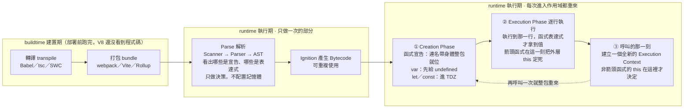

# JavaScript 函式類型總整理

> 來源為 ChatGPT 分享對話，Abby 指定的複習重點之一。

---

## 5W1H 速查：讀本篇之前先把座標定好

> [!important]+ 最常被搞錯的一件事：<mark style="background: #FF5582A6;">「函式表達式不會 hoisting」這句話少講了半句</mark>
> 完整版是：<mark style="background: #BBFABBA6;">**變數綁定本身還是被 hoist 了，沒被 hoist 的是「值」**</mark>。
> a. `var foo = function () {}`：`foo` 在 Creation Phase 就已經存在、值是 `undefined`，所以提前呼叫拿到的是 <mark style="background: #FFF3A3A6;">`TypeError: foo is not a function`</mark>，**不是** `ReferenceError`——它找得到名字，只是那個值不能被呼叫。
> b. `const foo = function () {}`：`foo` 同樣在 Creation Phase 就建立了，只是處在 TDZ，提前碰它才會是 <mark style="background: #FFF3A3A6;">`ReferenceError`</mark>。
> c. 而 hoisting 本身也不是「程式碼真的被搬到最上面」，更不是 buildtime 做的事——它是 <mark style="background: #FF5582A6;">runtime 執行期、每一次進入這個作用域時的 Creation Phase 重做一次</mark>的結果。

| 5W1H          | 問題              | 一句話答案                                                                                                                                                                                                 |
| ------------- | --------------- | ----------------------------------------------------------------------------------------------------------------------------------------------------------------------------------------------------- |
| **What** 是什麼  | 這篇到底在整理什麼？      | 四條互相獨立的分類軸：宣告 vs 表達式、具名 vs 匿名、箭頭 vs 非箭頭、一般 vs Generator vs Constructor。<mark style="background: #BBFABBA6;">它們各管各的，不要混在一起記</mark>                                                                     |
| **When** 什麼時候 | 這些差別在哪一格才兌現？    | 宣告／表達式的差別在 <mark style="background: #FF5582A6;">runtime 執行期、每次進入作用域的 Creation Phase</mark> 兌現；箭頭函式的 `this` 在**定義的那一刻**就跟著外層定死；非箭頭函式的 `this` 每一次呼叫重新決定一次                                               |
| **Who** 誰做的   | 是誰把函式宣告提上去的？    | JS 引擎（V8）。規格上對應 `FunctionDeclarationInstantiation`（函式內）與 `GlobalDeclarationInstantiation`（全域）。<mark style="background: #ADCCFFA6;">跟 Babel、跟打包工具都無關</mark>                                            |
| **Where** 在哪裡 | 名字跟函式本體分別住哪？    | 名字（綁定）住在 Environment Record 裡——沒被閉包捕獲就在 **Stack Frame**，被捕獲就在 **Heap 的 Context 物件**；函式物件本身<mark style="background: #FFF3A3A6;">一律在 Heap</mark>，變數只是拿著它的位址                                             |
| **Which** 哪一種 | 哪一條軸才決定 `this`？ | <mark style="background: #BBFABBA6;">箭頭 vs 非箭頭</mark>。宣告 vs 表達式<mark style="background: #FF5582A6;">只決定 hoisting，完全不影響 `this`</mark>——這正是本篇第四節與是非題 T5 在講的事                                            |
| **How** 怎麼做到  | 怎麼一眼分辨宣告還是表達式？  | 看 `function` 這個字出現在哪個位置。<mark style="background: #ADCCFFA6;">在陳述式位置</mark>（行首、可以自己獨立成一句）→ 函式宣告，連名帶身體整包被 hoist；<mark style="background: #ADCCFFA6;">在表達式位置</mark>（`=` 右邊、當引數、包在括號裡）→ 函式表達式，只有變數被 hoist |
| **Why** 為什麼   | 為什麼要分這麼細？       | 因為這幾條軸各自決定一個會真的咬人的行為：a. 能不能提前呼叫；b. 出事時報 `TypeError` 還是 `ReferenceError`；c. `this` 是誰；d. 能不能被 `new`、能不能 `yield`                                                                                        |

### 時間軸：這件事發生在哪一格

```text
◄──────────── buildtime 建置期 ────────────►◄──────── runtime 執行期 ────────────►
        （你的電腦／CI，部署前就跑完）              （瀏覽器或 Node 載入腳本之後）

 ①轉譯          ②打包            ③Parse          ④Bytecode      ⑤每次進入作用域都重來
 transpile      bundle           解析             產生            ↓↓↓↓↓↓↓↓↓↓
 ┌────────┐   ┌────────┐     ┌───────────┐   ┌──────────┐   ┌────────────────────┐
 │Babel   │   │webpack │     │Scanner    │   │Ignition  │   │ Creation Phase      │
 │tsc     │──►│Vite    │────►│Parser     │──►│把 AST 編成│──►│ ★ 函式宣告：連名帶  │
 │SWC     │   │Rollup  │     │AST        │   │Bytecode  │   │   身體整包就位      │
 │        │   │合併壓縮│     │Scope      │   │          │   │ ★ var：先給 undefined│
 └────────┘   └────────┘     │Analysis   │   └──────────┘   │ ★ let／const：進 TDZ │
                             └───────────┘                  ├────────────────────┤
                             每個函式只做一次                 │ Execution Phase     │
                             只做「決策」，不配置記憶體         │ ★ 執行到那一行，函式 │
                                                             │   表達式的值才進去   │
                                                             └────────────────────┘

 ★ hoisting 站在第 ⑤ 格，不是第 ①② 格，也不是第 ③ 格。
   Parse 在第 ③ 格只是「看到」有哪些宣告，真正在 RAM 裡建綁定是第 ⑤ 格的事。
```

再看同一段程式碼在一次「進入作用域」裡的三個時刻：

```text
 進入作用域
     │
     ├─► ① Creation Phase（還沒執行任何一行）
     │      ┌────────────────────────────────────────────┐
     │      │ function decl(){}   → decl  ＝ 完整函式物件  │ ← 現在呼叫就能跑
     │      │ var expr = fn       → expr  ＝ undefined     │ ← 現在呼叫 TypeError
     │      │ const arrow = fn    → arrow ＝ TDZ           │ ← 現在碰它 ReferenceError
     │      └────────────────────────────────────────────┘
     │
     ├─► ② Execution Phase（逐行往下跑）
     │      執行到 var expr = function () {}   這一行 → expr 這時候才拿到值
     │      執行到 const arrow = () => {}      這一行 → 離開 TDZ，同時把外層 this 定死
     │
     └─► ③ 呼叫的那一刻（decl() ／ expr() ／ arrow()）
            每呼叫一次，就重新建立一個全新的 Execution Context
            非箭頭函式的 this 在這一刻依「誰點它」決定
            箭頭函式不管誰點它，用的都是 ② 那一刻繼承下來的 this
```



> [!warning]- 三個一起記會出錯的搭配，先在這裡拆開
> a. <mark style="background: #FFF3A3A6;">「匿名」不是一條可以自由組合的軸</mark>：函式宣告的 `function` 後面**一定**要有名字，`function () {}` 單獨寫直接 SyntaxError。所以「匿名函式宣告」這個組合根本不存在，匿名只能長在函式表達式上。
> b. <mark style="background: #ADCCFFA6;">箭頭函式沒有自己的 `this`，也沒有自己的 `arguments`</mark>，而且不能被 `new`。它連 `this` 的綁定槽都沒有，所以 `call`／`apply`／`bind` 對它是無效的。
> c. <mark style="background: #BBFABBA6;">Generator 的 `*` 只改「怎麼被呼叫、回傳什麼」</mark>：`gen()` 不會執行任何一行函式本體，只回傳一個 iterator；第一次 `.next()` 才真的開始跑到第一個 `yield`。它跟 hoisting、跟 `this` 那兩條軸互不干涉。


## 重點整理

### 一、最關鍵的一條軸：宣告 vs 表達式（2026-09-28 全面改寫）

> [!important]+ 先把三個很容易混在一起的名詞釘死
> 這一節之所以難，是因為<mark style="background: #FF5582A6;">「實例化 instantiation」「初始化 initialization」「賦值 assignment」被當成同義詞在用</mark>，其實它們在規範裡是**一個容器裝著兩個動作**的關係。

#### 1-1 三個名詞的層級關係：instantiation 包含 initialization，不是同義詞

| 名詞 | 規範裡的對應 | 層級 | 一句話 |
| --- | --- | --- | --- |
| **實例化 instantiation** | `FunctionDeclarationInstantiation`（函式內）<br>`GlobalDeclarationInstantiation`（全域）<br>`BlockDeclarationInstantiation`（區塊） | <mark style="background: #D2B3FFA6;">整個流程（容器）</mark> | 進入一個作用域時，**把這個作用域裡所有名字一次整批安頓好**的那個步驟 |
| **① 建立綁定 declare** | `CreateMutableBinding`<br>`CreateImmutableBinding` | 流程裡的一個動作 | 在 Environment Record 裡**登記這個名字**，但還沒有值 |
| **② 初始化 initialization** | `InitializeBinding` | 流程裡的一個動作 | 讓某一個綁定**拿到它的第一個值** |
| **③ 賦值 assignment** | `SetMutableBinding` | 已經不在那個流程裡了 | 後來**改掉**已經有值的綁定 |

　白話講這張表：<mark style="background: #BBFABBA6;">instantiation 是「整場開學典禮」，initialization 是「幫某一個學生把課本發下去」。</mark>一場典禮裡會發很多次課本，也可以刻意跳過某幾個學生不發（那就是 TDZ）。所以問「是沒被初始化還是沒被實例化」，答案是——

> [!tip]+ <mark style="background: #FFF3A3A6;">函式物件還沒被建立，算「沒被初始化」，不算「沒被實例化」</mark>
> 實例化（instantiation）<mark style="background: #BBFABBA6;">已經做完了</mark>——進入作用域時那一整批流程早就跑完，`foo` 這個名字已經被 `CreateImmutableBinding` 登記進 Environment Record 了。
> 它只是在那個流程裡<mark style="background: #FF5582A6;">被刻意跳過了 `InitializeBinding` 這一步</mark>。
> **TDZ 的定義就是「實例化做完了、初始化還沒做」的那段空窗。**

#### 1-2 每一步發生在哪一個 Phase

這是最常被搞混的一格。答案是：

| 步驟 | 函式宣告 `function foo(){}` | `var foo = fn` | `let`／`const foo = fn` |
| --- | --- | --- | --- |
| ① 建立綁定 | <mark style="background: #BBFABBA6;">Creation Phase</mark> | <mark style="background: #BBFABBA6;">Creation Phase</mark> | <mark style="background: #BBFABBA6;">Creation Phase</mark> |
| ② 初始化（拿到第一個值） | <mark style="background: #BBFABBA6;">Creation Phase</mark>，值＝**完整的函式物件** | <mark style="background: #BBFABBA6;">Creation Phase</mark>，值＝`undefined` | <mark style="background: #FF5582A6;">Execution Phase</mark>，跑到那一行才做 |
| ①②之間有沒有空窗 | 沒有 | 沒有 | <mark style="background: #FF5582A6;">有，這段就是 TDZ</mark> |
| ③ 賦值 | <mark style="background: #ADCCFFA6;">不需要，①②就結束了</mark> | Execution Phase，跑到那一行 | <mark style="background: #ADCCFFA6;">不需要，②就是拿到函式物件的那一刻</mark> |

三個必須記住的結論：

a. <mark style="background: #FF5582A6;">「函式物件在哪個 Phase 被做出來」才是宣告與表達式的真正分界</mark>
　- 函式**宣告**的函式物件在 <mark style="background: #BBFABBA6;">Creation Phase</mark> 就被建立（規範的 `InstantiateFunctionObject`），所以提前呼叫沒問題。
　- 函式**表達式**右邊那個 `function(){}` 是一個**表達式**，而<mark style="background: #FFF3A3A6;">表達式只在 Execution Phase 逐行執行時才會被求值</mark>。Creation Phase 只建綁定，不求值任何 `=` 右邊的東西。

b. <mark style="background: #ADCCFFA6;">賦值不屬於 instantiation</mark>
　instantiation 在 Creation Phase 就整批結束了。`var foo = fn` 的賦值發生在 Execution Phase，那時 instantiation 早就收工。所以「要到賦值才算完成 instantiation」是錯的。

c. <mark style="background: #BBFABBA6;">函式宣告只有①②，沒有③</mark>
　它是一連串行雲流水沒錯，但那串是「①建立綁定 → ②初始化成函式物件」，兩步都在 Creation Phase，中間不換格，也沒有第三步在等。

#### 1-3 `var` 的函式表達式：進入作用域同時就初始化了嗎

<mark style="background: #BBFABBA6;">會，而且值就是 `undefined`。</mark>規範在 `FunctionDeclarationInstantiation` 裡對每個 `var` 名字明確做了 `InitializeBinding(名字, undefined)`。

所以 `var` 的綁定在 Creation Phase 結束時是「**已宣告、已初始化、還沒賦值**」——三個階段走完了兩個。

實測驗證（Node v22.22.2，2026-09-28）：

```javascript
(function () {
  console.log(typeof foo)   // 'undefined'，不報錯
  console.log(foo)          // undefined，不報錯
  var foo = function () {}
})()
```

　白話講：`typeof foo` 跟 `console.log(foo)` 都拿得到值，證明綁定**存在而且有值**，只是那個值是 `undefined`。如果它連初始化都沒做，這裡會跟 `const` 一樣丟 `ReferenceError`。

#### 1-4 <mark style="background: #D2B3FFA6;">用 `typeof` 一秒分辨三種狀態</mark>

這是分辨「沒宣告」「已初始化成 undefined」「在 TDZ」最快的方法，也是面試常考：

```javascript
typeof 從來沒出現過的名字   // 'undefined'  ← 不報錯
typeof varFoo（提前）       // 'undefined'  ← 不報錯
typeof constFoo（提前）     // ReferenceError: Cannot access 'constFoo' before initialization
```

　白話講：`typeof` 是 JS 裡唯一一個對「完全不存在的名字」也不報錯的運算子。<mark style="background: #FF5582A6;">但它擋不住 TDZ</mark>——`const`／`let` 在 TDZ 裡連 `typeof` 都會爆。
　<mark style="background: #FFF3A3A6;">這正好反證了 TDZ 不是「不存在」</mark>：如果 `constFoo` 真的不存在，`typeof` 應該安靜地回 `'undefined'` 才對。

#### 1-5 四種寫法的完整對照

| 類型 | 語法 | ①建立綁定 | ②初始化 | 提前使用的結果 | 可否匿名 |
| --- | --- | --- | --- | --- | --- |
| 函式宣告 | `function foo(){}` | Creation | <mark style="background: #BBFABBA6;">Creation，函式物件</mark> | <mark style="background: #BBFABBA6;">正常執行</mark> | ==❌ 一定要有名字== |
| 函式表達式（`var`） | `var foo = function(){}` | Creation | <mark style="background: #FFF3A3A6;">Creation，`undefined`</mark> | 讀 → `undefined`（不報錯）<br>呼叫 → <mark style="background: #FFB86CA6;">`TypeError: foo is not a function`</mark> | ✅ |
| 函式表達式（`let`／`const`） | `const foo = function(){}` | Creation | <mark style="background: #FF5582A6;">Execution，跑到那行</mark> | 讀、`typeof`、呼叫<mark style="background: #FF5582A6;">全部 `ReferenceError`</mark> | ✅ |
| 箭頭函式 | `const foo = () => {}` | Creation | <mark style="background: #FF5582A6;">Execution，跑到那行</mark> | 同上，`ReferenceError` | ✅（一定匿名） |

> [!warning]+ 兩個錯誤名稱的分界
> <mark style="background: #FF5582A6;">`ReferenceError`</mark> ＝ <mark style="background: #ADCCFFA6;">名字這一關就過不了</mark>（找不到，或找到了但在 TDZ 不准碰）。
> <mark style="background: #FFB86CA6;">`TypeError`</mark> ＝ 名字過關、值也拿到了，但<mark style="background: #ADCCFFA6;">那個值的型別不支援你要做的事</mark>（`undefined()` 不能呼叫）。
> 分界線在於：`var` 的綁定**有值**（是 `undefined`），所以讀沒問題、當函式用才爆；`const`／`let` 的綁定**連值都還沒有**，所以在 TDZ 裡連讀都被擋。

#### 1-6 `var` 與 `const` 的函式表達式，差在哪

| | `var foo = function(){}` | `const foo = function(){}` |
| --- | --- | --- |
| ②初始化的時機 | Creation Phase | <mark style="background: #FF5582A6;">Execution Phase</mark> |
| 有沒有 TDZ | 沒有 | <mark style="background: #FF5582A6;">有</mark> |
| 提前讀（`console.log`／`typeof`） | `undefined`，<mark style="background: #FFF3A3A6;">安靜地錯</mark> | `ReferenceError`，<mark style="background: #BBFABBA6;">大聲地錯</mark> |
| 提前呼叫 | `TypeError: foo is not a function` | `ReferenceError` |
| 能不能重新賦值 | 能 | <mark style="background: #FF5582A6;">不能</mark>（`TypeError: Assignment to constant variable`） |
| 作用域邊界 | 函式作用域（`if`／`for` 的 `{}` 關不住） | <mark style="background: #BBFABBA6;">區塊作用域</mark> |
| 在全域宣告會不會變成 `globalThis` 的屬性 | <mark style="background: #FF5582A6;">會</mark>（`globalThis.foo` 讀得到） | 不會（實測 `globalThis.foo` 是 `undefined`） |
| 同一個名字重複宣告 | 允許，後面覆蓋前面 | <mark style="background: #FF5582A6;">SyntaxError</mark> |

<mark style="background: #BBFABBA6;">設計意圖：`let`／`const` 刻意保留 TDZ，就是要把「用在宣告之前」從 `var` 那種安靜的 `undefined` 升級成大聲的 `ReferenceError`。</mark>安靜的錯會一路傳到很遠的地方才爆，大聲的錯當場就停。

#### 1-7 所以實務上該怎麼呼叫

| 寫法 | 可以在哪裡呼叫 |
| --- | --- |
| 函式宣告 `function foo(){}` | <mark style="background: #BBFABBA6;">同作用域內任何位置</mark>，包括宣告之前 |
| 函式表達式（任何關鍵字） | <mark style="background: #FF5582A6;">只能在賦值那一行之後</mark> |

```javascript
// ✅ 函式宣告：兩個位置都可以
processProducts()
function processProducts() { console.log('成功') }
processProducts()

// ❌ 函式表達式：宣告之前不行
processProducts()                                  // ReferenceError
const processProducts = function () { console.log('成功') }

// ✅ 函式表達式：一定要在下面
const processProducts2 = function () { console.log('成功') }
processProducts2()
```

> [!tip]+ 一條不用背規則的實務準則
> <mark style="background: #BBFABBA6;">不管哪一種，一律寫成「先定義、後呼叫」。</mark>
> 這樣兩種寫法行為完全一致，你就不需要在腦中維護「這個能提前呼叫、那個不行」這張表。
> 唯一真的需要用到「宣告可以提前呼叫」這個特性的場合，是<mark style="background: #ADCCFFA6;">互相遞迴的兩個函式</mark>（A 呼叫 B、B 也呼叫 A），那時函式宣告才有不可取代的價值。

- 三階段（宣告／初始化／賦值）的更細拆解見 [[16-綁定生命週期-宣告-初始化-賦值三階段與形式參數]]。
- hoisting 與 instantiation 的命名關係、`arguments` 的完整機制見 [[09-Hoisting-函式宣告vs函式表達式-TDZ]]。
- 錯誤型別的分界見 [[15-ReferenceError-vs-undefined-值與錯誤的分界]]。

### 二、具名 vs 匿名（不具名）
「具名／匿名」是形容<mark style="background: #ADCCFFA6;">「有沒有函式名稱」</mark>：

- 具名函式：`function foo(){}`、`const a = function bar(){}`
- 匿名函式：`function(){}`（沒名字）
- <mark style="background: #BBFABBA6;">「不具名」=「匿名」</mark>，只是中文翻譯不同，是同義詞。

> [!warning] 為什麼沒有「匿名函式宣告」？
> 因為<mark style="background: #FF5582A6;">函式宣告語法的 `function` 一定要有名字</mark>，`function(){}` 直接 SyntaxError。匿名只能出現在「函式表達式」。所以：具名函式宣告 ✅、匿名函式宣告 ❌、匿名函式表達式 ✅、具名函式表達式 ✅。

### 三、其他常見函式型態
- <mark style="background: #ADCCFFA6;">具名函式表達式</mark>（Named Function Expression）：`const a = function foo(){}`——名字 `foo` 只在函式內部可見，利於遞迴與除錯堆疊。
- <mark style="background: #ADCCFFA6;">Generator 函式</mark>：`function* gen(){}`，`*` 代表這是產生器函式，可用 <mark style="background: #FFF3A3A6;">`yield`</mark> 暫停/分次回傳。
  - `yield`：產出一個值並「暫停」，下次 `.next()` 從這裡繼續。
  - `return`：直接結束產生器（`done:true`）。
- <mark style="background: #ADCCFFA6;">Constructor 函式（建構式）</mark>：用 `new` 呼叫、慣例首字大寫，用來產生物件實例。
- （延伸）箭頭函式 `()=>{}`：一定匿名、不綁自己的 `this`，常作回呼。

### 三之一、`arguments`：只有非箭頭函式才自帶的隱式綁定（2026-09-28 補充）

這是「函式類型」這條軸上最容易被忽略的一個差異：<mark style="background: #FF5582A6;">同樣寫一個函式，用 `function` 寫跟用 `=>` 寫，作用域裡的東西不一樣多。</mark>

| 函式類型 | 有自己的 `arguments` 嗎 | 有自己的 `this` 嗎 | 能 `new` 嗎 | 有 `prototype` 屬性嗎 |
| --- | --- | --- | --- | --- |
| 函式宣告 `function foo(){}` | <mark style="background: #BBFABBA6;">有</mark> | 有 | 能 | 有 |
| 函式表達式 `const foo = function(){}` | <mark style="background: #BBFABBA6;">有</mark> | 有 | 能 | 有 |
| 物件的簡寫方法 `{ foo(){} }` | <mark style="background: #BBFABBA6;">有</mark> | 有 | <mark style="background: #FF5582A6;">不能</mark> | 沒有 |
| 箭頭函式 `const foo = () => {}` | <mark style="background: #FF5582A6;">沒有</mark> | <mark style="background: #FF5582A6;">沒有</mark> | 不能 | 沒有 |
| Generator `function* gen(){}` | <mark style="background: #BBFABBA6;">有</mark> | 有 | 不能 | 有 |

<mark style="background: #D2B3FFA6;">上表最右邊四欄並不是四條各自獨立的規定</mark>：箭頭函式那一列全是「沒有」，是因為它的內部欄位 `[[ThisMode]]` 是 `lexical`，而規範裡同一個判斷式同時關掉了 `this` 綁定與 `arguments` 物件。**它們在規格裡是同一個 `if` 的兩個結果。**

#### 三個必須講清楚的點

a. <mark style="background: #FF5582A6;">`arguments` 不是保留字（Reserved Word），是隱式區域變數／識別碼（Identifier）。</mark>
　每次非箭頭函式被呼叫，引擎都會在該函式作用域裡自動建立這個綁定。驗證方式是：保留字連當變數名都不行，但非嚴格模式下 `var arguments = 99` 完全合法。

```javascript
(function () { var arguments = 99; return arguments })()   // → 99，證明它只是普通識別碼
```

　白話講這行：立即執行函式裡用 `var arguments = 99` 把引擎建好的那個綁定**重新賦值**成數字，一點錯都不報。（嚴格模式下會 SyntaxError，但那是嚴格模式額外加的早期錯誤規則，不是因為它升格成保留字。）

b. <mark style="background: #ADCCFFA6;">它是類陣列物件（Array-like Object），不是真正的 Array。</mark>

| | `arguments` | 真陣列 |
| --- | --- | --- |
| `length` | 有 | 有 |
| 索引存取 `arguments[0]` | 可以 | 可以 |
| `push`／`slice`／`forEach`／`map` | <mark style="background: #FF5582A6;">沒有</mark> | 有 |
| `Array.isArray()` | `false` | `true` |
| `Object.prototype.toString` | `[object Arguments]` | `[object Array]` |
| `Symbol.iterator` | <mark style="background: #D2B3FFA6;">有（ES6 後）</mark> | 有 |

c. <mark style="background: #D2B3FFA6;">最後一列是多數教材漏掉的：ES6 之後 `arguments` 可迭代</mark>，所以轉真陣列不用再寫老寫法：

```javascript
function f() {
  const 真陣列 = [...arguments]                       // ✅ 最短
  // Array.from(arguments)                            // ✅ 也可以
  // Array.prototype.slice.call(arguments)            // ES5 時代的老寫法
  return 真陣列.map(x => x * 2)
}
```

　白話講：`[...arguments]` 透過 `Symbol.iterator` 把元素一個一個取出來，放進一個**新的真陣列**，之後才能直接 `.map()`。

d. <mark style="background: #FF5582A6;">實務上應該用 rest 參數取代它</mark>：`(...args) => {}` 拿到的是真陣列，而且箭頭函式也能用。`arguments` 現在的價值只剩「讀得懂舊程式碼」。

> 機制細節（為什麼綁定在 `FunctionDeclarationInstantiation` 那一步被建立、形式參數與 `arguments` 怎麼重疊、MDN `myConcat` 的完整拆解）寫在 [[09-Hoisting-函式宣告vs函式表達式-TDZ]]，本篇只放「哪一種函式有、哪一種沒有」這條比較軸。

### 四、箭頭函式的 `this`（事件監聽器情境）

箭頭函式<mark style="background: #FF5582A6;">不綁自己的 `this`</mark>，而是<mark style="background: #FFF3A3A6;">從外層作用域繼承</mark>過來。所以在 `addEventListener` 裡寫箭頭函式時，`this` 是「綁定事件時所在的上下文」，<mark style="background: #FF5582A6;">不是被點的按鈕本身</mark>。

> [!important] 「普通函式」是指函式宣告還是函式表達式？→ <mark style="background: #BBFABBA6;">both（兩者都是）</mark>
> 決定 `this` 的軸線是「**箭頭 vs 非箭頭**」，<mark style="background: #FF5582A6;">不是「宣告 vs 表達式」</mark>。
> - <mark style="background: #FFF3A3A6;">函式宣告 `function foo(){}` 和函式表達式 `const foo = function(){}` 對 `this` 的行為完全相同</mark>——`this` 都是「**呼叫當下才決定**」（看 call-site：誰、怎麼呼叫）。
> - 宣告 vs 表達式的差別只影響 **hoisting**（見第一節），<mark style="background: #FF5582A6;">不影響 `this`</mark>。
> - 方法簡寫 `{ handle(){} }` 也算「普通（非箭頭）函式」，行為一樣。

### 四之一、函式表達式的 `this`（與宣告相同）

「非箭頭函式」的 `this` 由<mark style="background: #FFF3A3A6;">呼叫方式</mark>決定，宣告與表達式皆然：

| 怎麼呼叫 | `this` 指向 |
|---|---|
| `obj.fn()`（當方法呼叫） | `obj` |
| `fn()`（單獨呼叫） | `undefined`（strict）/ `window`（非嚴格） |
| `el.addEventListener('click', fn)` | <mark style="background: #BBFABBA6;">綁監聽器的元素（= `e.currentTarget`）</mark> |
| `fn.call(x)` / `.apply(x)` / `.bind(x)` | `x` |
| `new Fn()` | 新建立的實例 |

```javascript
// ① 函式表達式（匿名）→ this = button
button.addEventListener('click', function () { console.log(this); });

// ② 函式宣告，先宣告再傳 → this 一樣 = button
function handle() { console.log(this); }
button.addEventListener('click', handle);

// ③ 方法簡寫（也是普通函式）→ this = button
const obj = { handle() { console.log(this); } };
button.addEventListener('click', obj.handle);
```

> 三種寫法的 `this` 都是 button，因為它們都是<mark style="background: #FF5582A6;">非箭頭函式</mark>；換成 `() => {}` 才會繼承外層。

- 例：按鈕掛在 `document` 或某個 `div` 內，箭頭函式裡的 `this` 會指向那個外層物件（`document` / `div`），而不是 button。
- <mark style="background: #BBFABBA6;">想讓 `this` 真的指向按鈕（觸發事件的元素），就用「普通函式」</mark>：

```javascript
// 普通函式：this 就是按鈕本身
button.addEventListener('click', function () {
  console.log(this); // 這裡 this = 被點的 button
});

// 箭頭函式：this 繼承外層，不是 button
button.addEventListener('click', () => {
  console.log(this); // 指向外層上下文（如 document / 模組），不是 button
});
```

> [!tip] 小結
> 要拿「觸發事件的元素」：用普通函式的 `this`，或不論哪種寫法都可改用 <mark style="background: #BBFABBA6;">`e.currentTarget`</mark>（綁監聽器的元素）／`e.target`（實際被點的元素），就不受 `this` 綁定影響。

## 五、前端面試考題（this 綁定綜合，來源：Gemini）

> 來源：[Gemini 分享對話](https://gemini.google.com/share/36c04292fea7)（JavaScript 事件循環 / 閉包 / this 綁定核心觀念複習）
> 關聯筆記：[[Hoisting-函式宣告vs函式表達式-TDZ]] · [[作用域-scope-global-function-block]] · [[傳值vs傳址-賦值與記憶體空間]] · [[執行緒-非同步-延遲的差異]] · [[記憶體模型-stack-heap-動態配置-GC]]

### 🔑 判斷 this 的兩條黃金口訣
- <mark style="background: #FFF3A3A6;">傳統（非箭頭）函式</mark>：**不看宣告看呼叫** —— 誰「點（`.`）」它，`this` 就是誰；沒人點就是預設綁定（非嚴格→全域物件、嚴格→`undefined`）。
- <mark style="background: #ADCCFFA6;">箭頭函式</mark>：**不看呼叫看宣告** —— `this` 在定義當下就繼承外層範疇，之後 `call/apply/bind` 都改不動。
- 另外兩種綁定：`new`（→新實例）、`call/apply/bind`（→強制指定）。

> [!question]- 是非題 T5：函式宣告會 hoisting（提升），所以它的 `this` 也會在提升時就被決定。（○／✗）
> **✗ 錯。** Hoisting <mark style="background: #FF5582A6;">只影響「函式/變數能不能在宣告前被存取」</mark>，跟 `this` 完全無關。傳統函式的 `this` 是在**被呼叫的那一刻**依呼叫方式動態決定；箭頭函式的 `this` 是在**定義位置**依語彙範疇決定。兩者都不是「提升時」決定。→ 詳見 [[Hoisting-函式宣告vs函式表達式-TDZ]]

> [!question]- 是非題 T6：把物件方法賦值給新變數再單獨呼叫（`const f = obj.method; f()`），`this` 仍然指向原本的物件。（○／✗）
> **✗ 錯。** 賦值只是複製了函式的參照；單獨呼叫時前面沒有物件點它 → 觸發**預設綁定**，`this` 變成全域物件（非嚴格）或 `undefined`（嚴格）。這就是 React class 要 `this.handleClick = this.handleClick.bind(this)` 的原因。

---

> [!question]- 含金量題 Q1：this 的四種綁定路徑（東尼史塔克）
> ```js
> var name = '全域大大';
> const ironMan = {
>   name: '東尼史塔克',
>   sayName: function () { console.log('一：', this.name); },
>   delaySayName1: function () { setTimeout(function () { console.log('二：', this.name); }, 100); },
>   delaySayName2: function () { setTimeout(() => { console.log('三：', this.name); }, 100); }
> };
> const genericSayName = ironMan.sayName;
> ironMan.sayName();       // 狀況一
> ironMan.delaySayName1(); // 狀況二
> ironMan.delaySayName2(); // 狀況三
> genericSayName();        // 狀況四
> ```
> **答案（非嚴格模式）：一 東尼史塔克、二 全域大大、三 東尼史塔克、四 全域大大。**
> - 一：隱式綁定，`ironMan.` 點它 → `ironMan`。
> - 二：傳統函式被 `setTimeout` 當 callback，100ms 後由 Event Loop 獨立呼叫（前面沒人點）→ 預設綁定 → 全域。
> - 三：箭頭函式繼承外層 `delaySayName2` 的 `this`（= `ironMan`）→ 東尼史塔克。
> - 四：只複製了函式參照，`genericSayName()` 獨立呼叫 → 預設綁定 → 全域。
> - 嚴格模式下：二、四會變 `undefined`，讀 `undefined.name` 直接 `TypeError`。
> 關聯：[[執行緒-非同步-延遲的差異]]（為何 callback 最後才跑）

> [!question]- 含金量題 Q2：巢狀物件 + 箭頭函式的範疇陷阱（蜘蛛人）— 大魔王
> ```js
> var name = '全域老爸';
> const hero = {
>   name: '蜘蛛人',
>   actions: {
>     name: '彼得帕克',
>     sayName1: function () { console.log(this.name); },
>     sayName2: () => { console.log(this.name); }
>   },
>   sayName3: function () {
>     const inner = () => { console.log(this.name); };
>     inner();
>   }
> };
> hero.actions.sayName1();                         // 狀況一
> hero.actions.sayName2();                         // 狀況二
> const mid = hero.actions.sayName1; mid();        // 狀況三
> hero.sayName3();                                 // 狀況四
> ```
> **答案：一 彼得帕克、二 全域老爸、三 全域老爸、四 蜘蛛人。**
> - 一：`hero.actions.` 最後一個點它的是 `actions` → 彼得帕克。（隱式綁定只認**最後一層**呼叫者）
> - 二：<mark style="background: #FF5582A6;">大魔王</mark> —— 箭頭函式的外層 `this` **不是** `actions` 物件！因為<mark style="background: #FFF3A3A6;">物件字面量 `{}` 不會產生新的作用域</mark>；箭頭定義時外層是全域，故 `this` = 全域 → 全域老爸。
> - 三：賦值後單獨呼叫 → 預設綁定 → 全域老爸。
> - 四：`sayName3` 被 `hero.` 呼叫 → `this` = `hero`；內層箭頭 `inner` 繼承它 → 蜘蛛人。
> 關聯：[[作用域-scope-global-function-block]]、[[傳值vs傳址-賦值與記憶體空間]]

> [!question]- 含金量題 Q3：為什麼物件方法要用一個 function 把 setTimeout「包起來」？
> ```js
> // ✅ 正確：延遲執行（lazy），delaySayName1 裝的是「函式藍圖」
> delaySayName1: function () { setTimeout(() => {/*...*/}, 100); }
> // ❌ 錯誤：建立物件當下就立刻執行 setTimeout
> delaySayName1: setTimeout(() => {/*...*/}, 100)
> ```
> **重點：** 沒包 function 的話，瀏覽器讀到物件字面量的<mark style="background: #FFF3A3A6;">那一刻就立刻執行 `setTimeout`</mark>，倒數馬上開始；而且 `setTimeout` 會回傳一個 **Timer ID（正整數）**，於是 `delaySayName1` 裡裝的是數字 `1` 而不是函式，之後 `ironMan.delaySayName1()` 等於 `1()` → `TypeError: is not a function`。
> 外層那個 `function(){}` 是「延遲執行的保護殼」——被呼叫時才打開執行裡面的 `setTimeout`。
> 補充：`setTimeout`／`setInterval` 共用同一個編號池，回傳的 Timer ID 用來 `clearTimeout(id)`／`clearInterval(id)` 取消（Node.js 回傳的是 Timeout 物件而非純整數）。

> [!question]- 含金量題 Q4：Event Loop 輸出順序（同步 → 微任務 → 巨任務）
> ```js
> console.log('1');
> setTimeout(() => console.log('2'), 0);
> Promise.resolve().then(() => console.log('3'));
> console.log('4');
> ```
> **答案：1 → 4 → 3 → 2。** 同步碼先跑（1、4）；`Promise.then` 是**微任務**，優先於 `setTimeout` 的**巨任務**；每次 Call Stack 清空，Event Loop 會**先把微任務佇列清空**才執行下一個巨任務。
> 關聯：[[執行緒-非同步-延遲的差異]]、[[記憶體模型-stack-heap-動態配置-GC]]

## Obsidian callout / CSS Snippet 筆記（同對話的次要重點）

- <mark style="background: #FF5582A6;">toggle 一遇程式碼就中斷</mark>：在 Obsidian 的折疊（callout/toggle）裡嵌程式碼區塊容易把區塊切斷，需注意縮排與是否在 callout 內正確續行。
- <mark style="background: #FFB8EBA6;">callout 內 h3 比外面 h3 還大</mark>：是 snippet 把 `.callout h6`（或標題層級）樣式覆寫到了 callout 內標題；把 `.callout h6` 註解掉反而出問題，代表你的標題實際吃到的是 h6 規則。調整 callout 內標題字級要對「.callout 內對應層級」設定，而非全域 h3/h6。
- <mark style="background: #ADCCFFA6;">對比色</mark>：`background-color: var(--code-background); color: var(--code-color);` 就是讓底色與文字做對比的意思。
- <mark style="background: #FF5582A6;">`- [ ]` 沒出現 checkbox</mark>：①確認是 `.md` 檔（Canvas 的原生 text card 不解析）；②輸入要用<mark style="background: #BBFABBA6;">半形英文</mark>（中文全形符號不行）：`- [ ] 這是待辦`；③設定→編輯器→「調整 Checklist」要開；④檢查是否有 CSS snippet 蓋掉 checkbox 樣式。
- Canvas vs 一般編輯器：Canvas 是 Obsidian 1.1.0+ 的「畫布式筆記」（拖拉卡片、連結），與標準 Markdown 編輯器不同。

## 各對話來源

### JavaScript 函式類型總整理 & Obsidian-callout（ChatGPT 分享）— https://chatgpt.com/share/6a36285c-66b4-83e8-bb53-a6a83e0d7162

對話涵蓋兩大主題：
1. **Obsidian callout / CSS Snippet**：toggle 遇程式碼中斷、callout 內 h3 因 `.callout h6` 規則而變大、`var(--code-background)/--code-color)` 對比色、`- [ ]` checkbox 不顯示的排查（檔案需為 .md、半形輸入、開啟「調整 Checklist」、檢查 snippet）、Canvas 與標準編輯器差異。
2. **JavaScript 函式類型**：函式宣告 vs 函式表達式（hoisting 差異）、具名 vs 匿名（=不具名，同義詞）、為何沒有「匿名函式宣告」（宣告必須有名字否則 SyntaxError）、具名函式表達式、Generator `function*` 的 `*` 與 `yield` vs `return`、Constructor 建構式函式。

### JavaScript 事件循環 / 閉包 / this 綁定核心觀念（Gemini 分享）— https://gemini.google.com/share/36c04292fea7
涵蓋：Event Loop（Call Stack／Web APIs／微任務 vs 巨任務、輸出順序 1→4→3→2）、閉包（私有變數、`var` 迴圈陷阱、傳址導致私有性「漏水」與 `[...arr]` 切斷參照）、this 四種綁定（隱式／預設／箭頭繼承／賦值後獨立呼叫）、巢狀物件 + 箭頭範疇陷阱、`setTimeout` 需用 function 包裹（lazy execution）與 Timer ID、Call Stack push/pop 順序、`const` 鎖外殼不鎖內容。已整理成第五節「前端面試考題」。

### 補充（Abby 提供的重點）— 箭頭函式的 this
箭頭函式的 `this` 從外層作用域繼承，事件監聽器裡用箭頭函式時 `this` 指向綁定當下的上下文（如 document/div）而非按鈕；想指向按鈕本身要用普通函式 `function(){ console.log(this) }`。
