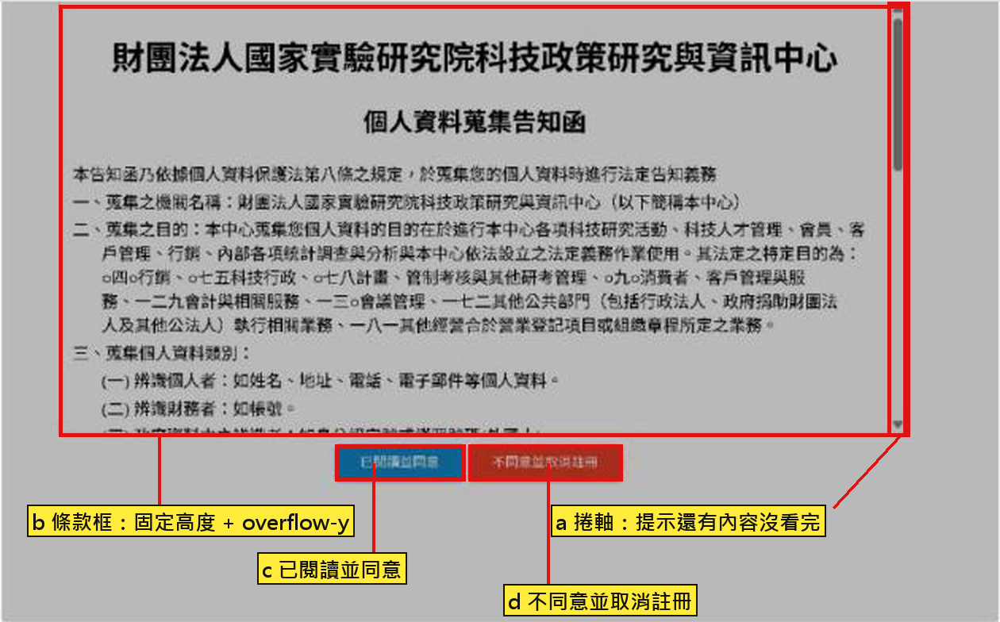

# 捲到底才能同意｜條款框 Scroll-to-Agree 的 React 做法

> [!info] 本篇重點 a–j，共 10 個
> 來源：next-one-time-tracker issue #8「做一個下拉捲動 後同意的功能」。程式範例：`scroll-to-agree-demo.jsx`（同資料夾）。互動版：[互動版](捲到底才能同意-條款框-React做法-互動版.html)。
> sentinel 元素的專文：[[sentinel元素-IntersectionObserver哨兵-捲到底-無限捲動-置頂偵測]]。
> 關聯筆記：[[03-useEffect將元件同步到外部系統-Web-API與DOM]]（IntersectionObserver 屬於 effect 同步外部系統）、[[useRef與Vue的ref-value-可變值不觸發渲染的兩種設計]]（`boxRef` 拿 DOM）、[[useSlideDeck-逐題解析-ref-closest-forEach-scroll-snap]]（同專案另一處 scroll 邏輯）。



---

## 一. 需求（issue #8 截圖）

(a) 截圖是「個人資料蒐集告知函」：條款框有捲軸，下方兩顆鈕「已閱讀並同意」「不同意並取消註冊」。

| 元素 | 行為 |
|---|---|
| 條款框 | 固定高度 + [`overflow-y`](https://developer.mozilla.org/en-US/docs/Web/CSS/overflow)；截圖的捲軸一直顯示，要一直顯示用 `scroll`（`auto` 只在內容超出時顯示） |
| 已閱讀並同意 | 捲到底之前 `disabled`；捲到底後可按 |
| 不同意並取消註冊 | 一直可按 |
| 條款很短、不用捲 | 載入當下直接解鎖 |
| 捲到底後又往上捲 | 保持解鎖，不再鎖回去 |

---

## 二. 技術選擇

(b) 這功能叫 scroll-to-agree（捲到底才解鎖）。React 沒有內建元件，用瀏覽器的 scroll 事件或 [IntersectionObserver](https://developer.mozilla.org/en-US/docs/Web/API/Intersection_Observer_API) 自己做。

| 項目 | A：`onScroll` + [`scrollTop`](https://developer.mozilla.org/en-US/docs/Web/API/Element/scrollTop) | B：[IntersectionObserver](https://developer.mozilla.org/en-US/docs/Web/API/Intersection_Observer_API) + sentinel |
|---|---|---|
| 判斷方式 | `scrollTop + clientHeight >= scrollHeight - 1` | 容器最後放 1px 的 sentinel，看到它就算捲到底 |
| 觸發頻率 | 每次捲動都跑 handler | 只在可見狀態改變時跑 |
| 小數誤差 | 要自己留 1px 容差 | 不用算 |
| 條款不用捲 | 要另外在 mount 時檢查一次 | `observe()` 後 callback 會先跑一次，自動解鎖 |
| 程式量 | 少（一個 handler） | 多一個 sentinel 與 effect |
| 適合 | 邏輯簡單、不想多一個元素 | 要乾淨、少事件 |

(c) 本專案建議用 B。理由：不用處理小數與容差，也不用另寫 mount 檢查。要最短程式再用 A。

---

## 三. 做法 A：onScroll

(d) 判斷用到三個高度屬性：

這三個都是 `Element` 的屬性（property），不是方法（method）：讀取時寫 `el.scrollTop`，不加括號。

| 屬性 | 種類 | 定義 | 在這個判斷裡的角色 |
|---|---|---|---|
| [`clientHeight`](https://developer.mozilla.org/en-US/docs/Web/API/Element/clientHeight) | Element 唯讀屬性 | 元素的可視高度，單位 px、整數。算法：CSS `height` + `padding` - 水平捲軸高度；不含 border、margin | 條款框一次看得到的那一格高度 |
| [`scrollHeight`](https://developer.mozilla.org/en-US/docs/Web/API/Element/scrollHeight) | Element 唯讀屬性 | 這個元素內容的總高度，包含因 overflow 被藏起來、要捲才看得到的部分；含 padding，不含 border、margin；整數 | 整份條款有多高 |
| [`scrollTop`](https://developer.mozilla.org/en-US/docs/Web/API/Element/scrollTop) | Element 可讀可寫屬性 | 內容已經往上捲掉幾 px（可視框上緣離內容頂端的距離），可能有小數；設值就會捲動 | 目前看到哪裡 |

最大可捲距離 = `scrollHeight - clientHeight`；`scrollTop` 追上這個值就是捲到底。`scrollHeight` 等於 `clientHeight` 代表內容沒有超出，不用捲。

```
scrollHeight = 1000（這個元素的全部內容）
┌──────────────┐ ─┐
│ 已捲上去的部分 │  │ scrollTop = 700
├──────────────┤ ─┘
│ 看得到的那一格 │    clientHeight = 300
└──────────────┘
判斷：700 + 300 >= 1000 - 1  →  可視框的下緣碰到內容底端，捲到底
```

三個值都是「這個元素自己」的；`scrollHeight` 不是整個 HTML 頁面的高度，也不是捲軸本身的尺寸。

學習時的提問：

| 提問 | 回答 |
|---|---|
| `scrollTop` 是整個條款的 container 嗎？ | 不是。container 是那個 div（`boxRef.current`）；`scrollTop` 是 container 的一個屬性，值是內容已經捲掉幾 px |
| `scrollTop` 是距離上面的距離？`clientHeight` 是元素的高度？ | `scrollTop` 對：可視框上緣離內容頂端的距離。`clientHeight` 是 container 可視那一格的高度，不是內容的高度 |
| 大於卷軸高度就設定到達底部？ | 不是比卷軸。條件是 `scrollTop + clientHeight >= scrollHeight - 1`：已捲掉的加上看得到的，碰到內容總高度 |
| `scrollHeight` 是 HTML 的高度嗎？ | 不是。是這個 container 內容的總高度；用在 `document.documentElement` 才是整頁高度 |
| 可視框在哪？這個元素指的是 container 嗎？ | 是。掛 `ref={boxRef}` 的 div 就是 container，可視框是它露在畫面上的那一塊，不是瀏覽器視窗 |
| `clientHeight`、`scrollHeight`、`scrollTop` 是方法嗎？ | 不是。都是 Element 的屬性，讀取時不加括號 |
| 互動版的「剩餘可捲距離」為什麼不等於 `scrollHeight - scrollTop`？ | 剩餘可捲距離 = `scrollHeight - clientHeight - scrollTop`。可視框本身已經看得到 `clientHeight` 那麼高，要再扣掉；結果為 0 就是到底 |

完整程式在 `scroll-to-agree-demo.jsx`，重點三行如下。

`boxRef.current` 的意思：

| 寫法 | 意思 |
|---|---|
| `const boxRef = useRef(null)` | 建一個 ref 物件 `{ current: null }`，跨 render 保持同一個物件 |
| `<div ref={boxRef}>` | 告訴 React：畫面長出這個 div 之後，把真正的 DOM 節點放進 `boxRef.current` |
| `boxRef.current` | 條款框那個真正的 DOM 元素，才有 `scrollTop`、`clientHeight`、`scrollHeight` 可讀 |
| mount 前、unmount 後 | `boxRef.current` 是 `null`，所以程式裡要先判斷 `if (!el) return` |
| 改變 `.current` | 不會觸發重新渲染；要讓畫面變的值（`reachedEnd`）才用 `useState` |

相關：[[useRef與Vue的ref-value-可變值不觸發渲染的兩種設計]]。

```jsx
const check = () => {
  const el = boxRef.current   // 條款框的真實 DOM 元素（ref={boxRef} 掛上去後 React 填入）
  if (!el) return             // mount 前 current 是 null，先擋掉
  if (el.scrollTop + el.clientHeight >= el.scrollHeight - 1) setReachedEnd(true)
}
useEffect(() => { check() }, [])          // 不用捲時直接解鎖
// <div ref={boxRef} onScroll={check} style={{ height: 320, overflowY: 'auto' }}>
```

---

## 四. 做法 B：[IntersectionObserver](https://developer.mozilla.org/en-US/docs/Web/API/Intersection_Observer_API)

(e) `root` 要設成捲動容器；預設 `null` 是整個 viewport，會判斷錯。

```jsx
useEffect(() => {
  const io = new IntersectionObserver(
    ([entry]) => {
      if (entry.isIntersecting) { setReachedEnd(true); io.disconnect() }
    },
    { root: boxRef.current, threshold: 0 }  // boxRef.current：條款框的 DOM，當作觀察的「視窗」
  )
  io.observe(endRef.current)                // endRef.current：最後那個 1px sentinel 的 DOM
  return () => io.disconnect()              // cleanup
}, [])
// <div ref={boxRef} style={{ height: 320, overflowY: 'auto' }}>
//   {children}
//   <div ref={endRef} style={{ height: 1 }} aria-hidden="true" />
// </div>
```

---

## 五. 陷阱

(f)

| 陷阱 | 原因 | 對策 |
|---|---|---|
| 用 `===` 比 scrollTop | [`scrollTop`](https://developer.mozilla.org/en-US/docs/Web/API/Element/scrollTop) 可能有小數，[`scrollHeight`](https://developer.mozilla.org/en-US/docs/Web/API/Element/scrollHeight)、`clientHeight` 是整數（MDN） | 用 `>=` 加 1px 容差；MDN 建議 `Math.abs(scrollHeight - clientHeight - scrollTop) <= 1` |
| Safari 橡皮筋 | Safari overscroll 時 `scrollTop` 會超過最大值（MDN） | 用 `>=`，不用 `===` |
| `onScroll` 綁在外層 | React 的 `onScroll` 不冒泡（React docs） | 綁在捲動容器本身 |
| 條款短不用捲 | 沒有 scroll 事件 | A 在 mount 檢查一次；B 靠 `observe()` 先跑一次 callback（MDN） |
| 解鎖又被鎖回去 | 每次 scroll 都重算 state | 只 `setReachedEnd(true)`，不設 false |
| IO 的 `root` 沒設 | 預設是 viewport | `root: boxRef.current` |
| 鍵盤無法捲 | 捲動區預設不可聚焦 | 容器加 `tabIndex={0}`、`role="region"`、`aria-label` |
| 只擋前端 | `disabled` 可被改掉 | 後端存同意紀錄：使用者、時間、條款版本 |

---

## 六. 套回本專案

(g) 現況與落點：

| 項目 | 現況 | 改動 |
|---|---|---|
| 註冊頁同意區 | `app/user/register/page.js` 491–533 行，單純 checkbox `agree`，條款連結 `target="_blank"` | 點同意改為開 Modal，Modal 內放條款框 |
| 條款內容 | `app/terms/page.js` 整頁（132 行），另有 `return-policy`、`privacy-policy` | 內容抽成共用元件，頁面與 Modal 都用 |
| Modal | 專案已裝 `react-bootstrap` ^2.10.10 | 用 `Modal` 包 `ScrollToAgree` |
| 狀態 | `user.agree` 已存在，驗證在 107、194 行 | 「已閱讀並同意」按下才 `agree: true`；「不同意」維持 false 並取消註冊 |
| 打包 | 條款是靜態長文字 | Modal 用 `next/dynamic` 延後載入，減少註冊頁首包 |

待決定：

| 問題 | 選項 |
|---|---|
| 三份文件都要捲到底？ | 已決定：三份文件各自使用同一個 `ScrollToAgree` 元件 |
| 三份文件的呈現順序 | 分頁籤 / 依序三步 |
| 取消註冊的行為 | 回首頁 / 回表單、勾選取消 |

---

## 七. 互動版

(h) 可操作的示範（捲到底解鎖、短條款自動解鎖、方法 A/B 切換）：[互動版](捲到底才能同意-條款框-React做法-互動版.html)

---

## 八. 追加（Gemini 對話，2026-11-05）

(i) <mark style="background: #ADCCFFA6;">`element.clientHeight` 對 `window.innerHeight`</mark>：前者是某個元素自己的可視高度（content + padding，不含 border、margin、水平捲軸）。後者是瀏覽器視窗 viewport 目前看得見的高度，會隨視窗縮放或開關 DevTools 改變。做「捲到底」要用元素的，不是 window 的。

(j) Gemini 對「下拉捲動後同意」列出三種做法（原生 `scroll` 事件、IntersectionObserver、React `onScroll`），結論與本篇二、三、四節一致。它額外強調兩點：內容短到不用捲時要預設可按（本篇已涵蓋）；手機網址列收合會改變視窗高度，IntersectionObserver 較穩。
> ⚠️ 存疑/更正：Gemini 該回答的原生 JS 範例有一行 `const { scrollTop, scrollHeight, clientHeight } locals = scrollContainer;`，多了 `locals`，是語法錯誤，照抄會報錯，正確是 `... } = scrollContainer;`。

### 各對話來源
- 網頁高度屬性差異（2026-11-05）— https://gemini.google.com/app/cbbb5903507d7074：使用者問「element.clientHeight 是元素內部高度、window.innerHeight 是視窗內部高度？」Gemini 回答「沒錯」並說明如 (i)。
- 下拉捲動同意實作方式（2026-11-05）— https://gemini.google.com/app/805fb1447ce5da22：使用者要求列出實作方式，內容如 (j)。

## 資料來源（含查證時間）

| 主題 | 連結 | 版本／時間 |
|---|---|---|
| Issue #8 需求與截圖 | https://github.com/Abbychickenfillet-github/next-one-time-tracker/issues/8 | 查證 2026-11-05 |
| IntersectionObserver 選項、`isIntersecting`、observe 後先跑一次 callback | https://developer.mozilla.org/en-US/docs/Web/API/Intersection_Observer_API | MDN 最後修改 2026-09-02；查證 2026-11-05 |
| `scrollHeight` 與捲到底判斷公式 | https://developer.mozilla.org/en-US/docs/Web/API/Element/scrollHeight | MDN 最後修改 2026-10-14；查證 2026-11-05 |
| `scrollTop` 小數、Safari overscroll | https://developer.mozilla.org/en-US/docs/Web/API/Element/scrollTop | MDN 最後修改 2025-04-19；查證 2026-11-05 |
| `clientHeight` 定義與算法 | https://developer.mozilla.org/en-US/docs/Web/API/Element/clientHeight | MDN 最後修改 2025-04-19；查證 2026-11-05 |
| `overflow: scroll` 一直顯示捲軸、`auto` 只在超出時顯示 | https://developer.mozilla.org/en-US/docs/Web/CSS/overflow | MDN 最後修改 2026-08-27；查證 2026-11-05 |
| React `onScroll` 不冒泡 | https://react.dev/reference/react-dom/components/common | 無版本標示；查證 2026-11-05 |

未查證：`tabIndex={0}` 的無障礙規範（WCAG 條文）；法規是否要求「捲到底」才算同意；`react-intersection-observer` 套件（`useInView`）的細節。MDN 內容是用網頁擷取工具摘要，引用 MDN 的公式前建議再開原頁核對一次。
| `window.innerHeight` 定義 | https://developer.mozilla.org/en-US/docs/Web/API/Window/innerHeight | Gemini 回答未重新抓取原文（2026-11-05） |
