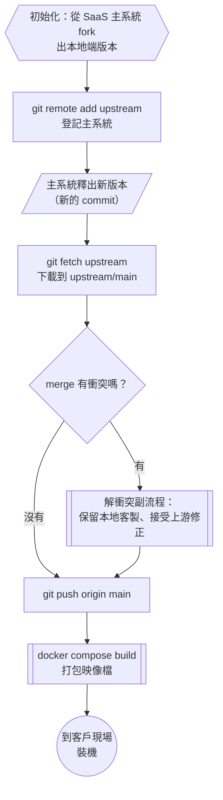

# 職缺解析：日羿智能 Sr. Full Stack Engineer（主 Node.js，副 React）

> 本篇重點 a–h，共 8 個。互動複習版：[[職缺解析-日羿智能-資深全端工程師-SWR-SaaS-GitFork-互動版.html]]
> 主軸圖：「SaaS 主系統（upstream）↔ 本地端分叉（fork）」同步流程，後面的 SWR、Monorepo 都掛在這張圖上。

## a. 職缺骨架

| 項目 | 內容 |
|---|---|
| 公司 | 日羿智能股份有限公司 |
| 職稱 | Sr. Full Stack Engineer 資深全端工程師（主 node.js，副 react） |
| 產品領域 | 醫療系統的維護與需求開發 |
| 薪資／地點 | 月薪 70,000 元以上／台北市信義區（台北 101／世貿站約 440 公尺） |
| 經歷／學歷 | 經歷不拘／專科以上 |
| 應徵人數 | 6~10 人（3 小時前處理過履歷） |
| 特殊工作 | 需要到現場了解需求並在本地端裝機 |

## b. JD 逐條對照（已具備 vs 待補）

| JD 要求 | Abby 的實證 | 狀態 |
|---|---|---|
| Monorepo 與各打包工具 | 昱拓科技 futuresign 專案以 monorepo 管理三端，用 git subtree 拆出獨立 repo | 已具備 |
| TypeScript | TimeLog 與公司專案皆以 TypeScript 開發 | 已具備 |
| Node.js 的 Fastify 框架 | 後端用過 FastAPI、Go Gin、Next.js API Routes，Fastify 尚未實作 | 待補 |
| Next.js | TimeLog 以 Next.js 開發並部署 | 已具備 |
| TailwindCSS | 用 SCSS 做多主題 design system，Tailwind 待確認 | 待確認 |
| Zustand | 概念熟悉，實作待確認 | 待確認 |
| SWR | 用過 TanStack Query，兩者採同一套 stale-while-revalidate 策略 | 概念已具備 |
| Git Fork 分叉處理 | 做過 subtree 分離與同步，處理過 non-fast-forward 衝突 | 概念相近 |
| 容器化部署 | 公司專案用 Docker Compose 建置 | 已具備 |
| AI 開發工具與原理 | 串接 Gemini 2.5 Flash 與 RAG，用 Claude Skill 管理工作流程 | 已具備 |

相關既有筆記：
- Monorepo 拆分與同步 → [[push-to-seperate-repo]]、[[subtree-push-conflict-resolution]]
	- 關聯原因：subtree 分離後「兩邊長期並行又要同步」的問題，和 fork 維護本地端分支是同一類問題。
- 伺服器狀態管理 → [[react-query-architecture]]、[[樂觀更新-Optimistic-Update]]
	- 關聯原因：TanStack Query 和 SWR 都是 stale-while-revalidate 策略的實作。
- 打包流程 → [[Dev-Server在Node環境-devServer-proxy繞過CORS-HMR用WebSocket-與原生語言打包工具]]
	- 關聯原因：JD 要求了解 monorepo 裡的各打包工具。
- Node.js 底層 → [[Node-js底層架構-V8-libuv-Bindings與CSR澄清]]
	- 關聯原因：Fastify 跑在 Node.js 上，面試可從事件迴圈切入。

## c. SWR 是什麼

<mark style="background: #FFF3A3A6;">SWR 是 stale-while-revalidate 的縮寫，意思是「先回傳舊的（stale）快取資料，同時在背景重新驗證（revalidate）並抓新資料」。</mark>

這個詞有兩層意思：
1. HTTP 快取指令：[RFC 5861](https://www.rfc-editor.org/rfc/rfc5861)（2010-05，M. Nottingham）定義了 `Cache-Control` 的 `stale-while-revalidate` 擴充。
	- 例：`Cache-Control: max-age=600, stale-while-revalidate=30` 表示回應在 600 秒內是新鮮的，過期後的 30 秒內，快取仍可先回傳舊資料，同時在背景向伺服器重新驗證。
2. React 套件：Vercel 開發的 [SWR](https://swr.vercel.app/docs/getting-started) 是一個做資料抓取的 React Hooks 函式庫，把上面的策略搬到前端。
	- 它內建快取、背景重新驗證、同一請求去重（deduplication）等功能。

```jsx
import useSWR from 'swr'
const fetcher = (...args) => fetch(...args).then(res => res.json())

function Profile({ userId }) {
  const { data, error, isLoading } = useSWR(`/api/user/${userId}`, fetcher)
  if (error) return <div>failed to load</div>
  if (isLoading) return <div>loading...</div>
  return <div>hello {data.name}!</div>
}
```

逐行白話：
- 第 1 行：從 `swr` 套件匯入 `useSWR` 這個 Hook。
- 第 2 行：定義 `fetcher` 函式，它收到網址後呼叫瀏覽器的 `fetch`，再把回應 parse 成 JSON。
- 第 5 行：`useSWR` 用網址字串當作快取的 key，用 `fetcher` 去抓資料，回傳 `data`（資料）、`error`（錯誤）、`isLoading`（是否第一次載入中）三個值。
	- 同一個 key 在別的元件再被呼叫時，SWR 會先給快取、再背景重抓，而且不會重複發兩次請求。
- 第 6～8 行：依照「錯誤、載入中、完成」三種狀態渲染不同畫面。

| 比較 | SWR | TanStack Query |
|---|---|---|
| 開發者 | Vercel | TanStack |
| 核心策略 | stale-while-revalidate | stale-while-revalidate |
| 快取 key | 字串或陣列 | queryKey 陣列 |
| 修改資料 | `mutate` 與 `useSWRMutation` | `useMutation` |
| 定位 | 輕量，和 Next.js 同一家公司 | 功能較多，DevTools 完整 |

## d. SaaS 是什麼

<mark style="background: #FFF3A3A6;">SaaS 是 Software as a Service（軟體即服務）的縮寫：廠商把軟體架在自己的雲端上，客戶用瀏覽器或 App 連線使用，不必自己安裝和維護伺服器。</mark>

- 定義出處：[NIST SP 800-145](https://csrc.nist.gov/pubs/sp/800/145/final)（2011-09）把雲端服務分成 IaaS、PaaS、SaaS 三種模型。
	- IaaS（Infrastructure as a Service，基礎設施即服務）：廠商提供虛擬機器、網路、儲存空間，例如 AWS EC2。
	- PaaS（Platform as a Service，平台即服務）：廠商提供可以直接部署程式的平台，例如 Zeabur、Vercel。
	- SaaS：廠商提供完整可用的軟體，例如 Gmail、Notion。
- 這個職缺的意思：日羿智能的主系統是 SaaS（多家醫療院所共用雲端版本），但有些客戶因為醫療資料不能離開院內等原因，需要「本地端（on-premise）版本」，所以從主系統分叉出一份程式碼，裝在客戶現場的機器上。
	- 這就是為什麼 JD 同時要求 Git Fork、容器化部署和現場裝機。

## e. Git Fork 包含哪些

<mark style="background: #FFF3A3A6;">Fork 不是 Git 的指令，而是 GitHub、GitLab 這類平台的功能：在伺服器端把整個 repo 複製一份到你的帳號或組織底下，成為一個獨立的新 repo。</mark>

| 項目 | 會不會被複製 |
|---|---|
| 程式碼與完整 commit 歷史 | 會 |
| 分支 | 預設只複製預設分支（main），取消勾選「Copy the DEFAULT branch only」才會複製全部分支 |
| tags | 會 |
| issues、pull requests | 不會，fork 會有自己一套全新的 |
| repo 設定、協作者、Actions secrets | 不會 |
| GitHub Actions workflow 檔案 | 檔案會被複製，但 fork 上預設不會自動執行 |

Fork 之後的標準流程（[Configuring a remote](https://docs.github.com/en/pull-requests/collaborating-with-pull-requests/working-with-forks/fork-a-repo)、[Syncing a fork](https://docs.github.com/en/pull-requests/collaborating-with-pull-requests/working-with-forks/syncing-a-fork)）：

```bash
git clone https://github.com/你的帳號/repo.git
git remote add upstream https://github.com/原作者/repo.git
git remote -v
git fetch upstream
git checkout main
git merge upstream/main
git push origin main
```

逐行白話：
- `git clone`：把你 fork 出來的 repo 下載到本機，Git 會自動把它命名為 `origin`。
- `git remote add upstream ...`：再登記一個名叫 `upstream` 的遠端，指向原本的主系統 repo。
- `git remote -v`：列出所有遠端，確認 `origin` 指向自己的 fork，`upstream` 指向主系統。
- `git fetch upstream`：把主系統的最新 commit 下載到本機的遠端追蹤分支 `upstream/main`，這一步不會改動你的工作目錄。
- `git checkout main`：切換到自己的 main 分支。
- `git merge upstream/main`：把主系統的新變更合併進自己的 main，有衝突就在這一步解決。
- `git push origin main`：把合併後的結果推回自己在 GitHub 上的 fork。
	- 也可以直接在 GitHub 網頁按「Sync fork」→「Update branch」，有衝突時 GitHub 會提示開 PR 處理。



<mark style="background: #BBFABBA6;">維護分叉的關鍵做法：把本地端客製集中在設定檔、環境變數和擴充點，不要散落在主系統的核心程式碼裡，這樣每次合併上游時衝突最少。</mark>

| 比較 | Fork | Branch | Subtree |
|---|---|---|---|
| 發生在哪裡 | GitHub 伺服器，產生新 repo | 同一個 repo 內 | 一個 repo 內的子目錄與另一個 repo 對應 |
| 權限 | 不需要原 repo 的寫入權限 | 需要寫入權限 | 需要兩邊的寫入權限 |
| 常見用途 | 開源貢獻、長期維護客製版本 | 功能開發 | 把 monorepo 子目錄拆成獨立 repo |

## f. 求職信（最終版）

> 〔 〕是投遞前要自己確認或填入的地方。

```
日羿智能股份有限公司 招募團隊 敬啟：

您好，我是陳芸茜（Abby），一名以 TypeScript 為主軸、前後端都實際交付過的全端工程師。貴公司這個職缺提到的 Monorepo 與打包工具、Next.js 與 Zustand、SWR、Git Fork 分叉維護、容器化部署，以及 AI 開發工具，正好都是我在工作和自學中反覆鑽研的主題。讀完職缺內容時我非常興奮，因此誠摯來信應徵。

【我做過的事，和這個職缺的對應】
・Monorepo 與分叉維護：我在昱拓科技獨立負責一套活動攤位管理系統的三端開發（前台官網、後台管理介面、後端 API），專案以 Monorepo 管理。後來團隊需要把前台和後台拆成獨立 repo，我用 git subtree 把子目錄分離出去，整理出兩邊的同步流程，也處理過 subtree push 遇到的 non-fast-forward 衝突。貴公司「主系統為 SaaS、本職務負責分叉後的本地端服務」的情境，核心同樣是讓兩份程式碼長期並行又持續同步。我會先定清楚同步 upstream 的節奏與本地客製的邊界，讓本地改動集中在設定檔與擴充點，降低每次合併上游時的衝突。
・React 生態系：個人專案 TimeLog & Analysis 以 Next.js + TypeScript 開發，公司專案則以 TanStack Query 管理伺服器資料。我曾發現頁面載入時前端連續打四支 API 形成瀑布式請求，於是規劃改成 useQuery 搭配後端聚合 API。SWR 和 TanStack Query 採用同一套 stale-while-revalidate 策略（先回傳快取，再於背景重新驗證），因此我能直接理解貴公司前端的資料流。〔Zustand：若有實作請改寫具體用法，沒有則保留這句〕我熟悉把伺服器狀態和 UI 狀態分開管理的做法，Zustand 正是負責 UI 狀態的那一層。〔TailwindCSS：若有用過請補一句實際用法，沒有則保留這句〕樣式方面，我用 SCSS 建立過多主題 design system，也用過 Chakra UI，TailwindCSS 的 utility-first 寫法我能很快上手。
・後端與 Node.js：公司專案的後端是 Python FastAPI，個人專案用過 Go（Gin／GORM）與 Next.js API Routes，資料庫以 PostgreSQL 為主，也完成過 MySQL 到 PostgreSQL 的遷移。我還沒在正式專案中使用 Fastify，但它用 schema 驗證請求、用 plugin 組織路由的設計和 FastAPI 的思路很接近，加上我持續研究 Node.js 的底層（V8 與 libuv 事件迴圈），有信心能在短時間內上手。
・打包工具：我持續整理 bundler 的完整流程，從 parse 原始碼、resolve 模組路徑、transpile TypeScript 與 JSX，到產出帶 content hash 的檔案，也比較過 Vite、Webpack、SWC 的分工。遇到 Monorepo 裡多個 package 的建置順序或相依問題時，我能從這些原理下手排查。
・容器化部署：公司專案以 Docker Compose 建置，我在每次提交前都會先用 docker compose up --build 確認建置無誤，也處理過 Docker 映像檔佔滿磁碟的維運問題。個人專案則部署在 Zeabur 與 Vercel。需要到客戶現場安裝的本地端服務，最需要的就是「環境一致、安裝可重現」，這正是容器化擅長的事。
・AI 開發工具與原理：我在產品中串接過 Gemini 2.5 Flash 並實作 RAG，理解 embedding、向量檢索與 context 組裝的原理。日常開發我大量使用 Claude Code 等 AI 工具，並把反覆出現的工作流程寫成 Skill 來分類與管理，例如 Docker 磁碟清理 SOP、陌生副檔名判讀、求職信產生器。這樣 AI 每次都會依照同一套規則工作，產出穩定，也方便團隊共用。

【現場需求訪談】
這個職缺需要到現場了解需求並安裝系統。〔若不想提可刪除這兩句〕我做過社會住宅推廣師與業務助理，習慣直接面對使用者，把對方口語描述的困擾整理成具體需求。醫療現場的使用者通常很忙，我會先弄清楚他們的工作流程，再回頭決定系統該怎麼調整。

【我的個性】
我好相處，合作時會先把 PM、設計師和後端夥伴的需求聽完整，再提出自己的看法。我也是一個有想法的人：看到效能瓶頸或難以維護的程式碼，我會主動分析原因、提出重構方案，並寫成文件和團隊討論，而不只是修掉眼前的 bug。我是應用外語系畢業，習慣把技術決策寫成清楚的文件，讓新加入的夥伴能快速接手。

【作品】
・GitHub：https://github.com/Abbychickenfillet-github
・個人專案 TimeLog & Analysis 與公司的活動攤位管理系統，目前暫時無法提供線上網址。面試時我會攜帶筆電現場 demo，完整展示功能、程式碼架構與部署流程。

期待有機會加入日羿智能，一起把醫療現場的系統做得穩定又好用。感謝您撥冗閱讀。

順頌 時祺

陳芸茜（Abby）敬上
電話：〔0917-167-098〕
Email：〔aintluminate@gmail.com〕
```

## g. 面試考點預測

1. 為什麼 SWR 能讓畫面比較快？
	- 因為它先回傳快取，使用者立刻看到畫面，新資料在背景抓完後再更新。
2. 本地端分叉和 SaaS 主系統長期並行，要怎麼降低合併衝突？
	- 把客製集中在設定與擴充點，固定節奏同步 upstream，並用 feature flag 區分行為。
3. 為什麼本地端裝機適合用容器化？
	- 因為 Docker 映像檔把執行環境一起打包，客戶現場的機器只要有 Docker 就能重現同一套環境。
4. Fastify 和 Express 差在哪？
	- Fastify 以 JSON Schema 驗證請求並加速序列化，用 plugin 系統組織路由，效能比 Express 高。

LeetCode／NeetCode：本篇屬於工具與架構概念，沒有直接對應的演算法題。

## h. 資料來源（含查證時間）

| 主題 | 連結 | 版本／時間 |
|---|---|---|
| 職缺原文 | https://www.104.com.tw/job/8q6f2 | 職缺 07/21 更新，查證 2026-09-17 |
| stale-while-revalidate 定義 | https://www.rfc-editor.org/rfc/rfc5861 | RFC 5861，2010-05，查證 2026-09-17 |
| SWR 官方文件 | https://swr.vercel.app/docs/getting-started | 查證 2026-09-17 |
| SaaS 定義 | https://csrc.nist.gov/pubs/sp/800/145/final | NIST SP 800-145，2011-09 |
| About forks | https://docs.github.com/en/pull-requests/collaborating-with-pull-requests/working-with-forks/about-forks | 查證 2026-09-17 |
| Fork a repo | https://docs.github.com/en/pull-requests/collaborating-with-pull-requests/working-with-forks/fork-a-repo | 查證 2026-09-17 |
| Syncing a fork | https://docs.github.com/en/pull-requests/collaborating-with-pull-requests/working-with-forks/syncing-a-fork | 查證 2026-09-17 |
