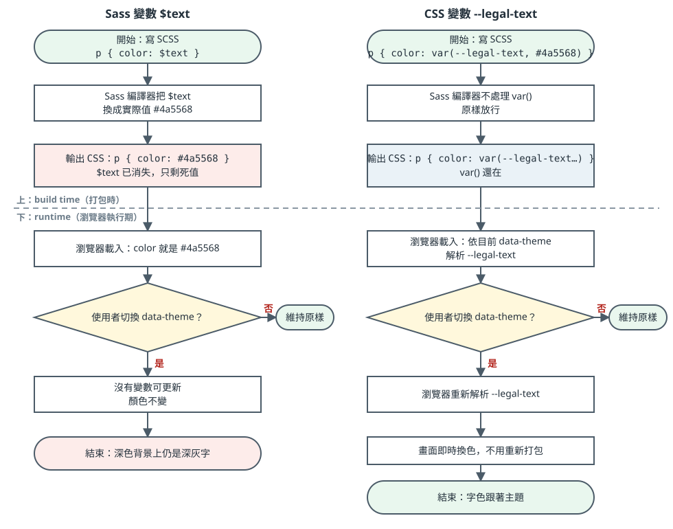

我的data-theme讓Sass固定嗎？倒也不是這麼說，是因為我的四個主題是執行期間用data-theme切換的，但是預處理器Sass的$x 編譯完就固定的，

`data-theme` 只是 `<html>` 上的屬性，瀏覽器要換主題時，只改得動還留在 CSS 裡的 `var(--x)`。Sass 的 `$text` 已經變成死的 `#4a5568`，改不了。

流程圖（上半是打包時，下半是瀏覽器執行期）：

| 作法                               | 效果                                    | 顏色何時決定                                                           |
| -------------------------------- | ------------------------------------- | ---------------------------------------------------------------- |
| 成對CSS變數                          | 每個主題要寫一組；最穩，所有瀏覽器可用                   | 執行期決定因為css可以用JS動態改變變數值網頁樣式會即刻更新，不需要重新編譯                          |
| CSS contrast-color(var(--bg)) | 只回傳黑或白； 背景必須是單色 漸層不行、 就瀏覽器沒有 | 執行期 瀏覽器能直接讀取和修改CSS變數。 可以利用JS動態改變變數值。 網頁樣式就會即刻更新！不須重新編譯！ |
| Sass函式text-on($bg)               | 被景色要寫死在Sass裡面                         | 編譯期(由Dart Sass將Sass編譯並轉換為標準CSS)                                  |

用CSS變數(--X)
不是Sass變數($x)

因為主題是執行期用data-theme切換的，Sass的$x編譯完就固定了，

